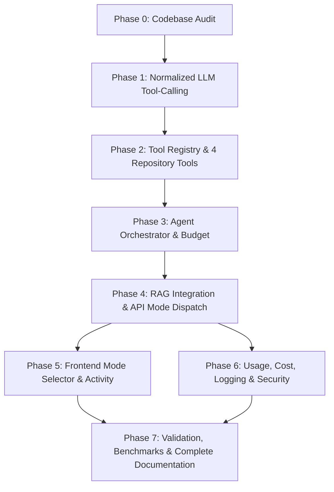

# Existing Architecture Audit: Agentic Repository Chat

**Audit Date:** 2026-11-07  
**Scope:** Repository Chat (RAG Pipeline, LLM Gateway, Repository/Symbol Services, and Frontend Chat)  
**Status:** Complete  

---

## 1. Executive Summary

This codebase audit investigates the existing repository-aware RAG pipeline, LLM gateway, database models, repository access controls, and frontend chat components in preparation for implementing **Bounded Agentic Repository Chat** (Feature F08 / Issue #188).

The objective is to enable multi-step repository investigation (searching code, reading file line ranges, inspecting symbol definitions, and tracing callers) using the existing free-tier LLM integrations (Google Gemini and Groq), while preserving the strict read-only security boundary, request budgets, and existing RAG grounding and citation verification.

---

## 2. Verified Existing Functionality

### 2.1 RAG Pipeline (`backend/ai/pipeline.py`)
- **Class:** `RAGPipeline` coordinates the repository-aware chat workflow.
- **Workflow:**
  1. Validates input query and repository UUID.
  2. Executes hybrid retrieval via `self._retrieve(cleaned_question, repo_uuid)` and fetches repository files via `self._get_repository_files(repo_uuid)`.
  3. Returns `RepositoryAnswer(status="no_match")` on zero results.
  4. Context construction: `ContextBuilder.build(chunks=chunks, memory=memory, history=chat_history, related_files=related_files)` creates an `AgentContext`.
  5. Prompt construction: `PromptBuilder.build_chat_prompt(context=rendered_data, question=cleaned_question)` enforces system/data separation (repository content is strictly DATA, never system instructions).
  6. LLM generation: `self._generate_with_repair()` calls `LLMGateway.generate()` with up to 2 repair iterations for malformed JSON.
  7. Grounding validation: `GroundingValidator.validate_sources()` removes hallucinated citations and verifies real repository files/line ranges.
  8. Secret redaction: `redact()` strips sensitive tokens and secrets before output is returned.
- **Output Schema:** `RepositoryAnswer` (`answer`, `sources`, `confidence`, `status`).

### 2.2 LLM Gateway and Providers (`backend/ai/llm/`)
- **Schemas (`schemas.py`):**
  - `Message`: Conversational turn (`role: Literal["system", "user", "assistant"]`, `content: str`).
  - `LLMRequest`: Standardized request (`model`, `messages`, `temperature`, `max_tokens`, `response_schema`, `response_format`, `request_id`).
  - `LLMResponse`: Immutable completion response (`content`, `model`, `input_tokens`, `output_tokens`, `latency_ms`).
  - Error hierarchy: `LLMError`, `LLMTimeoutError`, `LLMRateLimitError`, `LLMUnavailableError`, `LLMAuthenticationError`, `LLMValidationError`.
- **Gateway (`client.py`):**
  - `LLMGateway`: Single orchestrator enforcing logging telemetry (`llm_call`), timeout enforcement, and automatic fallback from primary to fallback provider (`gemini` $\to$ `groq`).
- **Gemini Provider (`gemini_provider.py`):**
  - Direct REST client using `https://generativelanguage.googleapis.com/v1beta/models/{model}:generateContent`.
  - Sends API key in `x-goog-api-key` header.
  - Cycle rotation across multiple API keys (`_key_cycle`).
  - Handles HTTP 429 rate limits and 5xx transient outages with retry backoff.
- **Groq Provider (`groq_provider.py`):**
  - OpenAI-compatible REST client using `https://api.groq.com/openai/v1/chat/completions`.
  - Supports key rotation across multiple API keys.
  - Supports JSON mode (`response_format={"type": "json_object"}`).

### 2.3 Repository Services and Graph Storage
- **File Retrieval (`backend/app/repositories/repository_files.py` & `backend/app/models/repository_file.py`):**
  - `RepositoryFile`: Maps repository ID, path, line count, language, size, and content hash.
  - `get_file_by_path(db, repository_id, path)`: Retrieves single file record.
  - Line-accurate file reconstruction: `indexer.chunker.reconstruct_file_from_chunks(chunks, start_line=..., end_line=...)` deduplicates overlapping chunks and extracts exact line spans.
- **Symbol Storage (`backend/app/repositories/code_symbol_repository.py` & `backend/app/models/code_symbol.py`):**
  - `CodeSymbol`: Maps name, kind, file_id, start_line, end_line, and signature.
  - `CodeSymbolRepository`: Scoped queries by `repository_id` and `file_id`.
- **Symbol Graph Storage (`backend/app/repositories/symbol_edge_repository.py` & `backend/app/models/symbol_edge.py`):**
  - `SymbolEdge`: Maps `source_symbol_id`, `target_symbol_id`, and `edge_type` (`"calls"`, `"imports"`, `"extends"`, `"implements"`).
  - `get_edges_for_target_symbol(db, repository_id, target_symbol_id)`: Retrieves incoming edges (callers) where `target_symbol_id == target_sym.id` and `edge_type == "calls"`.
- **Hybrid Retrieval (`backend/ai/retrieval/hybrid.py`):**
  - Combines vector search (HNSW) and lexical search (GIN / tsvector) with Reciprocal Rank Fusion (RRF) and ONNX reranking.

### 2.4 API Endpoint (`backend/app/api/v1/chat.py`)
- **Route:** `POST /repositories/{repository_id}/chat`
- **Dependency:** `_owned_repository(repository_id, request, db)` enforces caller ownership of the repository.
- **Handler:** Injects `RAGPipeline` from `request.app.state.rag_pipeline` and invokes `pipeline.chat(payload.question, repository_id, payload.history)`.

### 2.5 Frontend Chat Architecture
- **Hook (`frontend/src/hooks/useRepositoryChat.ts`):**
  - Manages chat state (`messages`, `isPending`, `error`, `sendMessage`, `clearConversation`).
  - AbortController lifecycle for in-flight request cancellation and repository switching.
  - Formats history to `ChatHistoryMessage[]` (last 50 turns).
- **Service (`frontend/src/services/chat.ts`):**
  - Calls `POST /api/v1/repositories/{repositoryId}/chat`.
- **UI (`frontend/src/pages/RepositoryChat.tsx`):**
  - Displays conversation turns, auto-scrolls, renders sources with line ranges, and shows pending spinner.

---

## 3. Missing Functionality (Gaps to Implement)

1. **Normalized LLM Tool Calling:**
   - `backend/ai/llm/schemas.py` lacks tool calling domain models: `LLMToolDefinition`, `LLMToolCall`, `LLMToolResult`, `LLMToolRequest`, and `LLMToolResponse`.
   - `backend/ai/llm/provider.py` does not define `generate_with_tools()`.
   - `backend/ai/llm/client.py` (`LLMGateway`) does not support routing tool-capable requests.
   - `GeminiProvider` does not support function declarations or parsing function call parts from Gemini REST response.
   - `GroqProvider` does not format `tools` payload or parse assistant `tool_calls`.
2. **Central Tool Registry & Policies:**
   - Package `backend/ai/agent/` does not exist.
   - Central tool registry, execution policy, parameter validation, and result sandboxing are absent.
3. **Repository Investigation Tools:**
   - The 4 required read-only tools (`search_code`, `read_file_range`, `get_symbol`, `find_callers`) need standard tool wrapper implementations.
4. **Agent Orchestrator & Budget Manager:**
   - Multi-round agent execution loop, state tracking, duplicate call detection, and token/execution budget enforcement do not exist.
5. **API Compatibility for Agentic Mode:**
   - `RepositoryChatRequest` only accepts `question` and `history`; needs `mode: Literal["normal", "agentic"] = "normal"`.
   - `RepositoryAnswer` lacks `agent_metadata` field.
6. **Frontend Mode Selector & Activity Display:**
   - Frontend lacks a mode toggle (Normal vs Agentic) and agent activity indicator.

---

## 4. Proposed New Functionality

### 4.1 Normalized LLM Tool-Calling Layer
- Define normalized types in `backend/ai/llm/schemas.py`:
  - `ToolParameterSchema`
  - `LLMToolDefinition`
  - `LLMToolCall`
  - `LLMToolResult`
  - `LLMToolRequest` (subclass of `LLMRequest` or standalone request containing `tools`, `messages`, etc.)
  - `LLMToolResponse` (containing `content`, `tool_calls`, `finish_reason`, `usage`)
- Add `generate_with_tools()` to `LLMProvider` and `LLMGateway`.
- Implement `GeminiProvider.generate_with_tools()` with Gemini `functionDeclarations`.
- Implement `GroqProvider.generate_with_tools()` with OpenAI-style `tools`.

### 4.2 Central Agent Package (`backend/ai/agent/`)
- `schemas.py`: `AgentState`, `AgentEvidenceItem`, `AgentToolCall`, `AgentToolResult`.
- `tool_registry.py`: Register and discover permitted read-only tools.
- `policy.py`: Permission checks (repository ownership, path traversal checks, line range limits, read-only enforcement).
- `tool_executor.py`: Timeout enforcement, byte truncation (8 KB max), and secret redaction.
- `budget.py`: Track rounds ($\le 3$), tool calls ($\le 6$), model calls ($\le 4$), tokens ($\le 12,000$ in, $\le 2,000$ out), and timeout ($\le 35$s).
- `orchestrator.py`: Multi-step investigation loop collecting evidence and handing off to `RAGPipeline.finalize_chat()`.
- `tools/`:
  - `search_code.py`: Wrap `HybridRetriever.retrieve`.
  - `read_file_range.py`: Read file lines using `reconstruct_file_from_chunks`.
  - `get_symbol.py`: Lookup symbol in `CodeSymbolRepository`.
  - `find_callers.py`: Lookup incoming caller edges in `SymbolEdgeRepository`.

### 4.3 API & Finalization Integration
- Update `RepositoryChatRequest` in `backend/app/schemas/repository.py` to add `mode: Literal["normal", "agentic"] = "normal"`.
- Update `RepositoryAnswer` in `backend/ai/schemas/output.py` to add `agent_metadata: dict[str, Any] | None = None`.
- In `backend/app/api/v1/chat.py`, branch on `payload.mode`:
  - `normal`: call existing `pipeline.chat()`.
  - `agentic`: invoke `AgentOrchestrator.run()`, which uses collected evidence and finalizes through `pipeline.finalize_chat()`.

### 4.4 Frontend Integration
- Update `frontend/src/types/api.ts` with `mode?: 'normal' | 'agentic'` and `agent_metadata`.
- Update `frontend/src/services/chat.ts` to send `mode`.
- Update `frontend/src/hooks/useRepositoryChat.ts` to support mode selection and pass mode in requests.
- Update `frontend/src/pages/RepositoryChat.tsx` to provide a clean toggle pill for "Normal Chat" vs "Agentic Chat", and render agent activity and metadata.

---

## 5. Risk and Compatibility Assessment

1. **Backward Compatibility:**
   - Normal chat requests without `mode` default to `"normal"`, executing the exact current RAG pipeline path without modification.
2. **Security & Read-Only Guarantee:**
   - No tool is capable of modifying files, creating commits, or executing code.
   - All tools query through existing repository models with mandatory repository ID scoping and path traversal protection.
3. **Grounding & Citations:**
   - The agent does not create its own citations. Evidence gathered by tools is passed to `ContextBuilder` and verified by `GroundingValidator`.

---

## 6. Implementation Dependencies

Audit complete. Proceeding to Phase 1.
