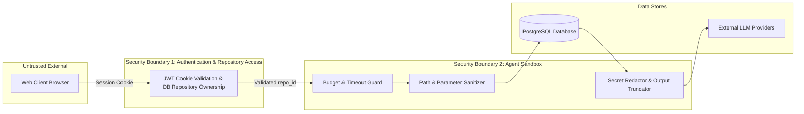

# 02 — System Architecture

## 1. System Architecture Overview

The Bounded Agentic Repository Chat system introduces an autonomous decision layer into the existing code exploration pipeline without disrupting standard RAG flows.

```mermaid
graph TB
    subgraph Client Layer
        WebUI[React Frontend / RepositoryChat]
        ModeSelector[Mode Selector: Normal | Agentic]
    end

    subgraph API & Gateway Layer
        ChatRouter[POST /api/v1/repositories/:id/chat]
        AuthMiddleware[JWT Auth & Tenant Scoping]
    end

    subgraph Orchestration Layer
        AgentOrchestrator[AgentOrchestrator]
        AgentBudget[AgentBudget Manager]
        AgentState[AgentState Tracker]
        ToolExecutor[ToolExecutor & Secret Redactor]
        ToolRegistry[Central Tool Registry]
    end

    subgraph LLM Provider Layer
        LLMGateway[LLMGateway]
        GeminiAdapter[GeminiProvider - 2.5 Flash]
        GroqAdapter[GroqProvider - Llama 3.3]
    end

    subgraph Existing RAG Core
        HybridRetriever[HybridRetriever]
        ContextBuilder[ContextBuilder]
        GroundingValidator[GroundingValidator]
        Database[(PostgreSQL + pgvector)]
    end

    WebUI --> ChatRouter
    ChatRouter --> AuthMiddleware
    AuthMiddleware -->|mode == 'normal'| ContextBuilder
    AuthMiddleware -->|mode == 'agentic'| AgentOrchestrator

    AgentOrchestrator --> AgentBudget
    AgentOrchestrator --> AgentState
    AgentOrchestrator --> LLMGateway
    LLMGateway --> GeminiAdapter
    LLMGateway --> GroqAdapter

    AgentOrchestrator --> ToolExecutor
    ToolExecutor --> ToolRegistry
    ToolRegistry --> Database
    ToolRegistry --> HybridRetriever

    AgentOrchestrator -->|Evidence Chunks| ContextBuilder
    ContextBuilder --> GroundingValidator
    GroundingValidator --> ChatRouter
```

---

## 2. Component Descriptions

### 2.1 AgentOrchestrator (`backend/ai/agent/orchestrator.py`)
Directs the autonomous investigation loop. Bootstraps the conversation with baseline vector retrieval chunks, builds model messages, negotiates tool calls via `LLMGateway`, dispatches tool execution to `ToolExecutor`, tracks budget depletion, and routes accumulated evidence into `RAGPipeline.finalize_agent_chat`.

### 2.2 AgentBudget (`backend/ai/agent/budget.py`)
Request-scoped monitor tracking:
- Maximum agent investigation rounds (default: 3).
- Maximum tool calls (default: 6).
- Maximum model calls (default: 4).
- Maximum input tokens (default: 12,000).
- Maximum output tokens (default: 2,000).
- Total request timeout (default: 35.0s).
- Duplicate tool call detection (max 1 retry allowed).

### 2.3 ToolRegistry & ToolExecutor (`backend/ai/agent/tool_registry.py`, `tool_executor.py`)
- `ToolRegistry`: Validates and registers read-only tool definitions with strict JSON Schema specifications.
- `ToolExecutor`: Safely invokes tools under a 5.0-second timeout, truncates outputs exceeding 8 KB, and strips sensitive credentials via `sanitize_and_redact`.

### 2.4 LLMGateway & Tool Calling Adapters (`backend/ai/llm/`)
- Unified `generate_with_tools` interface.
- Normalizes Gemini's Function Declarations & Function Responses.
- Normalizes Groq's OpenAI-compatible `tools` array & assistant tool call messages.

---

## 3. Trust Boundaries & Security Enclaves


