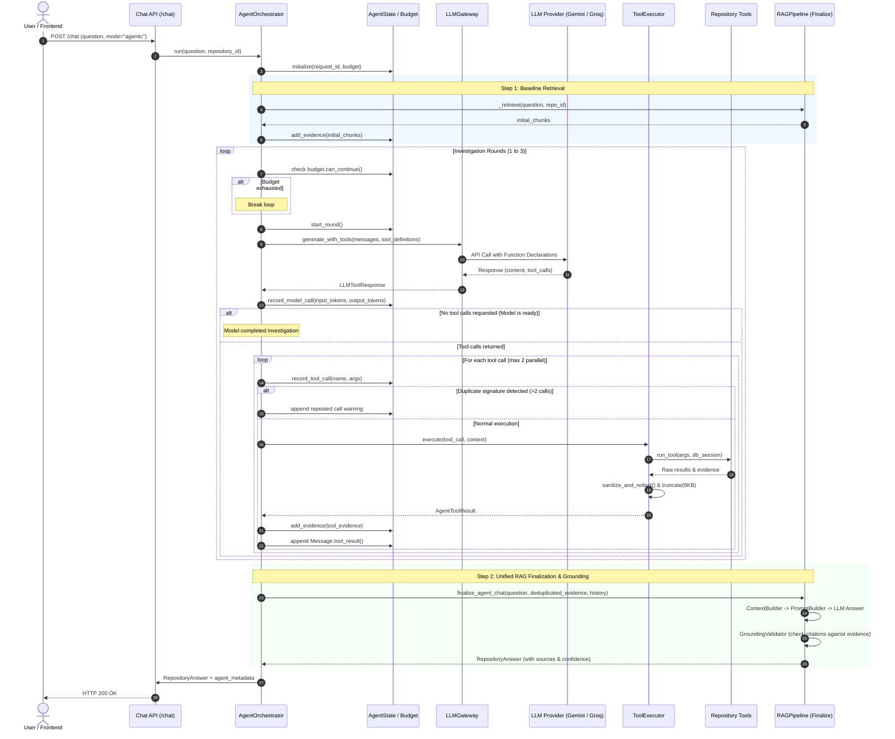

# 03 — Agent Execution Flow

## 1. Sequence Diagram

---

## 2. Step-by-Step Flow Description

1. **Bootstrap Phase:**
   When a user submits an agentic query, the orchestrator first runs an initial vector search using the platform's `HybridRetriever`. This ensures that even before making its first tool decision, the agent has candidate files to anchor its thought process.

2. **Investigation Loop (Rounds 1–3):**
   - The orchestrator formats the prompt and provides the 4 JSON Schemas.
   - The model inspects the current state and either requests tool invocations or emits a final synthesized thought.
   - Up to 2 tool calls are dispatched per round.
   - Every tool execution is isolated, timed out at 5.0 seconds, stripped of credentials, and capped at 8 KB.

3. **Termination Conditions:**
   The loop terminates as soon as any of the following occur:
   - The model makes no tool calls (declares investigation finished).
   - Maximum 3 rounds reached.
   - Maximum 6 tool calls reached.
   - Maximum 4 model calls reached.
   - Token budget (12,000 input / 2,000 output) exceeded.
   - Request timeout (35.0 seconds) exceeded.
   - Duplicate tool invocation detected.

4. **Finalization Phase:**
   All gathered evidence items are converted into `CodeChunk` representations, deduplicated, and passed through `RAGPipeline.finalize_agent_chat`. This guarantees that the final answer is validated against actual repository code lines by `GroundingValidator`.
