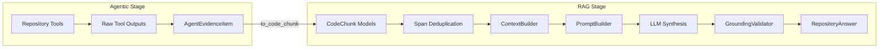

# 10 — RAG Integration and Grounding

## 1. Unified RAG Pipeline Finalization

A critical design requirement of Issue #188 is that agentic chat must not bypass existing grounding and anti-hallucination guardrails. Agentic chat does not replace the RAG pipeline; it acts as an evidence-gathering front-end for it.

---

## 2. Converting Tool Evidence to `CodeChunk`

In `AgentEvidenceItem.to_code_chunk()`:
- `file_path`, `start_line`, and `end_line` are mapped into standard `CodeChunk` fields.
- Content is formatted with file headers and line references.
- Synthetic UUIDs are assigned to ephemeral snippets so the downstream validator can reference them uniformly.

---

## 3. Strict Citation Validation (`GroundingValidator`)

Once the LLM generates the synthesized answer:
1. `GroundingValidator` scans all cited file paths and line ranges.
2. Every cited line range must exist in the accumulated evidence chunks.
3. Unsupported citations are pruned.
4. Grounding confidence is evaluated:
   - `high`: Multiple validated citations with strong line alignment.
   - `medium`: Validated file references with minor span variance.
   - `low`: Minimal or weak citation overlap.
5. `agent_metadata` is attached to the final `RepositoryAnswer` and returned to the client.
