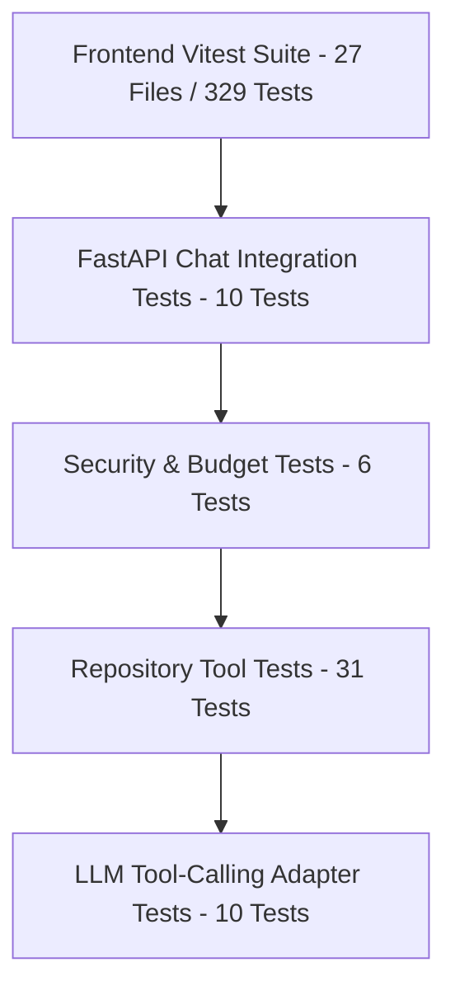

# 13 — Testing Strategy

## 1. Testing Pyramid

The testing strategy spans unit, integration, security, and UI regression layers:

---

## 2. Test Suites Summary

| Suite File | Scope | Tests | Status |
| :--- | :--- | :--- | :--- |
| `backend/tests/test_llm_tool_calling.py` | Gemini & Groq function calling adapters, request formatting, fallback | 10 | PASS |
| `backend/tests/test_agent_policy.py` | Path traversal, line ranges, symbol names, 8 KB truncation, secret redaction | 23 | PASS |
| `backend/tests/test_agent_tools.py` | 4 repository tools execution (`search_code`, `read_file_range`, `get_symbol`, `find_callers`) | 8 | PASS |
| `backend/tests/test_agent_orchestrator.py` | Orchestrator loop, baseline retrieval, evidence collection, RAG finalization | 4 | PASS |
| `backend/tests/test_agent_chat_api.py` | API routing, mode dispatch, 422 validation, disabled feature flag | 5 | PASS |
| `backend/tests/test_repository_chat_api.py` | Existing normal RAG chat API regressions | 5 | PASS |
| `backend/tests/test_agent_security_and_budget.py` | Hard budget limits, round ceilings, token ceilings, concurrent isolation | 6 | PASS |
| `backend/tests/test_agent_benchmark.py` | 35-case benchmark suite and metrics evaluation | 2 | PASS |
| `frontend/src/test/agenticChat.test.tsx` | Mode toggle, agentic request payload, metadata badge, expandable tools | 3 | PASS |
| `frontend/src/test/*` | Full frontend Vitest regression suite | 326 | PASS |

**Total Backend Agentic Tests:** 63 passing tests.
**Total Frontend Tests:** 329 passing tests across 27 suites.
