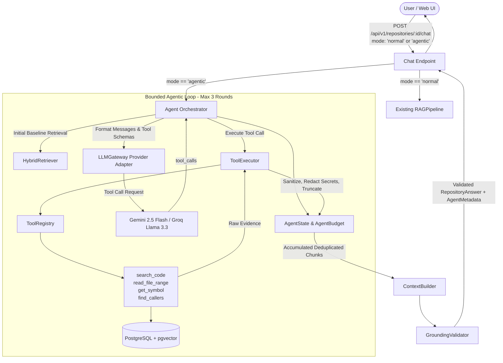

# Bounded Agentic Repository Chat

## 1. Overview & Motivation

Bounded Agentic Repository Chat is an enhancement to the software development platform's code intelligence capabilities (Issue #188 / F08). While the platform's standard repository-aware Retrieval-Augmented Generation (RAG) pipeline delivers fast, 1-turn answers for simple localized queries, complex architectural investigations—such as cross-file data flows, call hierarchies, indirect dependencies, and debugging multi-module subsystems—require iterative, evidence-driven exploration.

Rather than relying on unconstrained autonomous agents that risk runaway token costs, hallucinated shell operations, or uncontrolled code mutations, **Bounded Agentic Repository Chat** introduces a strictly regulated investigation loop. It equips free-tier language models (Google Gemini and Groq) with four read-only repository tools while enforcing deterministic round bounds, tool call budgets, token limits, and strict secret redaction.

---

## 2. Normal Chat vs. Agentic Chat

| Dimension | Normal Chat (Default) | Agentic Chat |
| :--- | :--- | :--- |
| **Execution Pattern** | 1-shot retrieval $\rightarrow$ context assembly $\rightarrow$ prompt $\rightarrow$ LLM answer | Multi-turn bounded loop $\rightarrow$ autonomous tool selection $\rightarrow$ evidence accumulation $\rightarrow$ RAG finalization |
| **Tools Available** | None (pure retrieval) | 4 read-only repository tools (`search_code`, `read_file_range`, `get_symbol`, `find_callers`) |
| **Max Model Calls** | 1 | $\le 4$ |
| **Max Investigation Rounds** | 1 | $\le 3$ |
| **Max Tool Calls** | 0 | $\le 6$ |
| **Latency Profile** | Sub-second to ~1.5s (P50: 980ms) | 2–4s (P50: 2450ms) |
| **Best Used For** | Fast symbol lookup, direct file explanations, simple Q&A | Cross-file call hierarchies, tracing execution paths, debugging multi-component interactions |
| **Grounding & Validation** | Full `GroundingValidator` & citation checks | Full `GroundingValidator` & citation checks on all tool evidence |

---

## 3. High-Level Architecture



---

## 4. Key Capabilities & Safety Guardrails

- **Zero Arbitrary Execution:** No shell commands, filesystem writing, git commits, or network egress.
- **Repository-Scoped Access:** Every tool execution verifies database tenant ownership and repository boundary (`repository_id`).
- **Hard Execution Ceilings:**
  - Max 3 investigation rounds.
  - Max 6 tool calls per user turn.
  - Max 4 model invocations per request.
  - Max 2 parallel tool calls per round.
  - Max 12,000 input tokens / 2,000 output tokens.
  - 35-second hard request timeout; 5-second per-tool timeout.
  - 8 KB maximum per-tool output truncation.
- **Secret Redaction:** AWS tokens, GitHub personal access tokens, private keys, database connection URIs, and authorization headers are dynamically redacted before model ingestion.
- **Deduplicated Tool Calls:** Repeated identical tool queries are detected and terminated to prevent model spinning.
- **Unified Grounding Guarantee:** All agentic findings are passed into the platform's existing `GroundingValidator`. Agentic chat never produces ungrounded citations or bypasses hallucination checks.

---

## 5. Provider & Model Support

The agentic engine operates via the unified `LLMGateway`:
- **Primary Provider:** Google Gemini (`gemini-2.5-flash`) via `google-genai` SDK.
- **Secondary / Fallback Provider:** Groq (`llama-3.3-70b-versatile`) via `groq` SDK.
- **Free-Tier Compatibility:** Configured specifically for zero-tier cost boundaries. API inference may remain within the available free-tier allowance, subject to provider-specific quota and usage restrictions. Exceeding the free allowance may result in throttling or charges depending on provider account settings.

---

## 6. Configuration & Activation

Enable agentic chat via environment variables:

```bash
# Agentic Chat Feature Flags
AGENTIC_CHAT_ENABLED=true
AGENTIC_CHAT_MAX_ROUNDS=3
AGENTIC_CHAT_MAX_TOOL_CALLS=6
AGENTIC_CHAT_MAX_MODEL_CALLS=4
AGENTIC_CHAT_MAX_INPUT_TOKENS=12000
AGENTIC_CHAT_MAX_OUTPUT_TOKENS=2000
AGENTIC_CHAT_REQUEST_TIMEOUT_SECONDS=35.0
AGENTIC_CHAT_TOOL_TIMEOUT_SECONDS=5.0
```

---

## 7. Documentation Index

- [00. Existing Architecture Audit](./00-existing-architecture-audit.md)
- [01. Requirements & Scope](./01-requirements-and-scope.md)
- [02. System Architecture](./02-system-architecture.md)
- [03. Agent Execution Flow](./03-agent-execution-flow.md)
- [04. LLM Tool-Calling Integration](./04-llm-tool-calling-integration.md)
- [05. Gemini Provider Integration](./05-gemini-integration.md)
- [06. Groq Provider Integration](./06-groq-integration.md)
- [07. Tool Registry & Tool Reference](./07-tool-registry-and-tool-reference.md)
- [08. Agent Budget & Cost Control](./08-agent-budget-and-cost-control.md)
- [09. Security & Permissions](./09-security-and-permissions.md)
- [10. RAG Integration & Grounding](./10-rag-integration-and-grounding.md)
- [11. API & Frontend Integration](./11-api-and-frontend-integration.md)
- [12. Database & Redis Design](./12-database-and-redis-design.md)
- [13. Testing Strategy](./13-testing-strategy.md)
- [14. Benchmark & Evaluation](./14-benchmark-and-evaluation.md)
- [15. Deployment & Configuration](./15-deployment-and-configuration.md)
- [16. Troubleshooting](./16-troubleshooting.md)
- [17. Future Enhancements](./17-future-enhancements.md)
- [Implementation Changelog](./IMPLEMENTATION_CHANGELOG.md)
- [Implementation Test Report](./IMPLEMENTATION_TEST_REPORT.md)
