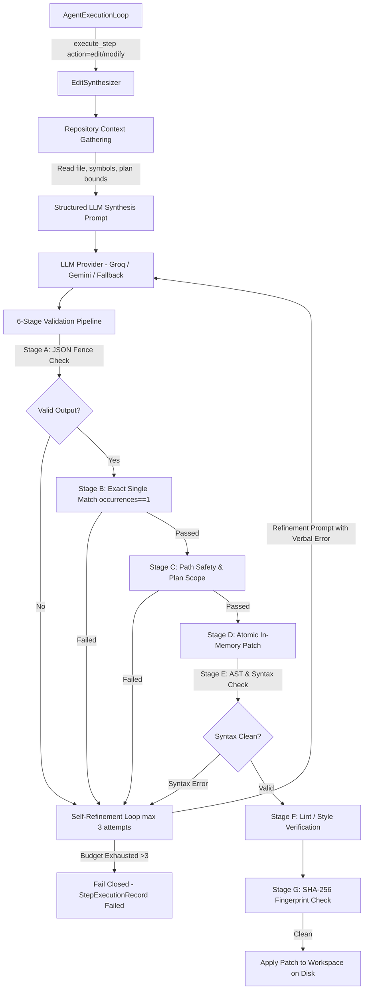

# 03 — EditSynthesizer Architecture and Search/Replace Synthesis

## 1. Executive Summary

`EditSynthesizer` (`backend/ai/services/edit_synthesizer.py`) is the autonomous code modification engine of the platform. It eliminates the fragile dependency on external callers providing code payloads for plan execution steps, enabling the agent to autonomously generate precise, plan-bound code changes following human plan approval.

Rather than generating entire file contents (which is token-inefficient, hallucinatory, and high-risk for large codebases), `EditSynthesizer` employs constrained search/replace blocks inspired by SWE-agent and Aider. Every synthesized modification is subjected to a strict 6-stage validation pipeline and bounded self-correction before being committed to the workspace.

---

## 2. Architecture & Service Responsibilities



### 2.1 Core Responsibilities
1. **Context Localization**: Reads existing target file contents from the isolated sandbox workspace, extracts relevant symbols and line contexts, and establishes an immutable base content fingerprint.
2. **Prompt Formulation**: Fences untrusted inputs, injects strict JSON schemas, and specifies exact search/replace instructions.
3. **Structured Search/Replace Block Generation**: Directs the LLM to output precise replacement blocks consisting of target `search_block` (verbatim substring) and `replace_block`.
4. **Validation Pipeline**: Executes rigorous multi-stage validation prior to any file writes.
5. **Bounded Self-Refinement**: If validation detects a failure (e.g., zero match, multiple matches, syntax error), reinforces the error into a correction prompt up to 3 total attempts.
6. **Thread-Safe Synchronous Integration**: Exposes `synthesize_sync` for direct execution within the `AgentExecutionLoop` step executor.

---

## 3. Data Contracts and Schemas

### 3.1 EditBlock Schema
```python
class EditBlock(BaseModel):
    search_block: str = Field(..., description="Exact substring from the existing file to be replaced.")
    replace_block: str = Field(..., description="New replacement content.")
    explanation: Optional[str] = Field(None, description="Brief justification for this edit block.")
```

### 3.2 EditSynthesisResult Schema
```python
class EditSynthesisResult(BaseModel):
    success: bool
    file_path: str
    original_content_hash: str
    modified_content: Optional[str] = None
    modified_content_hash: Optional[str] = None
    blocks: list[EditBlock] = Field(default_factory=list)
    attempts: int = 1
    error_summary: Optional[str] = None
    validation_status: str = "PENDING"
    patch_hash: Optional[str] = None
```

### 3.3 EditValidationMetrics
```python
class EditValidationMetrics(BaseModel):
    total_attempts: int = 1
    exact_matches: int = 0
    syntax_valid: bool = False
    lint_valid: bool = False
    in_scope: bool = False
    latency_ms: float = 0.0
```

---

## 4. Synthesis Prompt Design

The synthesizer instructs the LLM with strict formatting rules:
- Response must strictly be valid JSON wrapped in ````json ... ````.
- `search_block` MUST be a unique, exact verbatim match in the target file.
- If creating a new file, `search_block` is empty (`""`), and `replace_block` is the complete new content.
- Never write placeholder comments like `// TODO` or `... rest of implementation ...`.

---

## 5. Elimination of Cross-Step Content Reuse

Prior to this implementation, `AgentExecutionLoop` contained an unsafe fallback loop:
```python
# DEPRECATED VULNERABLE CODE:
for other_input in payload_map.values():
    if other_input.content:
        content = other_input.content
        break
```
This resulted in catastrophic cross-contamination where a payload meant for `src/models.py` would be applied to `src/auth.py`.

`EditSynthesizer` eliminates this loop entirely:
1. Caller-supplied payload for the *specific* step ID takes highest priority.
2. If missing, `EditSynthesizer.synthesize_sync()` is invoked autonomously with the step's specific target file.
3. If synthesis fails or is rejected, the step fails closed. No fallback across unrelated steps is ever permitted.

