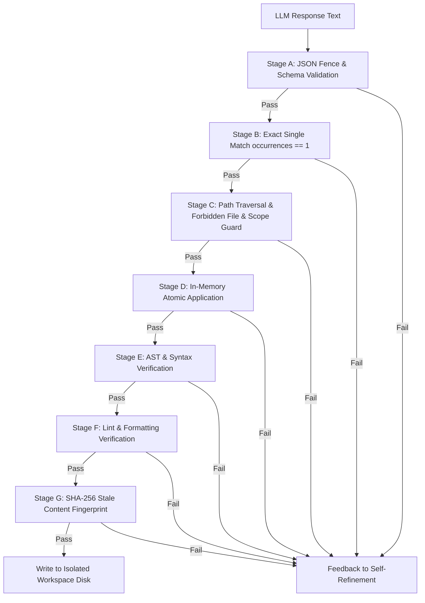

# 04 — Patch Validation and Application

## 1. Executive Summary

Autonomous code editing without rigorous validation leads to corrupted repositories, broken syntax, and security escapes. `EditSynthesizer` introduces a deterministic, 7-stage validation filter chain that evaluates proposed edit blocks *in memory* before touching any physical disk state.

---

## 2. The 7-Stage Validation Pipeline



### Stage A: Structured Output Parsing
Extracts and parses JSON from markdown fences (````json ... ````) or raw objects. Validates presence of `file_path` and a non-empty `blocks` list. Rejects malformed JSON immediately with descriptive parse errors.

### Stage B: Exact Single-Match Rule (`occurrences == 1`)
A critical requirement inspired by Aider:
- A `search_block` must match **exactly once** in the target file content.
- If `target_content.count(search_block) == 0`:
  `Zero matches found. Ensure search_block matches the current file verbatim including indentation and whitespace.`
- If `target_content.count(search_block) > 1`:
  `Multiple matches ({count}) found. Expand search_block with unique surrounding context lines to disambiguate.`

### Stage C: Path Traversal, Forbidden Patterns & Plan-Bound Scope
1. **Path Safety**: Canonicalizes `file_path`, ensures no `..` path traversal or absolute roots outside the sandbox.
2. **Forbidden Files**: Evaluates filename and path against forbidden patterns (`.env*`, `*.pem`, `id_rsa*`, `.git/*`, `*credentials*`, `*secret*`).
3. **Plan Bounds**: Validates that `file_path` is explicitly declared in `expected_files` or `target_files` of the approved plan.

### Stage D: Atomic In-Memory Patch Application
Applies all edit blocks sequentially in memory to a copy of the target file content. If any block fails to apply or corrupts the buffer, the entire patch set is rolled back and discarded.

### Stage E: AST and Syntax Validation
1. **Python Files (`*.py`)**:
   Uses Python's standard `ast.parse(modified_content)` to detect syntax errors, mismatched brackets, unclosed strings, or invalid indentation.
2. **JSON Files (`*.json`)**:
   Uses `json.loads(modified_content)` to detect syntax errors.
3. **Other Extensions**:
   Basic balance checks for delimiters (`{}`, `()`, `[]`).

### Stage F: Lint Verification
Ensures no forbidden raw secrets, debug prints (`console.log`, `pdb.set_trace`), or placeholder comments (`# TODO implement`) were introduced into the code.

### Stage G: Stale-Content SHA-256 Fingerprint Detection
Before writing to disk, recalculates `sha256(current_disk_content)`. If it differs from `original_content_hash` recorded at the start of synthesis, concurrent modification has occurred. The patch is rejected with `STALE_CONTENT` to prevent overwriting intermediate states.

---

## 3. Rollback Guarantees

Because stages A through G operate strictly in memory:
1. Workspace files on disk are never left in a partially modified or corrupted state.
2. If any validation stage fails, the disk remains 100% clean and unmodified.
3. Only upon complete pass across all stages is atomic disk write performed.
