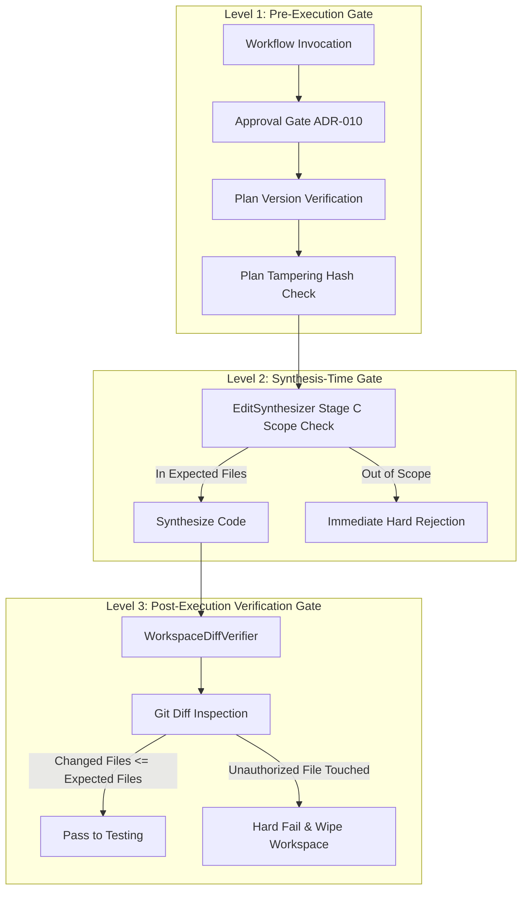

# 05 — Plan-Bound Edit Security and Authorization Architecture

## 1. Security Overview and ADR-010 Compliance

Under Architecture Decision Record 010 (ADR-010), autonomous execution is **strictly contingent upon prior human plan approval**. Autonomous agents may never independently alter code, modify files, or publish changes without passing through verified authorization gates.

This document describes the three defense-in-depth levels that guarantee all synthesized code modifications remain strictly bound to human-approved plans.

---

## 2. Three-Level Plan Enforcement Architecture

### Level 1: Pre-Execution Gate (`step_validate_approval`)
- Verifies task status is `APPROVED`.
- Confirms `approved_plan_version` matches the persisted plan record.
- Re-calculates cryptographic SHA-256 plan hash from immutable fields and confirms exact match with `TaskApproval.plan_hash`. Any tampering results in immediate rejection.

### Level 2: Synthesis-Time Scope Gate (`EditSynthesizer.validate_patch`)
- Inspects target `file_path`.
- Checks against `expected_files` and `target_files` of the approved plan.
- If the file is not declared in the approved plan, `EditSynthesizer` halts immediately with:
  `Unauthorized plan-bound scope violation: File '{file_path}' is not within approved plan expected_files.`

### Level 3: Post-Execution Workspace Diff Gate (`WorkspaceDiffVerifier`)
- After all steps execute, runs `git status` and `git diff` within the isolated workspace.
- Detects added, modified, deleted, or renamed files.
- If any file modified on disk was not declared in the plan, or matches forbidden patterns (`.env*`, `*.pem`, `id_rsa*`, `.git/*`), verification fails immediately, aborting the workflow before commit or push.

---

## 3. Threat Model and Neutralized Attack Vectors

| Attack Vector | Mechanism | Neutralization Strategy |
| :--- | :--- | :--- |
| **Path Traversal Escape** | LLM outputs `../../etc/passwd` | Canonicalization rejects non-child workspace paths. |
| **Forbidden File Tampering** | LLM attempts modifying `.env` or credentials | Multi-stage `fnmatch` filter immediately rejects file. |
| **Plan Scope Creep** | LLM modifies unauthorized files outside approved steps | Level 2 and Level 3 diff verifiers fail closed. |
| **Placeholder Code Injection** | LLM outputs `// TODO` or empty methods | Stage F lint checks and AST inspection reject empty shells. |
| **Concurrent Workspace Mutex Breach** | Multiple threads modifying workspace concurrently | Workspace locks and SHA-256 stale-content fingerprints prevent overwrites. |
| **Unapproved Workflow Execution** | Directly calling `/run-workflow` on draft task | Approval gate throws 400 Bad Request before workspace initialization. |

