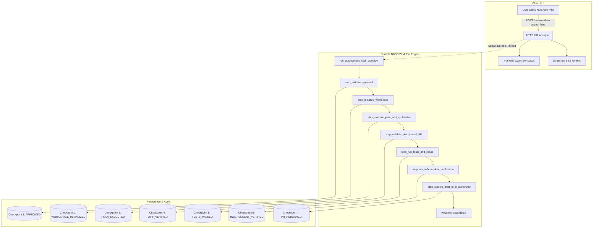

# 07 — Durable Workflow Execution Architecture

## 1. Executive Summary

Autonomous software development workflows involve complex, multi-stage pipelines: workspace setup, plan execution, LLM synthesis, diff verification, test execution, bounded repair, independent verification, and draft PR publication.

Running this entire pipeline synchronously within a single HTTP request exposes users to HTTP client timeouts (typical 30s-60s proxy timeouts), lost connections on laptop sleep or WiFi switch, and inability to track multi-minute execution states.

`autonomous_task_workflow.py` (`backend/ai/workflows/`) implements a durable, asynchronous workflow architecture powered by DBOS (Database-Oriented Operating System) steps and workflows.

---

## 2. DBOS Durable Steps and Workflow Design

### 2.1 The 7 Durable Steps
Each step is decorated with `@dbos_step()`, recording its execution status and output:

1. **`step_validate_approval`**: Enforces ADR-010 approval status, plan version consistency, and re-computes plan hash.
2. **`step_initialize_workspace`**: Prepares isolated workspace directory, cleans previous artifacts, and syncs base branch files.
3. **`step_execute_plan_and_synthesize`**: Runs `AgentExecutionLoop`, autonomously invoking `EditSynthesizer` when caller payloads are not provided.
4. **`step_validate_plan_bound_diff`**: Uses `WorkspaceDiffVerifier` to confirm modified files match `expected_files` and contain no forbidden files.
5. **`step_run_tests_and_repair`**: Executes repository test suite. If failures occur and `auto_repair=True`, runs `BoundedRepairLoop` (up to 3 repair attempts).
6. **`step_run_independent_verification`**: Executes fresh, independent secondary verification on the target commit.
7. **`step_publish_draft_pr_if_authorized`**: Commits verified changes, pushes feature branch, and opens GitHub Draft PR if human authorization is confirmed.

---

## 3. Stable Workflow IDs and Idempotency

- Every task submission generates a stable workflow identifier formatted as `wf-{task_id}-{uuid[:8]}`.
- An in-memory re-entrant lock (`_registry_lock = threading.RLock()`) guarantees duplicate submissions for the same active task do not spawn concurrent processes.
- If a client calls `/run-workflow` while a workflow is already running, the system returns `HTTP 202 Accepted` pointing to the existing workflow ID with `is_new=False`.

---

## 4. Checkpointing and Crash Recovery

Each step transition creates a secret-scrubbed `TaskCheckpoint` in the database. If a catastrophic system crash occurs:
- The persistent checkpoint preserves the verified revision, plan version, step records, and remaining repair budget.
- The `TaskRecovery` service inspects the latest checkpoint to resume or roll back safely without duplicate side-effects.
