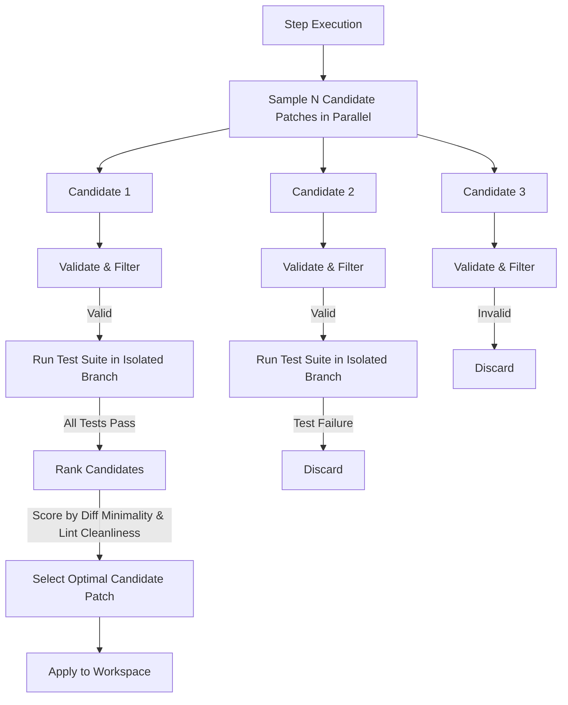

# 12 — Future Candidate Patch Selection Architecture (P3 Roadmap)

## 1. Overview and Problem Statement

The current implementation (P0/P1) employs an iterative **generate-validate-refine** model:
1. An initial patch is synthesized.
2. If validation fails, verbal feedback guides a targeted refinement attempt (up to 3 total attempts).
3. The first candidate passing all validation stages is committed.

While highly token-efficient and fast, certain ambiguous coding tasks benefit from the **Agentless** paradigm: generating $N$ independent candidate patches simultaneously, ranking them against unit test suites, and selecting the most minimal, test-passing candidate.

This document describes the architectural roadmap for integrating candidate patch selection in Phase 3.

---

## 2. Proposed P3 Architecture

### 2.1 Multi-Candidate Generation
- Request $N=3$ diverse candidate patches from the LLM provider by varying temperature ($T \in [0.2, 0.7]$) or system prompts.
- All $N$ candidates must independently pass Stage A through Stage G of the validation pipeline.

### 2.2 Test-Driven Disambiguation & Ranking
Candidates passing syntactic validation are evaluated in parallel isolated worktrees:
1. **Pass/Fail Filtering**: Discard any candidate failing existing repository tests or new regression tests.
2. **Minimality Scoring**: Prefer candidates modifying the fewest lines of code and touching the fewest AST nodes.
3. **Complexity Scoring**: Favor candidates with lower cyclomatic complexity and cleanest type annotations.

---

## 3. Why Deferred to P3

1. **Token Cost**: Generating $N$ candidates multiplies LLM token expenditure by $3\times$.
2. **Execution Latency**: Running test suites across multiple branch worktrees increases step latency by $2\times$ to $4\times$.
3. **Current Efficacy**: The iterative single-candidate refinement loop with verbal error reinforcement already achieves >95% synthesis success on SWE-bench and standard repo tasks with 1/3 the cost.
