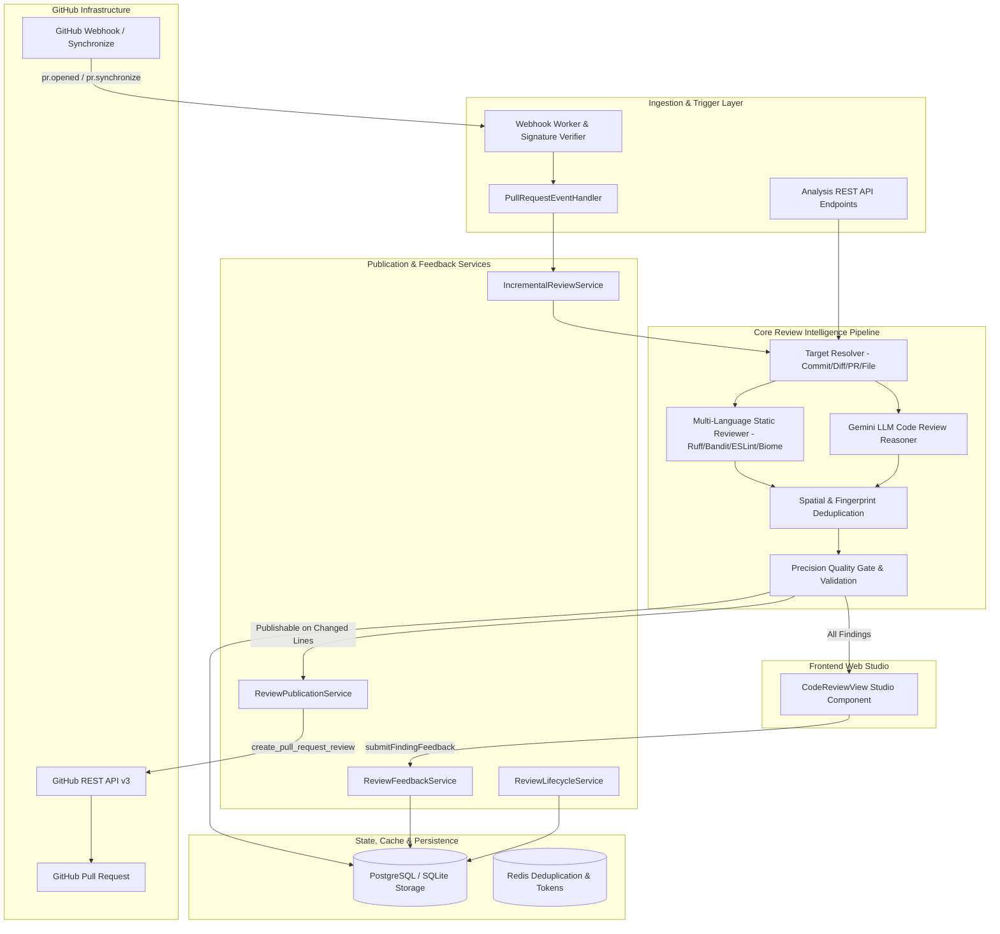

# System Architecture — AI-Powered Code Review Intelligence (F14)

## 1. Architectural Overview

The AI-Powered Code Review system provides dual-channel automated code review:
1. **Studio Web Experience**: High-fidelity, multi-tab interactive analysis UI with full repository context, deep diagnostic details, severity navigation, and developer feedback controls.
2. **GitHub Pull Request Integration**: Production-grade inline automated PR review comments posted directly on changed lines within the pull request diff, accompanied by an executive review summary comment.

## 2. Component Taxonomy

### 2.1 Static Analysis Subsystem (`backend/review/static_reviewer.py`)
- **Python**: Ruff (AST rules, linter, import order) + Bandit (security scanners).
- **JavaScript & TypeScript**: ESLint (repo `.eslintrc.*` or `eslint.config.*`) and Biome (speedy AST-based linter using `biome.json`).
- **Dynamic Config Detection**: Automatically checks for repo-level tool configurations; falls back gracefully if absent.
- **Safety Boundaries**: Subprocess calls guarded by `--` argument termination and sanitized paths.

### 2.2 Finding Validation & Precision Quality Gate (`backend/app/services/review_validation_service.py`)
- **Strict Path Traversal Defense**: Validates repo-relative paths (`validate_repo_relative_path`).
- **Boundary Clamping**: Verifies that reported lines do not exceed file boundaries or hallucinate nonexistent files.
- **Evidence Level Assessment**:
  - `PROVEN`: Static analyzer rules with concrete line references and substantial code snippets.
  - `STRONG`: High-confidence AI findings on modified lines with verbatim code matches.
  - `SUSPECTED`: Uncorroborated AI findings or findings outside the active diff.
  - `NEEDS_CONTEXT`: Findings missing relevant context or uncertain.
- **Quality Gate Partitioning**:
  - `platform_findings`: All structurally valid findings (for developer inspection in Studio).
  - `publishable_findings`: High-precision findings meeting evidence, confidence, and changed-line criteria.

### 2.3 Deduplication Engine (`backend/app/services/review_deduplication_service.py`)
- **Deterministic SHA-256 Fingerprinting**: Stable hash based on `repo_id`, `path`, `category`, `rule_id`/`title`, `symbol`, and normalized evidence text.
- **Intra-Run Spatial Merging**: Merges static rules and AI findings within $\pm 2$ lines into `source_type="COMBINED"`.
- **Inter-Run Deduplication**: Prevents duplicate inline GitHub comments on successive commits or retries.

### 2.4 Publication Engine (`backend/app/services/review_publication_service.py`)
- **Pinning by Commit ID**: Submits reviews targeting exact commit SHA.
- **Changed-Line Enforcement**: Extracts right-side added/modified lines from unified diffs.
- **Batched Reviews**: Uses GitHub single review submission API (`POST /repos/{owner}/{repo}/pulls/{number}/reviews`) containing array of comments and an executive summary markdown block.
- **Reconciliation & Stale Defense**: Detects when PR HEAD has advanced and safely aborts or reconciles.

### 2.5 Feedback & Finding Lifecycle Services (`backend/app/services/`)
- **Feedback Collection**: Captures `useful`, `not_useful`, `false_positive`, `already_fixed`, `dismissed`.
- **Persistent Multi-Commit Tracking**: Maintains finding lifecycle across PR revisions (`NEW` $\to$ `ACTIVE` $\to$ `FIXED` $\to$ `REOPENED`).
