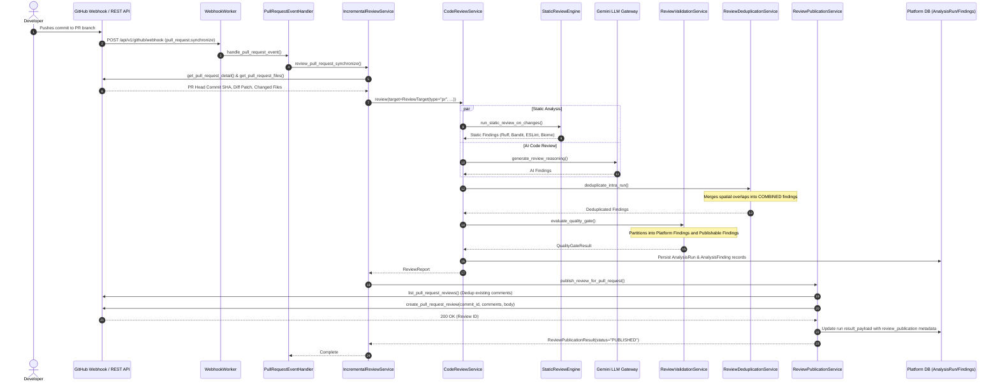
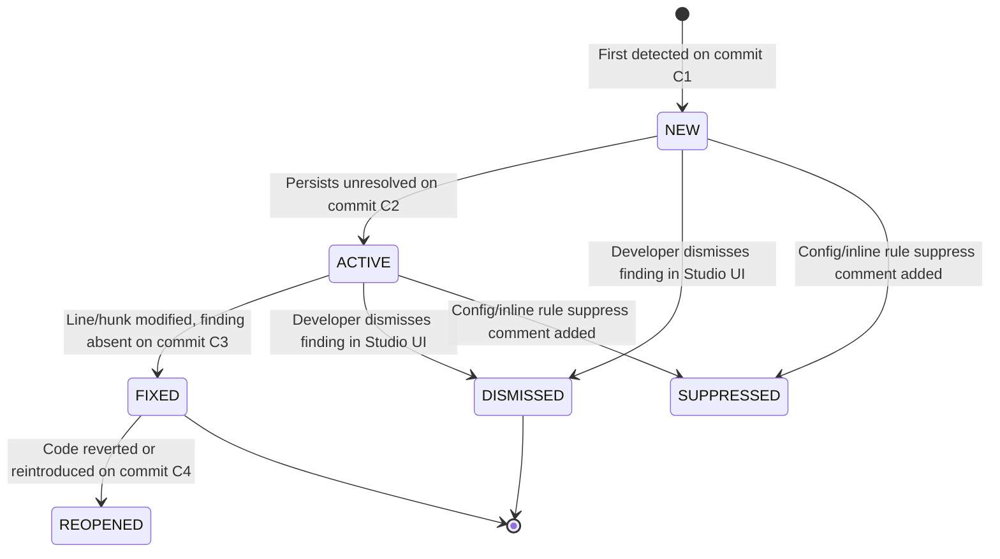

# Review Execution Flow — AI-Powered Code Review Intelligence (F14)

## 1. End-to-End Sequence Diagram

The review workflow handles both webhook triggers (`pull_request.opened` / `pull_request.synchronize`) and manual API triggers.

## 2. Review States & Lifecycle Transitions

Findings transition through a well-defined state machine across commit synchronizations:

### Transition Validation Rules:
- **`NEW` $\to$ `ACTIVE`**: Allowed when unchanged on consecutive commit.
- **`NEW` / `ACTIVE` $\to$ `FIXED`**: Allowed when the diff rectifies the line or symbol.
- **`FIXED` $\to$ `REOPENED`**: Allowed if fingerprint reappears in a subsequent commit.
- **`DISMISSED` / `SUPPRESSED`**: Terminal or muted states; do not re-alert on PR sync.
