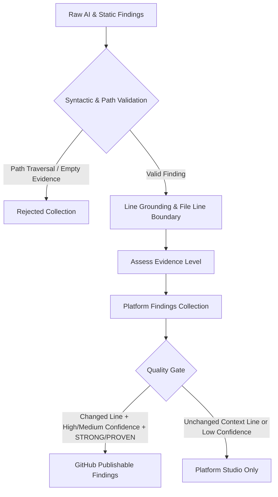

# 05 — Finding Quality Gate & Validation Architecture

**Document**: `Docs/code-review/05-finding-quality-and-validation.md`  
**Feature**: F14 — AI-Powered Code Review Intelligence  
**Author**: Antigravity Senior Architecture & QA Team  
**Status**: IMPLEMENTED & TESTED  

---

## 1. Principles & Quality Gating

Adopting Google AutoCommenter's primary lesson—**Precision over Recall**—we implement a multi-stage validation filter before any review finding is displayed or submitted to GitHub.

---

## 2. Gating Criteria

### 2.1 Evidence Levels
Findings are dynamically classified into 4 evidence tiers:
1. **PROVEN**: Confirmed by deterministic static analysis (Ruff, Bandit, ESLint, Biome) with exact AST coordinates.
2. **STRONG**: High-confidence AI finding anchored on an added/modified line with sufficient evidence code ($\ge 25$ chars).
3. **SUSPECTED**: Medium/low confidence AI observation or issue located on an unchanged context line.
4. **NEEDS_CONTEXT**: Flagged when `is_uncertain=True` or counter-evidence was detected.

### 2.2 Two-Tier Collections
- **Platform Findings**: Preserves all validated findings. If an issue is on an unchanged line (e.g. caller in another file affected by a signature change), it is rendered in the Studio UI so developers have full visibility.
- **GitHub Publishable Findings**: Strict subset allowed to create inline comments. Must be `PROVEN` or `STRONG`, meet `min_confidence`, and anchor on a changed line.

### 2.3 Path and Range Safety
- Protects against malicious diff payloads attempting path traversal (`require_safe_repo_path`).
- Rejects line numbers that exceed actual file length + diff boundaries.
