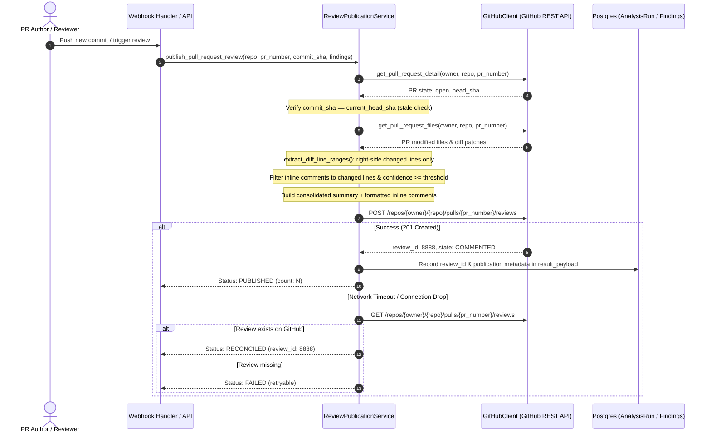

# 06 — GitHub PR Review Publication Architecture

**Document**: `Docs/code-review/06-github-publication.md`  
**Feature**: F14 — AI-Powered Code Review Intelligence  
**Author**: Antigravity Senior Architecture & QA Team  
**Status**: IMPLEMENTED & TESTED  

---

## 1. Overview & Architecture

The **ReviewPublicationService** enables the platform to automatically or manually submit qualified code review findings as inline comments on GitHub Pull Requests.

---

## 2. Key Safeguards

### 2.1 Commit Pinning & Stale Review Prevention
- Every review publication is pinned to a specific HEAD `commit_sha`.
- If the PR author pushes a new commit while analysis is running, `current_head_sha` will diverge from `commit_sha`.
- The publication service immediately detects the mismatch and **aborts with `status="SKIPPED"`**, preventing inline comments from attaching to outdated or moved lines.

### 2.2 Diff Line Coordinate Anchor Validation
- Inline comments can only be attached to lines added or modified on the right side of the unified diff (`side="RIGHT"`).
- `extract_diff_line_ranges()` parses git diff hunks (`@@ -old,count +new,count @@`) and identifies right-side changed lines.
- Findings targeting context lines or unchanged lines are excluded from GitHub inline comments (remaining accessible in the Platform Studio).

### 2.3 Single Atomic Review Submission
- Instead of spamming individual comment notifications (`POST /comments`), all inline comments are batched into a **single review object** with `event="COMMENT"` and `body=summary`.
- Contributors receive one consolidated notification containing the executive summary and inline suggestions.

### 2.4 Idempotency & Reconciliation
- In distributed environments, network drops can occur after GitHub processes the review request but before the HTTP response reaches the backend.
- `_reconcile_with_github()` queries `GET /pulls/{n}/reviews` to check if the review was posted remotely before declaring failure.

### 2.5 Secret Redaction
- All descriptions, evidence code snippets, suggested fixes, and summaries pass through `app.core.secret_redaction.redact()` before being sent to GitHub.
