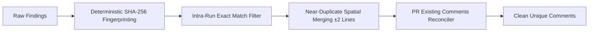
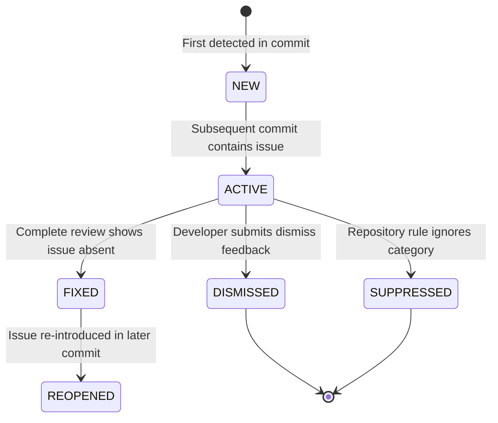

# 07 — Finding Deduplication & Lifecycle Architecture

**Document**: `Docs/code-review/07-deduplication-and-lifecycle.md`  
**Feature**: F14 — AI-Powered Code Review Intelligence  
**Author**: Antigravity Senior Architecture & QA Team  
**Status**: IMPLEMENTED & TESTED  

---

## 1. Deduplication Architecture

Inspired by PR-Agent's persistent finding model, `ReviewDeduplicationService` eliminates noise across multiple axes:

### 1.1 Deterministic Fingerprint Formula
Line numbers change across git commits. Therefore, finding identity relies on semantic anchors:
$$\text{Fingerprint} = \text{SHA256}(\text{repo\_id} \parallel \text{file\_path} \parallel \text{category} \parallel \text{rule\_id\_or\_title} \parallel \text{symbol} \parallel \text{norm\_evidence})$$
- `norm_evidence`: Normalized code snippet with collapsed whitespace and truncated to the first 120 characters.
- Changes to surrounding whitespace do not invalidate the fingerprint.

### 1.2 Overlapping STATIC and AI Merging
When static analysis (e.g. Bandit B105) and LLM review detect the same vulnerability on the same or adjacent line ($\pm 2$ lines):
- Merged into a single finding with `source_type="COMBINED"`.
- Severity elevated to `max(STATIC_SEVERITY, AI_SEVERITY)`.
- Confidence elevated to `max(STATIC_CONFIDENCE, AI_CONFIDENCE)`.
- Suggested fix preserved from whichever engine provided it.

### 1.3 PR Comment Deduplication
- Pulls existing PR review comments from GitHub API (`GET /pulls/{n}/comments`).
- If an inline comment is already anchored to `(path, line)`, candidate inline comments targeting that coordinate are suppressed to prevent spamming contributors with duplicate suggestions.

---

## 2. Finding Lifecycle States

Findings progress through a formal state machine:

- **NEW**: Detected for the first time on a PR branch.
- **ACTIVE**: Persists in subsequent commits.
- **FIXED**: Clean commit removes the issue.
- **REOPENED**: Re-appears in a later commit.
- **DISMISSED**: Marked as not useful / false positive by developer.
- **SUPPRESSED**: Disabled by repository-level configuration.
