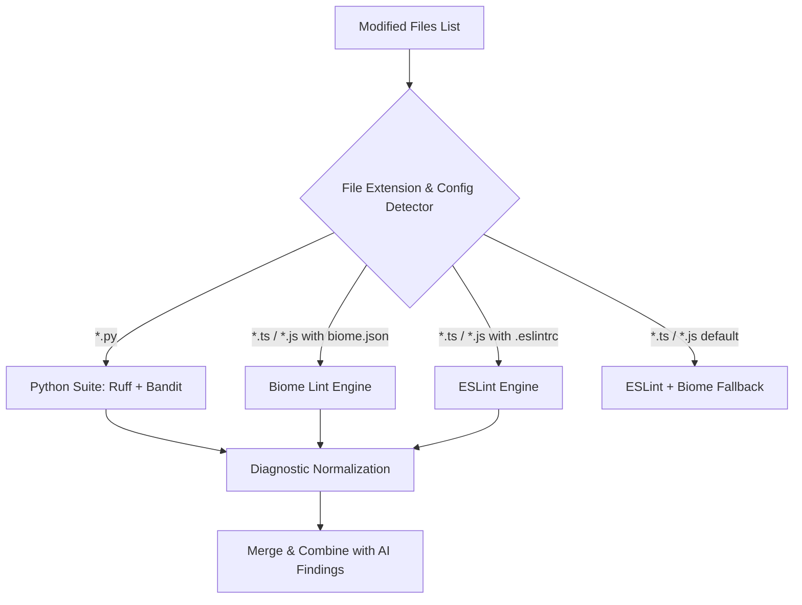

# 08 — Static Analysis Expansion Architecture (ESLint, Biome, Ruff, Bandit)

**Document**: `Docs/code-review/08-static-analysis-integration.md`  
**Feature**: F14 — AI-Powered Code Review Intelligence  
**Author**: Antigravity Senior Architecture & QA Team  
**Status**: IMPLEMENTED & TESTED  

---

## 1. Overview & Multi-Language Scanner Architecture

Static code analysis provides deterministic, reproducible defect detection that runs alongside AI reasoning. By combining linters with LLMs, the platform achieves both high precision on known syntactic bugs and semantic reasoning on complex logic bugs.

---

## 2. Supported Scanners & Configuration Detection

| Scanner | Target Languages | Config Triggers | CLI Command | Output Format |
|---|---|---|---|---|
| **Ruff** | Python (`.py`) | Default for Python, `pyproject.toml`, `ruff.toml` | `ruff check --output-format json -- <path>` | JSON List |
| **Bandit** | Python (`.py`) | Security analyzer for Python | `bandit -f json -r -- <path>` | JSON Object (`results`) |
| **ESLint** | JS / TS / React (`.js`, `.jsx`, `.ts`, `.tsx`) | `.eslintrc*`, `eslint.config.*`, `package.json` | `npx eslint --format json --no-color -- <path>` | JSON List (`messages`) |
| **Biome** | JS / TS / JSX / TSX | `biome.json`, `biome.jsonc` | `npx @biomejs/biome lint --reporter=json -- <path>` | JSON Object (`diagnostics`) |

---

## 3. Diagnostic Normalization

Regardless of the underlying tool, all diagnostics are normalized into the platform's unified schema:
- `rule_id`: Scanner-specific rule identifier (e.g. `B105`, `F401`, `react/jsx-no-target-blank`, `lint/correctness/noUnusedVariables`).
- `severity`: Normalized to `critical`, `high`, `medium`, `low`, or `info`.
- `message`: Secret-redacted diagnostic description.
- `file_path`: Repository-relative normalized path.
- `line_number`: 1-based start row.
- `scanner`: Name of scanner tool (`ruff`, `bandit`, `eslint`, `biome`).

---

## 4. Security & Isolation Safeguards

1. **Option Injection Prevention**: Paths starting with `-` or containing null bytes `\x00` are strictly rejected. `--` argument terminators are passed before the file path.
2. **Execution Timeout**: Capped at 60 seconds per tool invocation to prevent infinite loops or hanging linter processes.
3. **Output Truncation**: Output streams are capped and parsed via `json.loads` safely with exception redaction.
