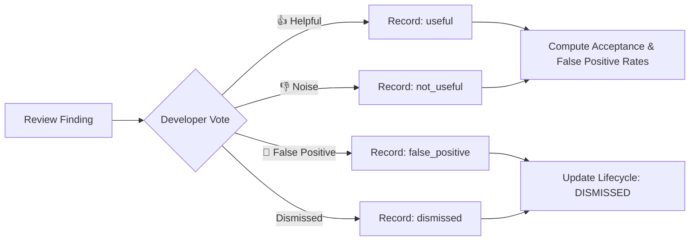

# 09 — Developer Feedback & Finding Lifecycle Architecture

**Document**: `Docs/code-review/09-feedback-and-evaluation.md`  
**Feature**: F14 — AI-Powered Code Review Intelligence  
**Author**: Antigravity Senior Architecture & QA Team  
**Status**: IMPLEMENTED & TESTED  

---

## 1. Overview

Adopting Google's **AutoCommenter (P-14)** philosophy, developer feedback serves as the primary metric of AI review usefulness. Instead of evaluating synthetic benchmarks alone, real developers provide signals on whether a finding is helpful or noisy.



---

## 2. Developer Feedback Model

Feedback is persisted within the `finding_metadata["feedback"]` JSONB structure on `AnalysisFinding`:
```json
{
  "feedback_type": "useful",
  "user_id": "3fa85f64-5717-4562-b3fc-2c963f66afa6",
  "comment": "Prevented race condition in payment checkout.",
  "updated_at": "2026-11-08T13:00:00Z"
}
```

### Metrics:
$$\text{Acceptance Rate} = \frac{\text{useful\_count}}{\text{useful\_count} + \text{not\_useful\_count} + \text{false\_positive\_count}}$$
$$\text{False Positive Rate} = \frac{\text{false\_positive\_count}}{\text{useful\_count} + \text{not\_useful\_count} + \text{false\_positive\_count}}$$

---

## 3. Finding Lifecycle State Tracking

Across subsequent commits on a pull request branch, `ReviewLifecycleService` maintains a state machine:
- **NEW**: Detected for the first time in commit $C_1$.
- **ACTIVE**: Persists in subsequent commit $C_2$.
- **FIXED**: Code modification resolves the issue in commit $C_3$.
- **REOPENED**: Re-appears in later commit $C_4$.
- **DISMISSED**: Marked as dismissed by developer.
- **SUPPRESSED**: Muted by repository policy.

Stored in `finding_metadata["lifecycle"]`:
```json
{
  "status": "ACTIVE",
  "first_detected_commit": "c1a2b3c4",
  "last_detected_commit": "d5e6f7a8",
  "fixed_in_commit": null,
  "history": [
    {
      "from": "NEW",
      "to": "ACTIVE",
      "commit_sha": "d5e6f7a8",
      "reason": "Defect persists in subsequent commit",
      "timestamp": "2026-11-08T13:05:00Z"
    }
  ]
}
```
