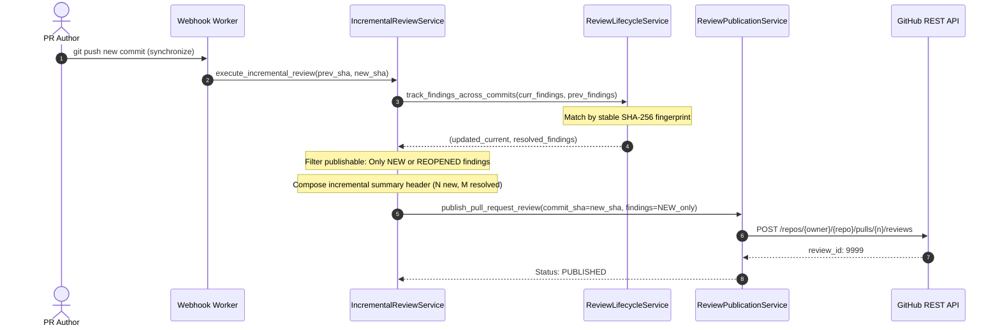

# 10 — Incremental Pull Request Review Architecture

**Document**: `Docs/code-review/10-incremental-review.md`  
**Feature**: F14 — AI-Powered Code Review Intelligence  
**Author**: Antigravity Senior Architecture & QA Team  
**Status**: IMPLEMENTED & TESTED  

---

## 1. Incremental Review Workflow

Adopting the **PR-Agent (OSS-07)** incremental review design, the platform processes pull request updates (`synchronize` webhook event) by evaluating the code delta between consecutive pushes:

---

## 2. Preventing Repetitive Noise on GitHub

On PR updates, contributors are annoyed when bots repeat comments on files that were already reviewed and unchanged.
The incremental engine strictly ensures:
1. Findings in subsequent commits whose fingerprint matches an existing issue are tagged `ACTIVE`.
2. Only findings tagged `NEW` or `REOPENED` are eligible for inline comments on incremental runs.
3. Issues resolved by the author's new commit are marked `FIXED` and celebrated in the executive overview (`"Previously Detected Issues Resolved: M"`).
4. Commits that accidentally re-introduce a previously resolved defect are tagged `REOPENED` and brought to the developer's attention.
