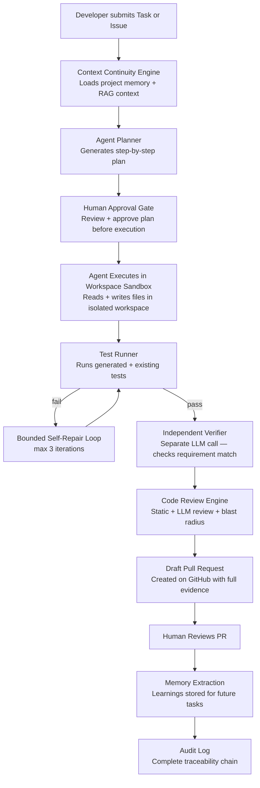

# 01. Project Overview
> **Version:** 4.0 | **Created:** 2026-09-24 | **Last Updated:** 2026-11-08 | **Owner:** Team | **Status:** 100% Complete (Weeks 1–3 + Post-Week 3 Enterprise Hardening)

---

## Problem Statement

Modern software teams juggle code review, testing, debugging, issue tracking, and pull request management across disconnected tools. Each activity happens in isolation — no shared thread connects *why* the work exists, *what was already tried*, and *what happened last time*.

This fragmentation worsens with AI involvement. Existing AI coding assistants are **stateless**: every session starts from zero. They don't know the project's architecture, the decisions that shaped it, the rules the team follows, or the approaches that already failed. Developers re-explain context repeatedly, and AI-generated changes often ignore conventions or repeat mistakes because nothing is remembered.

Additionally, giving an autonomous agent free rein over a codebase is unsafe. Without permissions, sandboxing, and human checkpoints, agentic execution risks unreviewed changes reaching production, runaway loops, or actions no one can trace back to a reason.

**Core problem:** software engineering work is fragmented, AI assistance is forgetful, and autonomous agents lack guardrails for developer trust.

---

## Objective

Build an AI-powered **Agentic Software Engineering Platform** that integrates with GitHub to:
1. Understand a project's codebase structurally (AST + dependency graph + symbol graph)
2. Remember engineering context across sessions (context continuity + project memory)
3. Analyze changes for correctness, security, and impact (code review, bug detection, blast radius)
4. Execute development tasks safely inside sandboxes (workspace sandbox, bounded test repair)
5. Validate results independently before human review (independent verifier)
6. Prepare draft pull requests with full traceability evidence
7. Deliver high-precision code retrieval and interactive agentic repository chat with strict budget & execution bounds

---

## System Flow

---

## Scope

### Included (Current Scope — Weeks 1–3 + Post-Week 3 Enterprise Hardening)

| Area | What's In Scope | Status |
|---|---|---|
| GitHub Integration | OAuth login, repository listing, cloning, durable webhooks (`github_webhook_events`), lease workers, auto-sync, automated PR review, draft PR creation | 🟢 Done |
| Repository Engine | File walking, language detection, AST parsing (tree-sitter), symbol extraction, 1-hop symbol graph expansion | 🟢 Done |
| Multi-Stage Retrieval | 7-stage pipeline: intent detection, simple GIN lexical FTS (`code_search_text`), dense vector search, RRF fusion, symbol graph expansion, ONNX cross-encoder reranking, Redis cache | 🟢 Done |
| AI Analysis Suite | Code review, bug detection, security analysis, blast radius, code explanation, test generation | 🟢 Done |
| Memory System | Project memory, decision memory, task memory, failure memory, context checkpoints | 🟢 Done |
| Agentic Workflow | Task planning, workspace sandbox execution, bounded repair loop, test generation+run, self-verification, draft PR | 🟢 Done |
| Bounded Agentic Chat | Dual-mode chat (`normal` \| `agentic`), normalized Gemini & Groq tool calling, read-only repo tools, execution policy, token/round/time ceilings | 🟢 Done |
| Security & Safety | Timing-safe HMAC JWT, 32-byte secret validation, state nonces in Redis, token rotation, permission tiers, human approval gates, kill switch | 🟢 Done |
| Frontend | Dashboard, repository list, repository detail, task planner/executor studio, bug/explain/test/review studios, dual-mode agentic chat UI | 🟢 Done |
| Infrastructure | PostgreSQL 15 + pgvector (12 linear Alembic migrations), Redis 7 (caching + locks + nonces), Docker Compose | 🟢 Done |

### Excluded (Future Scope)

| Excluded | Reason |
|---|---|
| Multi-agent parallelism | Cross-agent handoff is P2 — deferred |
| Full billing/metering | Out of scope for enterprise engineering pilot |
| Self-hosted LLM | Current approved providers: Google Gemini & Groq with normalized tool calling |
| Non-GitHub VCS | GitHub primary focus |

---

## Target Users

| User Type | Description |
|---|---|
| **Developer** | Primary user: submits tasks, reviews agent output, approves plans, interacts via dual-mode chat, merges PRs |
| **Team Lead / Maintainer** | Reviews agent analytics, manages repository automation settings, oversees project memory and automated reviews |
| **Platform Administrator** | Manages system configuration, webhook replay, and audit logs |

---

## Core Features

### F-01: GitHub Integration & Durable Automation
| Field | Value |
|---|---|
| **Purpose** | Connect platform to GitHub for auth, repos, durable webhooks, push auto-sync, PR review comments, and draft PRs |
| **User** | Developer & System |
| **Priority** | P0 |
| **Status** | 🟢 Done (Batch 1 & Batch 2 Hardened) |
| **Dependencies** | GitHub App credentials in `.env`, Redis |
| **Related APIs** | `/api/v1/auth/github/*`, `/api/v1/auth/refresh`, `/api/v1/github/webhooks`, `/api/v1/github/webhooks/events/*`, `/api/v1/repositories/{id}/automation` |
| **Related DB Tables** | `users`, `github_installations`, `repositories`, `github_webhook_events` |

### F-02: Repository Engine (Scanner & Symbol Graph)
| Field | Value |
|---|---|
| **Purpose** | Structural code understanding — file tree, AST parsing (tree-sitter), symbol extraction, 1-hop symbol graph expansion |
| **User** | System (background) |
| **Priority** | P0 |
| **Status** | 🟢 Done |
| **Dependencies** | tree-sitter, `repository_files`, `code_chunks` |
| **Related Modules** | `backend/app/scanner/`, `backend/app/indexer/symbol_graph.py` |

### F-03: Code Indexing & Lexical Search
| Field | Value |
|---|---|
| **Purpose** | Convert parsed symbols into vector-indexed chunks + code-aware lexical FTS (`code_search_text`) with adaptive HNSW savepoints |
| **User** | System (background) |
| **Priority** | P0 |
| **Status** | 🟢 Done |
| **Dependencies** | `code_chunks` DB table, `repositories.active_index_generation`, EmbeddingService |
| **Related Modules** | `backend/app/indexer/`, `backend/app/retrieval/adaptive_hnsw.py` |

### F-04: Multi-Stage Code Retrieval Engine
| Field | Value |
|---|---|
| **Purpose** | 7-stage retrieval: intent detection, simple GIN FTS, dense vector, RRF fusion, graph expansion, ONNX cross-encoder reranker, Redis cache |
| **User** | Developer & AI Subsystems |
| **Priority** | P0 |
| **Status** | 🟢 Done (150-query benchmark verified) |
| **Dependencies** | `code_chunks`, Redis, ONNX runtime (`ms-marco-MiniLM-L-6-v2`) |
| **Related Modules** | `backend/app/retrieval/`, `backend/app/ai/pipeline.py` |
| **Related APIs** | `POST /api/v1/repositories/{id}/chat`, `POST /api/v1/repositories/{id}/search` |

### F-05: LLM Gateway & Tool Calling
| Field | Value |
|---|---|
| **Purpose** | Centralized, normalized LLM gateway supporting Google Gemini and Groq with native tool-calling abstractions |
| **User** | System (all AI features) |
| **Priority** | P0 |
| **Status** | 🟢 Done |
| **Related Modules** | `backend/app/ai/llm/client.py`, `backend/app/ai/agent/llm_client.py` |

### F-06: Agentic Workflow & Bounded Repository Chat
| Field | Value |
|---|---|
| **Purpose** | Task planning, workspace sandbox execution, bounded repair loop, draft PR creation, and interactive bounded agentic chat |
| **User** | Developer |
| **Priority** | P0 |
| **Status** | 🟢 Done |
| **Dependencies** | Workspace sandbox, tool registry, execution policy, memory system |
| **Related Modules** | `backend/app/tasks/`, `backend/app/sandbox/`, `backend/app/ai/agent/` |

### F-07: Context Continuity Engine (Memory)
| Field | Value |
|---|---|
| **Purpose** | Persist project knowledge, decisions, task checkpoints, and failure learnings across sessions |
| **User** | System (agent) |
| **Priority** | P0 |
| **Status** | 🟢 Done |
| **Dependencies** | PostgreSQL, Redis, LLM Gateway |
| **Related Modules** | `backend/app/memory/` |

### F-08: Agent Safety & Security System
| Field | Value |
|---|---|
| **Purpose** | Timing-safe auth, state nonces, permission engine, budget limits (tokens, rounds, execution time), human approval gates |
| **User** | Developer & System |
| **Priority** | P0 |
| **Status** | 🟢 Done |
| **Related Modules** | `backend/app/core/security.py`, `backend/app/ai/agent/execution_policy.py`, `backend/app/ai/agent/budget_manager.py` |

---

## Technology Stack

| Layer | Technology |
|---|---|
| **Backend Framework** | FastAPI 0.115 |
| **Language (Backend)** | Python 3.11+ |
| **ORM** | SQLAlchemy 2.0 |
| **Migrations** | Alembic 1.13 (12 linear revisions) |
| **Primary DB** | PostgreSQL 15 with pgvector extension |
| **Cache / Queue / Locks** | Redis 7 |
| **LLM Providers** | Google Gemini (`gemini-1.5-pro` / `gemini-1.5-flash`), Groq (`llama-3.3-70b-versatile`) |
| **Embeddings** | HuggingFace `all-MiniLM-L6-v2` / Gemini embeddings |
| **Reranker** | ONNX Runtime `ms-marco-MiniLM-L-6-v2` with PyTorch fallback |
| **AST Parser** | tree-sitter |
| **Frontend Framework** | Vite + React 19 + TypeScript |
| **Frontend State** | Zustand 5 |
| **Server State** | TanStack Query 5 |
| **HTTP Client (FE)** | Axios |
| **Auth** | GitHub OAuth + JWT (timing-safe HMAC-SHA256, 32-byte secret, Redis nonces) |
| **Containerization** | Docker Compose |
| **Testing** | pytest, pytest-asyncio, httpx, Vitest |

---

## Key Differentiators

| Differentiator | Implementation |
|---|---|
| **It remembers** | Context Continuity Engine — project memory, decisions, and failure learnings persisted in PostgreSQL |
| **It acts, not just advises** | Workspace sandbox execution, bounded test-repair loop, and automated draft PR creation |
| **It stays safe** | Permission tiers, token/round/time budgets, timing-safe auth, mandatory human approval gates |
| **Multi-stage precision** | 7-stage retrieval with code-aware lexical FTS, dense vector, symbol graph expansion, ONNX reranking, and Redis caching |
| **Dual-mode interactive chat** | Standard RAG chat alongside tool-augmented bounded agentic repo exploration |
| **It stays traceable** | Requirement → plan approval → sandbox execution → tests → independent verification → PR → memory |
