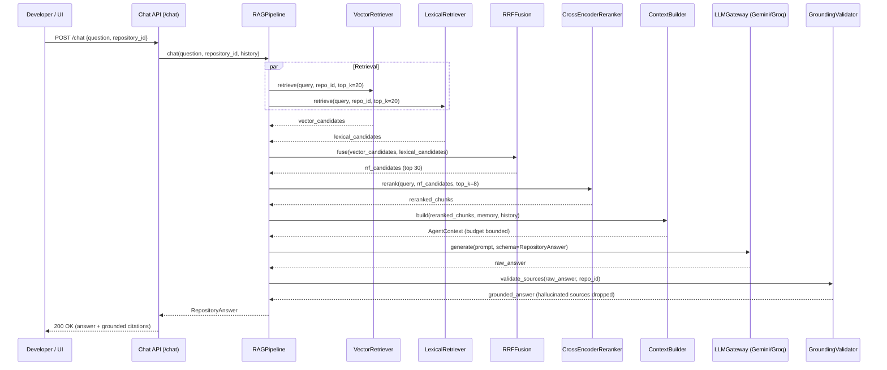

# 05. System Architecture
> **Version:** 3.0 | **Created:** 2026-09-24 | **Last Updated:** 2026-10-15 | **Status:** Synchronized & Live

---

## High-Level Architecture

```mermaid
flowchart TD
    subgraph Client["Frontend (React 19 + TypeScript + Vite)"]
        UI[Workbench / Repository Explorer / Drawers]
        Stores[Zustand Stores: AuthStore / RepositoryStore]
        API_Client[Axios API Client + SSE Real-time Stream]
    end

    subgraph Backend["Backend Gateway (FastAPI + Pydantic v2)"]
        Router[API Router /api/v1]
        Auth_API[Auth API\n/api/v1/auth/*]
        Health_API[Health API\n/api/v1/health]
        Repo_API[Repositories API\n/api/v1/repositories/*]
        Chat_API[Chat API\n/api/v1/repositories/{id}/chat]
        Analysis_API[Analysis API (W2)\n/explain, /detect-bugs, /generate-tests, /review]
        Task_API[Workflow Task API (W3)\n/tasks, /approve, /execute, /create-pr]
        Middleware[RequestIdMiddleware\nStructured Logging + Security Headers]
    end

    subgraph AI_Layer["AI & Intelligence Pipeline (backend/ai/)"]
        LLM_GW[LLM Gateway\nclient.py]
        Gemini_P[Google Gemini Provider\ngemini_provider.py]
        Groq_P[Groq Provider\ngroq_provider.py]
        Embed_SVC[Embedding Service\nservice.py]
        Vec_RET[Vector Retriever\nvector.py]
        Lex_RET[Lexical Retriever\nlexical.py]
        RRF[RRF Fusion\nfusion.py]
        Reranker[Cross-Encoder Reranker\nreranker.py]
        CTX_B[Context Builder\nbuilder.py]
        Intel_CTX[IntelligenceContext Builder\nbuilder.py]
        Prompt_B[Prompt Builder\nprompt_builder.py]
        Out_Val[Output Validator\nvalidator.py]
        Ground_Val[Grounding Validator\ngrounding.py]
    end

    subgraph Scanner["Repository Engine (backend/scanner/)"]
        Walker[FileWalker\nwalker.py]
        Detector[LanguageDetector\ndetector.py]
        Parser[tree-sitter Parser\nparser.py]
        Symbols[Symbol Extractor\nsymbols.py]
        Graph[Dependency Graph\ngraph.py]
        TestMap[Test Mapper\ntest_mapper.py]
    end

    subgraph Indexer["Indexer (backend/indexer/)"]
        Chunker[SymbolChunker\nchunker.py]
        Queue[EmbeddingQueue\nembedding_queue.py]
    end

    subgraph Infra["Infrastructure"]
        PG[(PostgreSQL 15\n+ pgvector)]
        Redis[(Redis 7)]
        GitHub_API[GitHub API\nApp + OAuth]
    end

    Client --> Backend
    Backend --> AI_Layer
    Backend --> Scanner
    Backend --> Indexer
    AI_Layer --> Infra
    Backend --> Infra
    Scanner --> Indexer
    Backend --> GitHub_API
```

---

## Backend Module Ownership Matrix

| Module | Path | Owner | Status | Notes |
|---|---|---|---|---|
| API Router | `backend/app/api/v1/` | Yug | 🟢 Done | All v1 endpoints registered |
| Core Config & Settings | `backend/app/core/config.py` | Yug | 🟢 Done | Reads environment variables with defaults |
| Core Database | `backend/app/core/database.py` | Yug | 🟢 Done | Async engine, sessionmaker, Base |
| Core Logging | `backend/app/core/logging.py` | Yug | 🟢 Done | Structured JSON logs with request_id |
| Core Security & Rate Limit | `backend/app/core/security.py`, `rate_limit.py` | Yug / Sukun | 🟢 Done | Password hashing, JWT, Redis rate limiting |
| Auth API | `backend/app/api/v1/auth.py` | Yug | 🟢 Done | GitHub OAuth, cookie JWT, logout |
| Repositories API | `backend/app/api/v1/repositories.py` | Yug | 🟢 Done | CRUD, sync, search, files, symbols |
| Chat API | `backend/app/api/v1/chat.py` | Yug | 🟢 Done | Grounded Q&A over repository chunks |
| Database Models | `backend/app/models/` | Om | 🟢 Done | SQLAlchemy models for identity, chunks, memory |
| Database Repositories | `backend/app/repositories/` | Om | 🟢 Done | Clean repository query abstraction layer |
| App Schemas | `backend/app/schemas/` | Yug + Dev | 🟢 Done | Pydantic v2 schemas for all requests/responses |
| Repository Sync Service | `backend/app/services/repository_sync.py` | Yug / Parth | 🟢 Done | Redis sync queue and worker orchestration |
| GitHub Integration | `backend/app/integrations/github/` | Parth | 🟢 Done | App token manager, git shallow clone, diffs |
| Sync Worker | `backend/app/workers/sync_worker.py` | Yug | 🟢 Done | Background worker executing clone-scan-index |
| LLM Gateway | `backend/ai/llm/` | Meet | 🟢 Done | Gemini & Groq provider adapters with retries |
| Embedding Service | `backend/ai/embeddings/` | Meet | 🟢 Done | Dimension validation, batching, retries |
| Vector Retriever | `backend/ai/retrieval/vector.py` | Meet | 🟢 Done | pgvector `<=>` cosine distance search |
| Lexical Retriever | `backend/ai/retrieval/lexical.py` | Meet | 🟢 Done | PostgreSQL full-text search `ts_rank` |
| RRF Fusion | `backend/ai/retrieval/fusion.py` | Meet | 🟢 Done | Reciprocal Rank Fusion ($k=60$) |
| Cross-Encoder Reranker | `backend/ai/retrieval/reranker.py` | Meet | 🟢 Done | ms-marco-MiniLM cross-encoder reranking |
| Context Builder | `backend/ai/context/builder.py` | Meet | 🟢 Done | `AgentContext` and `IntelligenceContext` with budgets |
| RAG Pipeline | `backend/ai/pipeline.py` | Meet | 🟢 Done | 7-step pipeline with JSON repair and grounding |
| Prompt Builder & Schemas | `backend/ai/schemas/prompt_builder.py` | Dev | 🟢 Done | System/data separation, placeholder injection |
| Grounding Validator | `backend/ai/schemas/grounding.py` | Dev | 🟢 Done | Verifies citations against database files & lines |
| Scanner Engine | `backend/scanner/` | Prit | 🟢 Done | Walker, detector, tree-sitter parser, graph |
| Indexer Subsystem | `backend/indexer/` | Devu | 🟢 Done | SymbolChunker, embedding queue |
| Developer Intelligence (W2) | `backend/ai/` | Dev / Meet | 🔵 In Progress | Explanation, Bug Detection, TestGen, Review |
| Workflow Automation (W3) | `backend/agent/` | Meet / Parth / Prit | ⚪ Todo | TaskPlanner, Approval Gate, Workspace, PR |
| Test Suite | `backend/tests/` | Keval | 🟢 Done | 369 passed tests, 71.31% code coverage |

---

## Component Data Flow: RAG Pipeline


