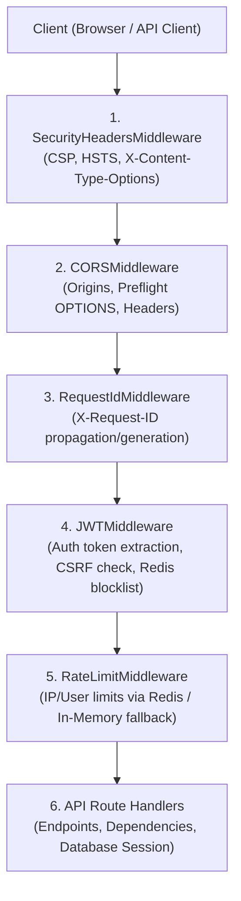
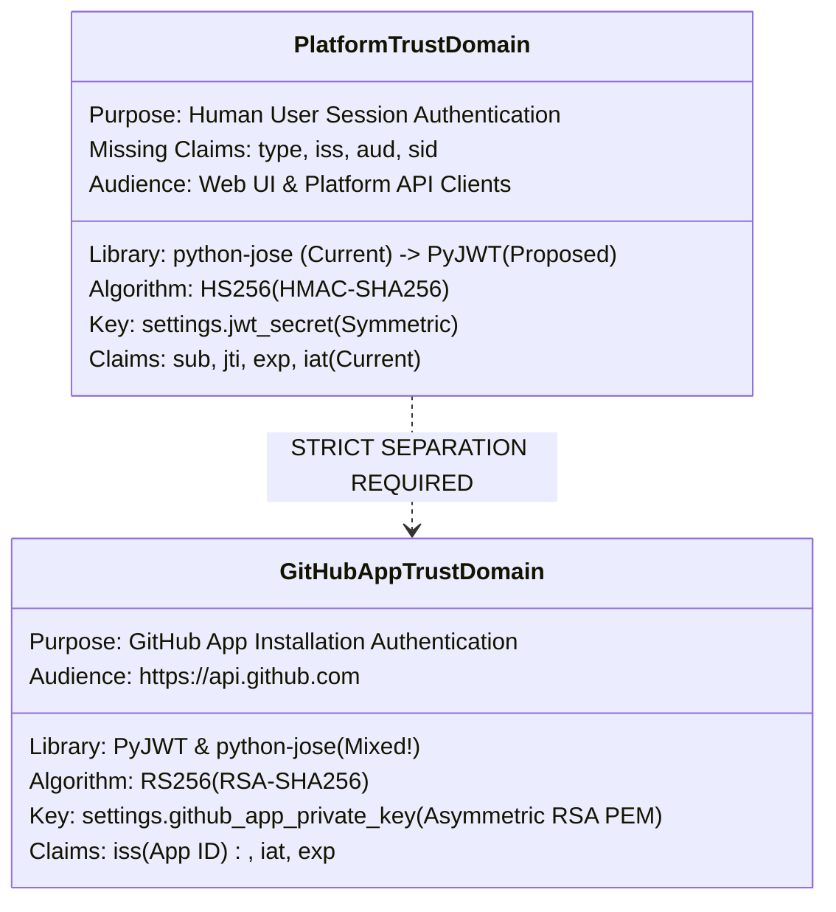
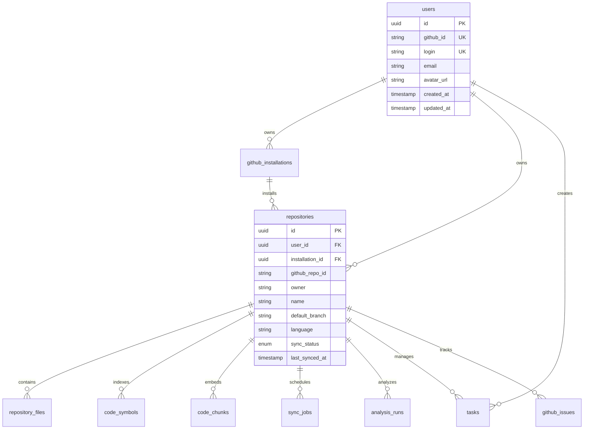

# 15. Authentication & Authorization Architecture Audit

> **Issue:** [#181](https://github.com/Meetvirugama/AI-Powered-Software-Development-Platform/issues/181) — Batch 0: Authentication and Authorization Architecture Audit  
> **Repository:** `Meetvirugama/AI-Powered-Software-Development-Platform`  
> **Target Branch:** `main` | **Working Branch:** `Dharmraj06-Issue181-Auth-Audit`  
> **Author:** Dharmraj06  
> **Date:** 2026-11-07  
> **Status:** Completed Audit & Architectural Design (Audit & Design Only — No Production Code Changes)

---

## 1. Executive Summary & Objective

This document provides a comprehensive security and architectural audit of the authentication, OAuth, JWT, session management, authorization, database schema, and frontend authentication subsystems in the AI-Powered Software Development Platform.

The objective of Issue #181 is to transition the platform from its initial single-user, cookie-only, non-persistent JWT session model to an enterprise-grade, multi-tenant, role-based authentication and authorization system. This audit establishes the baseline of existing implementations, identifies architectural and security vulnerabilities, examines library dependencies, evaluates database schema and migration constraints, maps frontend lifecycle flows, and presents an exhaustive test coverage analysis.

### Scope of Audit
1. **Backend Authentication & Session Flow:** OAuth state machine, JWT creation/verification, cookie vs. bearer token handling, Redis blocklist, and token revocation.
2. **JWT Libraries & GitHub Integration:** Analysis of `python-jose` vs. `PyJWT`, trust-domain boundary enforcement (Platform HS256 vs. GitHub App RS256), and cryptographic key configuration.
3. **Database Schema & Migrations:** Inspection of user identity, repository ownership, absence of explicit project entities, role tracking, session tracking, and migration lineage.
4. **Authorization & Tenant Isolation:** Ownership verification in API routes, absence of platform/project roles, deactivated user access windows, and platform administrator isolation boundaries.
5. **Frontend Authentication Architecture:** Axios interceptors, Zustand store, session verification, 401 handling, and missing transparent refresh mechanics.
6. **Security Vulnerability Catalog:** Prioritized gap ranking (P0 / P1 / P2).
7. **Test Suite Verification:** Coverage assessment of existing unit, integration, and security tests against Issue #181 requirements.

---

## 2. Current Architecture & Request Flow

> [!NOTE]
> This section documents the **pre-Batch-1 baseline architecture and security posture** as evaluated during the initial audit of Issue #181. Gaps identified here (e.g., `python-jose` usage, OAuth state fail-open fallback, lack of PKCE) are resolved in the Batch 1 hardening implementation (see [`Docs/engineering/17_jwt_oauth_hardening.md`](17_jwt_oauth_hardening.md)).

### 2.1 Incoming Request Pipeline & Middleware Hierarchy

The application runs on FastAPI (Starlette). Middleware is registered in [`backend/app/main.py`](../../backend/app/main.py#L58-L76). Because Starlette executes middleware in reverse order of addition (the last added middleware runs first), the actual execution sequence for every incoming HTTP request is:



#### Detailed Step-by-Step Flow:
1. **SecurityHeadersMiddleware:** Applies defensive headers (`X-Frame-Options: DENY`, `X-Content-Type-Options: nosniff`, `Content-Security-Policy`).
2. **CORSMiddleware:** Evaluates `Origin` header against `settings.cors_origins`. Preflight `OPTIONS` requests terminate here with 200/204 before entering downstream auth middleware.
3. **RequestIdMiddleware:** Establishes request tracing by reading or minting `X-Request-ID` attached to `request.state.request_id`.
4. **JWTMiddleware ([`backend/app/core/auth.py`](../../backend/app/core/auth.py#L62-L105)):**
   - Bypasses strict authentication for `PUBLIC_PATHS` (`/health`, `/docs`, `/openapi.json`, `/api/v1/events`, `/api/v1/github/webhook`, etc.) and `/api/v1/auth/github/*`. On public routes, calls `_try_populate_user_state` to opportunistically extract `user_id` if a valid token is supplied.
   - For protected routes, extracts token from `Authorization: Bearer <token>` or HTTP-only cookie (`access_token`).
   - If missing: returns immediate `401 UNAUTHORIZED`.
   - **CSRF Origin Verification:** For cookie-authenticated requests using state-changing methods (`POST`, `PUT`, `PATCH`, `DELETE`), validates that `Origin` (or in production, `Referer`) matches configured `cors_origins`. Rejects untrusted origins with `403 FORBIDDEN`.
   - **Token Signature & Claims Decoding:** Uses `decode_access_token` via `python-jose` with `settings.jwt_secret`.
   - **Revocation Check:** Checks Redis asynchronously (`_is_token_blocklisted_async`) for key `auth:blocklist:{jti}` with a 1.5-second timeout.
   - Attaches `request.state.user_id`, `request.state.token_jti`, and `request.state.token_exp`.
5. **RateLimitMiddleware ([`backend/app/core/rate_limit.py`](../../backend/app/core/rate_limit.py#L200-L288)):**
   - Reads `request.state.user_id` for per-user rules (e.g. `/tasks`, `/repositories/:id/chat`) or client IP for per-IP rules (e.g. `/auth/github/callback`).
   - Evaluates rate limits using Redis pipeline (`INCR` + `EXPIRE`).
6. **Route Handler & Dependencies:**
   - Database session injected via `Depends(get_db)`.
   - Endpoints invoke tenant isolation helpers (e.g., `_owned_repository`, `_owned_task`) to verify data ownership against `request.state.user_id`.

---

## 3. Existing Modules & Responsibilities

| Module Path | Layer | Primary Responsibility | Critical Dependencies |
|---|---|---|---|
| [`backend/app/api/v1/auth.py`](../../backend/app/api/v1/auth.py) | API | OAuth initiation (`/github/login`), callback processing (`/github/callback`), current user profile (`/me`), and logout (`/logout`). | `UserRepository`, `get_redis()`, `httpx`, `security.create_access_token` |
| [`backend/app/core/security.py`](../../backend/app/core/security.py) | Core Security | Platform JWT minting (`create_access_token`) and verification (`decode_access_token`). | `jose.jwt`, `Settings` (`jwt_secret`, `jwt_algorithm`) |
| [`backend/app/core/auth.py`](../../backend/app/core/auth.py) | Middleware | `JWTMiddleware`, token extraction (cookie & bearer), CSRF origin check, Redis JTI blocklist check. | `decode_access_token`, `get_redis()`, `Settings` |
| [`backend/app/core/config.py`](../../backend/app/core/config.py) | Configuration | Application configuration loaded via Pydantic `BaseSettings`. Includes production security validators. | Pydantic Settings, `.env` |
| [`backend/app/core/redis.py`](../../backend/app/core/redis.py) | Infrastructure | Synchronous and asynchronous Redis client factory (`get_redis()`, `get_redis_async()`). | `redis.Redis`, `redis.asyncio.Redis` |
| [`backend/app/core/rate_limit.py`](../../backend/app/core/rate_limit.py) | Middleware | Sliding-window route rate limiting backed by Redis with bounded in-memory fallback. | Redis, `get_settings()` |
| [`backend/app/api/v1/dependencies.py`](../../backend/app/api/v1/dependencies.py) | Dependency Injection | `get_request_user_id`, `get_owned_repository`, `get_owned_task`. | `RepositoryRepository`, `TaskRepository` |
| [`backend/app/repositories/user_repository.py`](../../backend/app/repositories/user_repository.py) | Data Access | User lookup by ID, GitHub ID, or login; user creation and profile upsert. | SQLAlchemy `Session`, `User` model |
| [`backend/app/models/user.py`](../../backend/app/models/user.py) | ORM Model | Maps `users` table: GitHub ID, login, email, avatar URL, timestamps. | SQLAlchemy `TimestampedModel` |
| [`backend/app/integrations/github/token_manager.py`](../../backend/app/integrations/github/token_manager.py) | Integration | GitHub App installation token generation with Redis caching and single-flight lock. | `PyJWT` (`jwt.encode`), `Redis`, `httpx` |
| [`backend/app/integrations/github/client.py`](../../backend/app/integrations/github/client.py) | Integration | GitHub REST API client; contains secondary App JWT signing method. | `jose.jwt` (duplicate!), `httpx` |
| [`frontend/src/stores/useAuthStore.ts`](../../frontend/src/stores/useAuthStore.ts) | Frontend State | Client-side Zustand store holding authenticated `user` and `isAuthenticated` boolean. | Zustand |
| [`frontend/src/services/auth.ts`](../../frontend/src/services/auth.ts) | Frontend Service | Service wrappers for `getCurrentUser()` (`/auth/me`) and `logout()` (`/auth/logout`). | `apiClient` |
| [`frontend/src/services/api.ts`](../../frontend/src/services/api.ts) | Frontend HTTP | Axios instance configured with `withCredentials: true`, timeout rules, and 401 redirect logic. | Axios |
| [`frontend/src/hooks/useAuth.ts`](../../frontend/src/hooks/useAuth.ts) | Frontend Hook | Session verification hook running `getCurrentUser()` on app mount. | `useAuthStore`, `auth.ts` |
| [`frontend/src/layouts/ProtectedRoute.tsx`](../../frontend/src/layouts/ProtectedRoute.tsx) | Frontend Routing | Route boundary redirecting unauthenticated users to `/login`. | React Router, `useAuth` |

---

## 4. JWT Trust-Domain Separation

The codebase interacts with two entirely distinct trust domains that issue and verify JWTs:



### 4.1 Detailed Trust Domain Comparison

| Dimension | Domain A: Platform User Session Tokens | Domain B: GitHub App JWT |
|---|---|---|
| **Intended Consumer** | Platform API (`JWTMiddleware`, `/api/v1/*`) | GitHub REST API (`https://api.github.com/app/*`) |
| **Signing Algorithm** | Symmetric `HS256` | Asymmetric `RS256` |
| **Key Secret Source** | `settings.jwt_secret` (minimum 32 chars in production) | `settings.github_app_private_key` (RSA private key PEM) |
| **Token Issuer (`iss`)** | Currently missing; should be `agent-platform` | `settings.github_app_id` (numeric string) |
| **Token Subject (`sub`)** | Internal `user.id` (UUID string) | None (App-level identity) |
| **Token Lifetime** | `settings.jwt_expire_minutes` (default 15 minutes) | 10 minutes (maximum permitted by GitHub API) |
| **Current Library Used** | `python-jose` ([`backend/app/core/security.py`](../../backend/app/core/security.py#L8)) | **Mixed:** `PyJWT` in [`token_manager.py`](../../backend/app/integrations/github/token_manager.py#L21) vs. `python-jose` in [`client.py`](../../backend/app/integrations/github/client.py#L475) |

### 4.2 Critical Findings & Risks
1. **Dual JWT Dependencies:** Declaring both `python-jose[cryptography]>=3.3,<4.0` and `PyJWT[crypto]>=2.8,<3.0` in [`backend/requirements.txt`](../../backend/requirements.txt#L13-L15) and [`pyproject.toml`](../../pyproject.toml#L27-L28) introduces dependency bloat and confusion. `python-jose` is effectively unmaintained and has known parsing vulnerabilities, whereas `PyJWT` is actively maintained.
2. **Library Inconsistency in Domain B:** [`backend/app/integrations/github/token_manager.py`](../../backend/app/integrations/github/token_manager.py#L165) uses `PyJWT` (`jwt.encode(payload, pem_key, algorithm="RS256")`), while [`backend/app/integrations/github/client.py`](../../backend/app/integrations/github/client.py#L475) performs an inline import:
   ```python
   from jose import jwt as jose_jwt
   app_jwt = jose_jwt.encode(payload, pem_key, algorithm="RS256")
   ```
   This duplicate, ad-hoc implementation in `client.py` bypasses the `InstallationTokenManager` cache and uses the deprecated library.
3. **Missing Token Claims in Domain A:** Platform tokens omit:
   - `type` / `token_use`: Token purpose (`access` vs `refresh`). Without this, a valid refresh token could be passed to an access endpoint if signed with the same key.
   - `iss`: Token issuer validation.
   - `aud`: Token audience verification.
   - `sid`: Database-backed session identifier.

---

## 5. OAuth State Lifecycle Audit

The GitHub OAuth 2.0 flow is implemented in [`backend/app/api/v1/auth.py`](../../backend/app/api/v1/auth.py).

### 5.1 Flow Traceability

```mermaid
sequenceDiagram
    autonumber
    actor User as Browser / User
    participant Backend as FastAPI Backend
    participant Redis as Redis Cache
    participant GitHub as GitHub OAuth Server
    participant DB as PostgreSQL DB

    User->>Backend: GET /api/v1/auth/github/login
    Backend->>Backend: Generate state = secrets.token_urlsafe(32)
    Backend->>Redis: SETEX oauth_state:{state} 600 "1" (Warning on fail!)
    Backend-->>User: 307 Redirect to GitHub + Set-Cookie: oauth_state={state}; HttpOnly
    User->>GitHub: User authorizes application
    GitHub-->>User: 302 Redirect to /api/v1/auth/github/callback?code={c}&state={s}
    User->>Backend: GET /api/v1/auth/github/callback?code={c}&state={s} (Cookie: oauth_state)
    Backend->>Backend: Compare state query param with oauth_state cookie
    Backend->>Redis: DEL oauth_state:{state} (Single-use check)
    Backend->>GitHub: POST /login/oauth/access_token (code exchange)
    GitHub-->>Backend: Return GitHub user access token
    Backend->>GitHub: GET /user (Fetch profile)
    GitHub-->>Backend: Return user profile (id, login, email)
    Backend->>DB: Upsert User record
    Backend->>Backend: Mint platform JWT access_token
    Backend-->>User: 302 Redirect to Frontend /auth/callback + Set-Cookie: access_token; HttpOnly
```

### 5.2 Vulnerability Analysis of OAuth State
- **Redis Failure Fails Open (P0):** In [`backend/app/api/v1/auth.py`](../../backend/app/api/v1/auth.py#L53-L54):
  ```python
  try:
      redis_client = get_redis()
      redis_client.setex(f"oauth_state:{state}", 600, "1")
  except Exception as exc:
      logger.warning("Could not persist oauth_state in Redis: %s", exc)
  ```
  And during callback consumption ([`backend/app/api/v1/auth.py`](../../backend/app/api/v1/auth.py#L163-L164)):
  ```python
  except Exception as exc:
      logger.warning("Could not consume oauth_state via Redis: %s", exc)
  ```
  If Redis is down or unreachable during the callback, the deletion fails, but the backend **merely logs a warning and proceeds with authentication anyway**. This completely disables single-use state validation and leaves the application susceptible to OAuth replay attacks during Redis degradation.
- **Cookie Binding without Cryptographic Signing:** The `oauth_state` cookie stores the plain state token without an HMAC signature. Although browser-bound, a state injection across subdomains is theoretically possible if cookies are shared.
- **Absence of PKCE:** While GitHub OAuth web application flow uses `client_secret`, implementing PKCE (`code_challenge` and `code_verifier`) provides critical defense-in-depth against code interception attacks.

---

## 6. Redis Security Behavior

Redis is utilized across three distinct operational surfaces:
1. **JWT Revocation Blocklist (`auth:blocklist:{jti}`):**
   - **Behavior on Failure:** **Fails Closed.**
   - In [`backend/app/core/auth.py`](../../backend/app/core/auth.py#L52-L60), if Redis times out (1.5s limit) or throws a connection error, `_is_token_blocklisted_async` raises `APIError(503, ErrorCode.SERVICE_UNAVAILABLE)`. This guarantees that if Redis is offline, revoked tokens cannot bypass authentication.
2. **OAuth State Verification (`oauth_state:{state}`):**
   - **Behavior on Failure:** **Fails Open.** (Critical flaw identified in Section 5).
3. **Rate Limiting (`ratelimit:{rule}:{identity}:{window}`):**
   - **Behavior on Failure:** **Mixed / Asymmetric.**
   - In [`backend/app/core/rate_limit.py`](../../backend/app/core/rate_limit.py#L255-L258):
     - For `AI_EXPENSIVE_RULES` (`repo_chat`, `task_plan`, `repo_review`, etc.), it falls back to a bounded in-memory store (`_fallback_ai_store`).
     - For non-AI rules—including `auth_callback` (`/api/v1/auth/github/callback`)—it executes `return await call_next(request)`. **Rate limiting fails completely open for authentication endpoints during Redis outages**, exposing login endpoints to unthrottled brute-force attacks.

---

## 7. Existing Authorization & Tenant Isolation Audit

### 7.1 Current Single-Tenant Ownership Model

The application currently enforces an isolated, 1-to-1 repository ownership model:
- Repositories belong directly to a single `user_id` ([`backend/app/models/repository.py`](../../backend/app/models/repository.py#L22)).
- Tasks belong to a `repository_id` and have an optional `user_id` ([`backend/app/models/task.py`](../../backend/app/models/task.py#L236)).
- Isolation is verified using helper functions:
  ```python
  # backend/app/api/v1/dependencies.py
  def get_owned_repository(repository_id: UUID, request: Request, db: Session, repo_cls: Any = None) -> Repository:
      user_id = get_request_user_id(request)
      repository = repo_cls(db).get_for_user(repository_id, user_id)
      if repository is None:
          raise APIError(404, ErrorCode.REPOSITORY_NOT_FOUND, "Repository does not exist or you do not have access.")
      return repository
  ```

### 7.2 Major Authorization Gaps

1. **No Project Concept:** The database contains no `projects` table. All data (repositories, tasks, code symbols, analysis runs) is isolated purely by individual repository and user. Collaborative team workflows or cross-repository projects cannot be represented.
2. **Absence of Roles in Database and Endpoints:**
   - The `User` model has **no role column**.
   - No route checks user roles or permissions.
   - Any authenticated user can perform all operations on their own repositories with zero privilege differentiation.
3. **Deactivated User Vulnerability (P0):**
   - The `users` table lacks an `is_active` flag.
   - Even if a user is deactivated or deleted in an external identity provider, `JWTMiddleware` **never queries the database**. It only validates the JWT signature and checks Redis.
   - A deactivated user's access token remains valid until expiration (up to 15 minutes by default, or up to 24 hours under permissive settings).
4. **Immediate Effect of Role / Permission Changes (P1):**
   - Because `JWTMiddleware` operates statelessly on JWT claims without DB lookups, any future role change in the database will have **no effect** until a new JWT is minted and issued to the client.
5. **Platform Administrator Boundaries:**
   - Platform administrators must not have blanket, unauthenticated bypass access to multi-tenant repository code, tasks, or intellectual property.
   - Administrative access to tenant data requires explicit scoping, just-in-time elevation, and comprehensive audit trail logging.

---

## 8. Database Schema & Migration Audit

### 8.1 Existing Schema Map



### 8.2 Migration Lineage & Test Infrastructure

The repository uses Alembic for database migrations. The migration chain in [`backend/migrations/versions/`](../../backend/migrations/versions/) is completely linear:

1. `24498ac67b3e` — `add_pgvector_extension` (Revises: None)
2. `5f6dc031921b` — `identity_schema` (Revises: `24498ac67b3e`)
3. `aef3bb17eb34` — `content_tables` (Revises: `5f6dc031921b`)
4. `cb4e2a7d0f31` — `add_sync_jobs` (Revises: `aef3bb17eb34`)
5. `e7b8c9d0f1a2` — `add_code_chunks_and_memory` (Revises: `cb4e2a7d0f31`)
6. `f1c2d3e4b5a6` — `add_analysis_runs_and_findings` (Revises: `e7b8c9d0f1a2`)
7. `b627460d74e0` — `add_pull_requests_table` (Revises: `f1c2d3e4b5a6`)
8. `b3c4d5e6f7a8` — `add_workflow_automation_tables` (Revises: `b627460d74e0`)
9. `c94e1f8a2d73` — `add_week3_task_and_issue_tables` (Revises: `b3c4d5e6f7a8`) — **Current Head**

### 8.3 Schema Requirements for Issue #181
To support Issue #181, the following entities and columns must be introduced:
- `users.role`: Platform role (`ADMIN`, `DEVELOPER`), `NOT NULL`, server default `'DEVELOPER'`.
- `users.is_active`: User status boolean, `NOT NULL`, server default `TRUE`.
- `projects`: Explicit project container model (`id`, `name`, `slug`, `description`, `owner_user_id`, timestamps).
- `project_memberships`: Join table (`id`, `project_id`, `user_id`, `role` [e.g. `OWNER`, `MAINTAINER`, `CONTRIBUTOR`, `VIEWER`], timestamps, `UniqueConstraint("project_id", "user_id")`).
- `user_sessions`: Stateful session tracking (`id`, `user_id`, `user_agent`, `ip_address`, `created_at`, `expires_at`, `revoked_at`, `is_active`).
- `refresh_tokens`: Secure refresh token persistence (`id`, `session_id`, `token_hash`, `expires_at`, `revoked_at`, `parent_token_id`).
- `security_audit_logs`: Append-only audit trail for authentication, authorization, and administrative events.

---

## 9. Frontend Authentication Lifecycle Audit

### 9.1 Current Lifecycle & Deficiencies

```mermaid
sequenceDiagram
    autonumber
    participant UI as React UI (Pages/Components)
    participant Store as Zustand (useAuthStore)
    participant Hook as useAuth() Hook
    participant Axios as Axios (apiClient)
    participant Backend as FastAPI Backend

    Note over UI,Hook: Application Mount / Route Navigation
    UI->>Hook: useAuth() initializes
    Hook->>Axios: GET /api/v1/auth/me (withCredentials: true)
    Axios->>Backend: Request with access_token cookie
    alt Token is Valid (within 15 mins)
        Backend-->>Axios: 200 OK + AuthenticatedUser
        Axios-->>Hook: User data
        Hook->>Store: setUser(user) [isAuthenticated = true]
        Hook-->>UI: Render Protected Content
    else Token Expired (> 15 mins)
        Backend-->>Axios: 401 UNAUTHORIZED
        Note over Axios: INTERCEPTOR FORCES HARD REDIRECT!
        Axios->>Axios: window.location.href = "/login?redirect=..."
        UI->>UI: Hard reload; all in-flight state lost!
    end
```

### 9.2 Key Frontend Architectural Deficiencies
1. **Disruptive 401 Hard Redirect:** In [`frontend/src/services/api.ts`](../../frontend/src/services/api.ts#L83-L93):
   ```typescript
   if (
     error.response?.status === 401 &&
     typeof window !== 'undefined' &&
     !window.location.pathname.startsWith('/login') &&
     !window.location.pathname.startsWith('/auth')
   ) {
     const currentPath = window.location.pathname + window.location.search;
     const redirectQuery = currentPath && currentPath !== '/' ? `?redirect=${encodeURIComponent(currentPath)}` : '';
     window.location.href = `/login${redirectQuery}`;
   }
   ```
   When the 15-minute access token expires, any background poll, repository chat, or studio request triggers a 401. The interceptor immediately forces a full browser redirect to `/login`, wiping out unsaved developer inputs, active terminal executions, and in-flight AI plans.
2. **Complete Absence of Silent Token Refresh:** The frontend lacks:
   - A refresh API endpoint call (`POST /api/v1/auth/refresh`).
   - A response interceptor that catches 401 responses, initiates a token refresh, and retries the original request.
3. **Missing Single-Flight Concurrency Control:** If five parallel requests trigger 401 simultaneously upon token expiry, all five would invoke `/auth/refresh` at the same time. This would violate single-use refresh token rotation and trigger false-positive security revocation.
4. **No At-Most-Once Retry Guard:** Interceptors must flag retried requests (`_retry = true`) to prevent infinite retry loops if the refresh call fails.
5. **Missing Multi-Tab Session Synchronization:** Logout or session expiration in one browser tab does not propagate to other open tabs.

---

## 10. Security Gaps Ranked by Priority (P0 / P1 / P2)

### Priority P0 — Critical Vulnerabilities (Immediate Remediation Required)

| ID | Title | Component | Impact / Threat Vector | Root Cause |
|---|---|---|---|---|
| **GAP-P0-01** | **No Refresh Token Rotation & Session Revocation** | `auth.py`, `security.py`, DB | Tokens cannot be revoked at the user session level; compromised access tokens remain active until JWT expiry. | Only single short-lived access token exists. No `refresh_tokens` or `user_sessions` tables. |
| **GAP-P0-02** | **Deactivated User Access Window** | `JWTMiddleware`, `models/user.py` | Deactivated or terminated users continue to execute authenticated actions until token expiry. | `JWTMiddleware` does not verify user active status or database record. User model lacks `is_active`. |
| **GAP-P0-03** | **OAuth State Replay on Redis Outage (Fail-Open)** | `api/v1/auth.py` | Attackers can replay consumed OAuth state parameters if Redis experiences downtime or connectivity errors. | Redis state verification catches exceptions with `logger.warning` and permits execution instead of failing closed. |
| **GAP-P0-04** | **Dual JWT Library Hazard & Inconsistent RS256 Implementation** | `requirements.txt`, `client.py` | Known parsing and cryptographic vulnerabilities in deprecated `python-jose`; inconsistent RS256 code paths. | Co-existence of `python-jose` and `PyJWT`; ad-hoc `jose` import in `client.py` instead of unified `token_manager.py`. |
| **GAP-P0-05** | **Missing Multi-Tenant Project Boundary Enforcement** | `models`, `dependencies.py` | Inability to share repositories within teams; no organization or project isolation boundaries. | Repositories belong directly to individual users; no `projects` or `project_memberships` entities exist. |

### Priority P1 — High Architectural & Security Deficiencies

| ID | Title | Component | Impact / Threat Vector | Root Cause |
|---|---|---|---|---|
| **GAP-P1-01** | **Rate Limiter Fails Open for Auth Callback** | `core/rate_limit.py` | OAuth callback endpoint can be subjected to unthrottled brute-force code attacks during Redis outages. | Non-AI rate limit rules pass through to `call_next` on Redis failure instead of applying in-memory fallback. |
| **GAP-P1-02** | **Incomplete JWT Claims Validation** | `core/security.py`, `core/auth.py` | Tokens lack audience, issuer, and token type binding; potential cross-context token substitution. | Platform JWT payload only encodes `sub`, `jti`, `exp`, and `iat`. |
| **GAP-P1-03** | **Missing Composable RBAC Dependencies** | `api/v1/dependencies.py` | Endpoints rely on ad-hoc ownership checks; cannot support platform roles or project-level permissions. | Lack of reusable dependencies for active user, platform role, project membership, and role checks. |
| **GAP-P1-04** | **Frontend Hard 401 Redirect & State Loss** | `frontend/api.ts` | Disrupted developer workflows and state loss every 15 minutes due to abrupt unhandled token expiration. | Axios interceptor forces `window.location.href = /login` on any 401 without attempting transparent token refresh. |
| **GAP-P1-05** | **Platform Admin Tenant Boundary Ambiguity** | `dependencies.py` | Risk of accidental unauthorized admin inspection of private tenant repository source code and tasks. | Undefined tenant isolation bypass policy for administrative platform roles. |

### Priority P2 — Medium Hardening & Operational Gaps

| ID | Title | Component | Impact / Threat Vector | Root Cause |
|---|---|---|---|---|
| **GAP-P2-01** | **Absence of Security Audit Logging** | Database, API | Inability to reconstruct forensic timelines for authentication failures, role escalations, or token reuse. | No `security_audit_logs` table or event dispatcher implemented. |
| **GAP-P2-02** | **Unthrottled OAuth Login Endpoint** | `core/rate_limit.py` | `/auth/github/login` is not covered by rate limiting rules; potential state exhaustion attack. | Rate limit rule regexes only cover `/auth/github/callback`. |
| **GAP-P2-03** | **Cross-Tab Session Desynchronization** | Frontend Store | Logging out in one tab leaves stale authenticated UI state in other open tabs. | No `BroadcastChannel` or `storage` event synchronization configured in `useAuthStore`. |
| **GAP-P2-04** | **OAuth PKCE Omission** | `api/v1/auth.py` | Lack of cryptographic authorization code binding against intermediate interception. | Relies solely on state parameter and server-side client secret without PKCE verification. |

---

## 11. Test Coverage Matrix & Gap Analysis

An exhaustive review of the existing test suites was conducted across [`backend/tests/`](../../backend/tests/) and [`frontend/src/test/`](../../frontend/src/test/).

### 11.1 Test Coverage Matrix

| Requirement / Scenario | Existing Test File(s) | Current Coverage Status | Notes & Identified Deficiencies |
|---|---|---|---|
| **Unauthenticated Request -> 401** | [`backend/tests/test_auth.py`](../../backend/tests/test_auth.py#L12), [`test_auth_and_repositories_api.py`](../../backend/tests/test_auth_and_repositories_api.py#L43) | **Covered** | Verified across multiple protected endpoints. |
| **Invalid JWT Token -> 401** | [`backend/tests/test_auth.py`](../../backend/tests/test_auth.py#L53) | **Covered** | Malformed and tampered tokens rejected. |
| **Revoked Token (Redis JTI) -> 401** | [`backend/tests/test_auth.py`](../../backend/tests/test_auth.py#L67), [`test_auth_and_repositories_api.py`](../../backend/tests/test_auth_and_repositories_api.py#L125) | **Covered** | Redis blocklist JTI lookup verified. |
| **Redis Outage During Token Check -> 503** | [`backend/tests/test_auth.py`](../../backend/tests/test_auth.py#L89) | **Covered** | Confirms fail-closed behavior for token blocklist. |
| **OAuth CSRF State Generation** | [`backend/tests/test_auth_and_repositories_api.py`](../../backend/tests/test_auth_and_repositories_api.py#L53) | **Covered** | Verifies redirect header and `oauth_state` cookie. |
| **OAuth State Cookie & Redis Binding** | [`backend/tests/test_auth_and_repositories_api.py`](../../backend/tests/test_auth_and_repositories_api.py#L73) | **Covered** | Verifies cookie match and Redis single-use deletion. |
| **OAuth State Fail-Closed on Redis Outage** | *None* | **Missing** | Existing code fails open; no test asserts fail-closed behavior. |
| **CSRF Origin Validation (Cookie Auth)** | [`backend/tests/test_day6_integration_and_security.py`](../../backend/tests/test_day6_integration_and_security.py) | **Covered** | Verifies rejection of untrusted cross-origin POST requests. |
| **Token Refresh Endpoint (`/auth/refresh`)** | *None* | **Missing** | Endpoint not yet implemented. |
| **Refresh Token Rotation (Single-Use)** | *None* | **Missing** | Refresh token persistence not yet implemented. |
| **Refresh Token Theft Detection & Invalidation** | *None* | **Missing** | Token family invalidation logic not yet implemented. |
| **Deactivated User Token Rejection** | *None* | **Missing** | `is_active` flag not yet checked in auth dependency. |
| **Platform Role Authorization (`ADMIN` / `DEV`)** | *None* | **Missing** | Platform roles not yet modeled or enforced. |
| **Project Boundary & Membership Enforcement** | *None* | **Missing** | Projects and memberships not yet modeled. |
| **Platform Admin Tenant Isolation Protection** | *None* | **Missing** | Admin isolation rules not yet implemented. |
| **Frontend Transparent Refresh Interceptor** | *None* | **Missing** | Axios interceptor currently forces hard redirect to `/login`. |
| **Frontend Single-Flight Refresh Concurrency** | *None* | **Missing** | No mutex or queue tested in frontend. |
| **Frontend Cross-Tab Session Sync** | *None* | **Missing** | Multi-tab session synchronization not tested. |
| **Migration Up/Down Consistency** | *None* | **Missing** | No automated migration rollback test exists in backend test suite. |

---

## 12. Audit Conclusions & Strategic Recommendations

1. **Retain Dual Trust-Domain Security Model:** The strict isolation between platform user sessions (symmetric key) and GitHub App operations (asymmetric key) is sound and must be maintained.
2. **Standardize on `PyJWT`:** Eliminate `python-jose` entirely. Migrate platform token generation and decoding to `PyJWT[crypto]`, removing duplicate implementations in `client.py` and unifying on a single, actively maintained library.
3. **Transition to Stateful Sessions with Rotating Refresh Tokens:** Implement `user_sessions` and `refresh_tokens` in PostgreSQL with Redis-backed hot caching. This enables instant session revocation, multi-device tracking, and secure token rotation.
4. **Implement Real-Time Deactivation & Role Checks:** Create composable FastAPI dependencies that verify user active status and roles directly against cached session state or PostgreSQL, closing the deactivated user security window.
5. **Elevate Single-Tenant Repositories to Multi-Tenant Projects:** Introduce a formal `projects` model and `project_memberships` table, migrating existing single-user repository ownership into default personal projects without downtime or data loss.
6. **Upgrade Frontend Axios Architecture:** Replace the crude 401 hard redirect with a transparent, single-flight refresh queue that preserves active developer workspace state.
