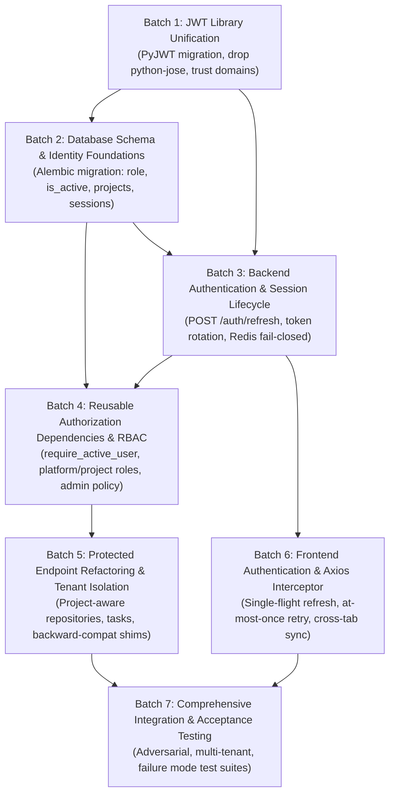
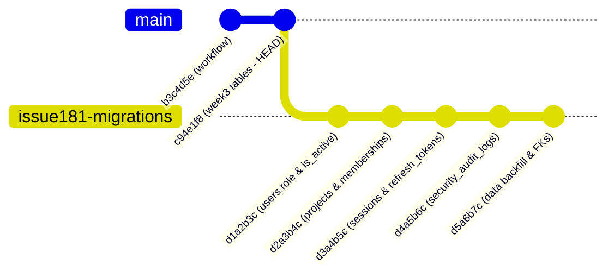

# 16. Issue #181 Implementation Plan: Authentication & Authorization Architecture

> **Issue:** [#181](https://github.com/Meetvirugama/AI-Powered-Software-Development-Platform/issues/181) — Comprehensive Authentication & Authorization Redesign  
> **Repository:** `Meetvirugama/AI-Powered-Software-Development-Platform`  
> **Target Branch:** `main` | **Working Branch:** `Dharmraj06-Issue181-Auth-Audit`  
> **Author:** Dharmraj06  
> **Date:** 2026-11-07  
> **Status:** Implementation Plan & Specification (Audit & Design Only — Implementation Staged for Subsequent Batches)

---

## 1. Overview & Strategy

This document establishes the step-by-step, verifiable implementation plan to resolve **Issue #181**. The plan transitions the platform from a single-user, cookie-only, non-persistent JWT session model to a robust multi-tenant architecture featuring:

1. **Unification on `PyJWT`:** Deprecation and elimination of `python-jose`, enforcing strict dual trust-domain separation.
2. **Stateful Session & Refresh Token Lifecycle:** Persistent `user_sessions` and `refresh_tokens` tables with automatic single-use rotation, token family tracking, and reuse detection.
3. **Database-Backed Identity & RBAC:** Schema migrations introducing `users.role`, `users.is_active`, `projects`, and `project_memberships`, backed by composable FastAPI authorization dependencies.
4. **Resilient Redis Security:** Fail-closed state validation for OAuth and in-memory rate limiting fallback for authentication endpoints.
5. **Non-Disruptive Frontend Refresh Interceptor:** Transparent single-flight token refresh, at-most-once retry policy, and cross-tab session synchronization.
6. **Zero Downtime & Backward Compatibility:** Non-breaking migration paths for existing users and repositories with preserved API contracts.

---

## 2. Batch-by-Batch Implementation Sequence

The work is organized into **7 distinct, independently verifiable batches**. Each batch has strict preconditions, atomic boundaries, and dedicated test verification gates.



---

## 3. Detailed Batch Specifications

### Batch 1: JWT Library Unification and Trust Domain Hardening

#### Objective
Eliminate `python-jose` across the entire codebase. Standardize all platform token operations and GitHub App JWT operations on `PyJWT[crypto]>=2.8,<3.0`. Retain strict isolation between the two cryptographic trust domains.

#### Exact Files to Change
- `backend/requirements.txt`: Remove `python-jose[cryptography]>=3.3,<4.0`. Retain `PyJWT[crypto]>=2.8,<3.0`.
- `pyproject.toml`: Remove `python-jose` from dependencies list.
- `backend/app/core/security.py`:
  - Replace `from jose import JWTError, jwt` with `import jwt` and `from jwt.exceptions import PyJWTError, ExpiredSignatureError, InvalidTokenError`.
  - Update `create_access_token` to include standard claims:
    - `iss`: `"agent-platform"`
    - `aud`: `"agent-platform-web"`
    - `type`: `"access"`
    - `sub`: `str(user_id)`
    - `jti`: `str(uuid4())`
    - `iat`: current UTC timestamp
    - `exp`: expiration UTC timestamp
  - Update `decode_access_token` to enforce:
    - `algorithms=[settings.jwt_algorithm]`
    - `issuer="agent-platform"`
    - `audience="agent-platform-web"`
    - Claim validation for `type == "access"`, `sub`, and `jti`.
- `backend/app/integrations/github/client.py`:
  - Remove inline `from jose import jwt as jose_jwt`.
  - Refactor App JWT generation to delegate directly to `InstallationTokenManager` or use `jwt.encode` with `algorithm="RS256"`.
- `backend/app/integrations/github/token_manager.py`:
  - Audit and ensure `PyJWT` handles PEM key sanitization and RS256 signing consistently.
- `backend/tests/test_auth.py` and `backend/tests/test_auth_and_repositories_api.py`:
  - Update test mocks to reflect `PyJWTError` handling instead of `jose.JWTError`.

#### Verification Gate
- `pytest backend/tests/test_auth.py backend/tests/test_auth_and_repositories_api.py` passes 100%.
- Search repository for `jose` returns zero references in production code.

---

### Batch 2: Database Schema & Identity Foundations (Alembic Migration)

#### Objective
Introduce database tables and columns necessary for multi-tenancy, RBAC, stateful sessions, and security audit logging. Provide a zero-downtime, fully reversible migration that backfills existing data safely.

#### Exact Files to Change
- `backend/app/models/user.py`:
  - Add `role`: `Mapped[UserRole] = mapped_column(Enum(UserRole), default=UserRole.DEVELOPER, nullable=False)`.
  - Add `is_active`: `Mapped[bool] = mapped_column(Boolean, default=True, nullable=False)`.
  - Add relationships to `user_sessions` and `project_memberships`.
- `backend/app/models/project.py` *(New File)*:
  - Define `Project` model inheriting `TimestampedModel, Base`:
    - `id`: UUID PK
    - `name`: String, non-nullable
    - `slug`: String, unique index, non-nullable
    - `description`: String, nullable
    - `owner_user_id`: UUID FK -> `users.id`
- `backend/app/models/project_membership.py` *(New File)*:
  - Define `ProjectMembership` model inheriting `TimestampedModel, Base`:
    - `id`: UUID PK
    - `project_id`: UUID FK -> `projects.id`, ondelete="CASCADE", indexed
    - `user_id`: UUID FK -> `users.id`, ondelete="CASCADE", indexed
    - `role`: Enum (`OWNER`, `MAINTAINER`, `CONTRIBUTOR`, `VIEWER`), non-nullable
    - `UniqueConstraint("project_id", "user_id")`
- `backend/app/models/session.py` *(New File)*:
  - Define `UserSession` model:
    - `id`: UUID PK
    - `user_id`: UUID FK -> `users.id`, ondelete="CASCADE", indexed
    - `user_agent`: String, nullable
    - `ip_address`: String, nullable
    - `is_active`: Boolean, default=True, indexed
    - `expires_at`: DateTime(timezone=True), indexed
    - `revoked_at`: DateTime(timezone=True), nullable
  - Define `RefreshToken` model:
    - `id`: UUID PK
    - `session_id`: UUID FK -> `user_sessions.id`, ondelete="CASCADE", indexed
    - `token_hash`: String(64) (SHA-256 hash of refresh token), unique index
    - `expires_at`: DateTime(timezone=True), indexed
    - `revoked_at`: DateTime(timezone=True), nullable
    - `parent_token_id`: UUID FK -> `refresh_tokens.id`, nullable (family lineage)
- `backend/app/models/audit_log.py` *(New File)*:
  - Define `SecurityAuditLog` model:
    - `id`: UUID PK
    - `user_id`: UUID FK -> `users.id`, nullable (system/unauth events), indexed
    - `event_type`: String(64), indexed
    - `action`: String(64)
    - `resource_type`: String(64), nullable
    - `resource_id`: String(64), nullable
    - `ip_address`: String(45), nullable
    - `user_agent`: String, nullable
    - `details`: JSON, default={}
    - `created_at`: DateTime(timezone=True), server_default=now(), indexed
- `backend/app/models/repository.py`:
  - Add `project_id: Mapped[uuid.UUID | None] = mapped_column(ForeignKey("projects.id", ondelete="SET NULL"), index=True, nullable=True)`.
- `backend/app/models/__init__.py`: Export all new models.
- `backend/migrations/versions/<new_id>_auth_rbac_and_session_schema.py` *(New Alembic Migration)*:
  - Down revision: `c94e1f8a2d73` (Current Head).
  - Creates tables: `projects`, `project_memberships`, `user_sessions`, `refresh_tokens`, `security_audit_logs`.
  - Alters table `users`: adds `role` with default `'DEVELOPER'` and `is_active` with default `TRUE`.
  - Alters table `repositories`: adds `project_id` foreign key.
  - **Data Backfill Logic in Upgrade:**
    - For each existing user in `users`, automatically create a default personal Project:
      `name = f"{user.login}'s Workspace"`, `slug = f"{user.login}-workspace"`, `owner_user_id = user.id`.
    - Create a `project_memberships` record granting the user `OWNER` role on their personal project.
    - Update all existing `repositories` owned by `user_id` to link `repositories.project_id = personal_project.id`.
- `backend/app/repositories/user_repository.py`: Update CRUD methods to read/write `role` and `is_active`.
- `backend/app/repositories/project_repository.py` *(New File)*: Repository class for `Project` and `ProjectMembership`.
- `backend/app/repositories/session_repository.py` *(New File)*: Repository class for `UserSession` and `RefreshToken`.

#### Verification Gate
- `alembic upgrade head` succeeds cleanly against PostgreSQL.
- Existing user records are verified to have `role = 'DEVELOPER'` and `is_active = True`.
- Existing repositories have valid `project_id` values pointing to user personal projects.
- `alembic downgrade -1` runs cleanly without orphan data lockups.

---

### Batch 3: Backend Authentication & Session Lifecycle

#### Objective
Implement stateful session management, rotating refresh tokens with reuse detection, atomic single-use token consumption, fail-closed Redis OAuth state handling, and endpoint rate limiting for authentication routes.

#### Exact Files to Change
- `backend/app/core/security.py`:
  - Add `create_refresh_token(user_id: UUID, session_id: UUID) -> tuple[str, str, int]`:
    - Returns `(raw_token, token_hash, expires_in)`.
    - Generates 64-character cryptographically secure token (`secrets.token_urlsafe(48)`).
    - Computes `hashlib.sha256(raw_token.encode()).hexdigest()`.
  - Add `verify_refresh_token_hash(raw_token: str, stored_hash: str) -> bool`:
    - Uses `secrets.compare_digest`.
- `backend/app/api/v1/auth.py`:
  - **Update `github_login`:**
    - Store OAuth state in Redis with fail-closed check: if Redis write fails, return `503 SERVICE_UNAVAILABLE` instead of falling open.
  - **Update `github_callback`:**
    - Atomically consume Redis state: if Redis delete fails or returns 0, reject immediately with `400 OAUTH_STATE_INVALID`.
    - Verify `user.is_active is True`: if deactivated, raise `403 FORBIDDEN` (`ErrorCode.ACCOUNT_DEACTIVATED`).
    - Create `UserSession` in PostgreSQL (with client IP, User-Agent, expiry = 30 days).
    - Mint `RefreshToken` and link to session.
    - Mint `access_token` JWT containing `sid` (session_id claim).
    - Set `refresh_token` in HTTP-only cookie (`name="refresh_token"`, `max_age=30 days`, `path="/api/v1/auth"`, `secure=True`, `samesite="lax"`).
    - Set `access_token` in HTTP-only cookie (`name="access_token"`, `max_age=15 mins`, `path="/"`, `secure=True`, `samesite="lax"`).
  - **Add `POST /api/v1/auth/refresh`:**
    - Reads `refresh_token` cookie (or bearer refresh header).
    - Hashes token and looks up `RefreshToken` record in DB.
    - **Replay / Theft Detection:** If token record was already `revoked_at is not None`:
      - **CRITICAL SECURITY EVENT:** Immediate token family invalidation. Revoke entire `UserSession` and all associated refresh tokens.
      - Log security audit alert (`TOKEN_ROTATION_REUSE_DETECTED`).
      - Delete cookies and return `401 UNAUTHORIZED` (`ErrorCode.TOKEN_REVOKED`).
    - Validate `expires_at > now()`.
    - Validate `session.is_active is True` and `user.is_active is True`.
    - **Atomic Rotation:**
      - Mark current token `revoked_at = now()`.
      - Mint new `RefreshToken` with `parent_token_id = current_token.id`.
      - Mint fresh `access_token` JWT.
      - Update cookies.
      - Return `200 OK` with token lifetime and user profile.
  - **Update `POST /api/v1/auth/logout`:**
    - Marks active `UserSession` as `is_active = False` and `revoked_at = now()`.
    - Marks all active refresh tokens for session as revoked.
    - Adds access token `jti` to Redis blocklist.
    - Deletes both `access_token` and `refresh_token` cookies.
- `backend/app/core/rate_limit.py`:
  - Add rate limiting rule for `/api/v1/auth/github/login` (20 req/min per IP).
  - Add rate limiting rule for `/api/v1/auth/refresh` (30 req/min per IP).
  - Update `RateLimitMiddleware` to apply in-memory fallback store (`_fallback_ai_store`) to authentication routes if Redis is down, preventing fail-open bypass.
- `backend/app/schemas/auth.py`:
  - Update `AuthenticatedUser` schema to include:
    ```python
    role: str = "DEVELOPER"
    is_active: bool = True
    ```
  - Add `RefreshResponse` schema.

#### Verification Gate
- Automated tests verify:
  - Token refresh produces a new access token and rotating refresh token.
  - Replaying an already-used refresh token immediately invalidates the entire session.
  - Logout revokes both the session in DB and the JTI in Redis.
  - OAuth fails closed when Redis is unavailable.

---

### Batch 4: Reusable Authorization Dependencies & RBAC Architecture

#### Objective
Build reusable, composable FastAPI dependencies that enforce active user status, platform role authorization, project membership, project roles, and granular permissions. Define platform administrator tenant boundaries.

#### Exact Files to Change
- `backend/app/core/permissions.py` *(New File)*:
  - Define `PlatformRole` enum (`ADMIN`, `DEVELOPER`).
  - Define `ProjectRole` enum (`OWNER`, `MAINTAINER`, `CONTRIBUTOR`, `VIEWER`).
  - Define `Permission` enum:
    - `PROJECT_READ`, `PROJECT_WRITE`, `PROJECT_DELETE`
    - `REPO_CONNECT`, `REPO_SYNC`, `REPO_DELETE`
    - `CODE_ANALYZE`, `CHAT_EXECUTE`
    - `TASK_CREATE`, `TASK_APPROVE`, `TASK_EXECUTE`, `TASK_PUBLISH`
    - `MEMBER_MANAGE`, `ROLE_ASSIGN`
  - Map `ProjectRole` hierarchy to granted `Permission` sets.
- `backend/app/api/v1/dependencies.py`:
  - Implement core dependencies:
    - `get_current_active_user(request: Request, db: Session = Depends(get_db)) -> User`:
      - Resolves `user_id` from `request.state.user_id`.
      - Loads user from DB (or Redis hot cache).
      - Checks `user.is_active is True`. If deactivated: raises `403 FORBIDDEN` (`ErrorCode.ACCOUNT_DEACTIVATED`).
      - Returns `User` model instance.
    - `require_platform_role(required_role: PlatformRole)`:
      - Returns dependency callable verifying `user.role == required_role`.
      - If unauthorized: raises `403 FORBIDDEN` (`ErrorCode.FORBIDDEN_ROLE`).
    - `require_project_membership(project_id: UUID, user: User, db: Session) -> ProjectMembership`:
      - Queries `project_memberships` for `(project_id, user.id)`.
      - If missing: raises `404 NOT_FOUND` (`ErrorCode.PROJECT_NOT_FOUND`) to prevent project enumeration.
    - `require_project_permission(permission: Permission)`:
      - Resolves membership role and evaluates permission matrix.
    - **Platform Administrator Tenant Isolation Policy:**
      - Administrators do NOT automatically bypass project membership.
      - An administrator accessing tenant data without explicit project membership requires:
        1. An explicit query parameter or header `X-Admin-Tenant-Override: true`.
        2. Immediate recording of a `SecurityAuditLog` entry documenting the override justification.
        3. Read-only access by default unless two-party approval or emergency write escalation is configured.
  - Maintain legacy shims:
    - `get_request_user_id` (delegates to `user.id`).
    - `get_owned_repository` (wraps project/membership repository lookup).
    - `get_owned_task` (wraps project/membership task lookup).

#### Verification Gate
- Unit tests verify active user checks, role gates, permission matrices, and admin isolation rules.
- Deactivated user with valid unexpired JWT receives `403 ACCOUNT_DEACTIVATED`.

---

### Batch 5: Protected Endpoint Refactoring & Tenant Isolation

#### Objective
Refactor existing repository, task, analysis, chat, and issue endpoints to use the new RBAC dependencies. Add dedicated project management endpoints. Ensure complete backward compatibility.

#### Exact Files to Change
- `backend/app/api/v1/projects.py` *(New File)*:
  - `POST /api/v1/projects`: Create project.
  - `GET /api/v1/projects`: List projects where user is member.
  - `GET /api/v1/projects/{project_id}`: Get project details.
  - `POST /api/v1/projects/{project_id}/members`: Invite/add member (requires `MEMBER_MANAGE`).
  - `PATCH /api/v1/projects/{project_id}/members/{user_id}`: Update member role.
  - `DELETE /api/v1/projects/{project_id}/members/{user_id}`: Remove member.
- `backend/app/api/v1/repositories.py`:
  - Update `list_repositories`: list repositories across all projects where user has `PROJECT_READ`.
  - Update `get_repository`, `sync_repository`, `delete_repository`: check project permission instead of raw `user_id`.
  - Maintain backward compatibility: if repository was created under single-user ownership, personal project membership satisfies permission check.
- `backend/app/api/v1/tasks.py`:
  - Protect plan approval (`approve_task_plan`), publication (`authorize-publication`), and execution endpoints with `TASK_APPROVE` and `TASK_EXECUTE` permissions.
- `backend/app/api/v1/chat.py`, `analysis/*.py`, `issues.py`:
  - Replace raw `_request_user_id` calls with `get_current_active_user`.
- `backend/app/api/v1/router.py`:
  - Register `projects.router`.

#### Verification Gate
- All existing repository and task tests pass without modification.
- Cross-user collaboration verified: User A invites User B to Project P; User B can view and chat with repositories in Project P.
- User C (outside Project P) receives `404 NOT_FOUND` when attempting to access Project P repositories.

---

### Batch 6: Frontend Authentication & Axios Interceptor Refactor

#### Objective
Upgrade the frontend authentication architecture to support seamless background token refresh via Axios interceptors, single-flight concurrency lock, at-most-once retry policy, and cross-tab logout synchronization.

#### Exact Files to Change
- `frontend/src/types/api.ts`:
  - Update `User` interface:
    ```typescript
    export interface User {
      id: string;
      login: string;
      name: string | null;
      email: string | null;
      avatar_url: string | null;
      role: 'ADMIN' | 'DEVELOPER';
      is_active: boolean;
    }
    ```
- `frontend/src/services/auth.ts`:
  - Add `refreshSession()` function:
    ```typescript
    export async function refreshSession(): Promise<User> {
      const response = await apiClient.post<User>('/auth/refresh');
      return response.data;
    }
    ```
- `frontend/src/services/api.ts`:
  - Implement single-flight refresh queue and mutex:
    ```typescript
    let isRefreshing = false;
    let refreshPromise: Promise<User> | null = null;
    let failedQueue: Array<{
      resolve: (value?: unknown) => void;
      reject: (reason?: unknown) => void;
    }> = [];

    const processQueue = (error: unknown) => {
      failedQueue.forEach((promise) => {
        if (error) promise.reject(error);
        else promise.resolve();
      });
      failedQueue = [];
    };
    ```
  - **Refactor Response Interceptor:**
    - Intercept `401 UNAUTHORIZED`.
    - If `error.config.url` is `/auth/refresh` or `/auth/logout`:
      - Refresh failed or logout executed; clear store and redirect to `/login`.
    - Check `error.config._retry`:
      - If already `true`: reject immediately (at-most-once retry guard).
    - Mark `error.config._retry = true`.
    - If `isRefreshing`:
      - Push request into `failedQueue` and await resolution.
    - If not `isRefreshing`:
      - Set `isRefreshing = true`.
      - Call `refreshSession()`.
      - On success: update Zustand store with fresh user data, resolve `failedQueue`, retry original request with `apiClient(error.config)`.
      - On error: reject `failedQueue`, clear Zustand auth store, redirect to `/login`.
      - Finally: `isRefreshing = false`, `refreshPromise = null`.
- `frontend/src/stores/useAuthStore.ts`:
  - Add `BroadcastChannel('auth_channel')` listener:
    - Listens for `'LOGOUT'` event -> calls `clearUser()`.
    - Listens for `'LOGIN'` event -> updates session.
    - On local `clearUser()`, broadcasts `'LOGOUT'` to notify all other tabs.

#### Verification Gate
- Vitest unit tests verify:
  - 401 triggers `/auth/refresh` transparently.
  - Multiple concurrent 401s generate exactly one `/auth/refresh` call.
  - Retried requests execute cleanly with original method and payload.
  - Refresh failure redirects cleanly to `/login` without looping.
  - Logging out in Tab 1 clears state in Tab 2 via `BroadcastChannel`.

---

### Batch 7: Comprehensive Integration, Security Verification & Acceptance Testing

#### Objective
Execute comprehensive end-to-end integration tests, security stress tests, and adversarial test scenarios verifying all Issue #181 requirements.

#### Files to Create
- `backend/tests/test_auth_refresh.py` *(New Test File)*:
  - Token refresh contract tests.
  - Refresh token expiration.
  - Stolen refresh token replay detection and session revocation.
- `backend/tests/test_rbac_and_tenant_isolation.py` *(New Test File)*:
  - Multi-tenant boundary tests across projects, repositories, and tasks.
  - Platform role permissions (`ADMIN` vs `DEVELOPER`).
  - Project role permissions (`OWNER`, `MAINTAINER`, `CONTRIBUTOR`, `VIEWER`).
  - Deactivated user immediate rejection test.
  - Platform administrator isolation audit trail test.
- `backend/tests/test_redis_fail_closed.py` *(New Test File)*:
  - Redis outage during OAuth callback asserting `503 SERVICE_UNAVAILABLE`.
  - Redis outage during rate limit checks asserting in-memory fallback.
- `frontend/src/test/tokenRefreshInterceptor.test.ts` *(New Frontend Test File)*:
  - MSW mocks simulating expired access tokens.
  - Verifies transparent request retry.
  - Concurrency test asserting single `/auth/refresh` invocation for multiple parallel requests.

#### Verification Gate
- Entire test suite (`pytest` and `vitest run`) passes with 0 failures and 0 warnings.
- Test coverage matrix achieves 100% "Covered" status across all Issue #181 requirements.

---

## 4. Database Migration & Rollback Strategy

### 4.1 Proposed Migration Sequence



To ensure maintainability and atomic rollback, the changes can be authored either as a single consolidated migration or sequential revisions. The recommended approach is **a single atomic migration** (`d1a2b3c4d5e6_auth_rbac_and_session_schema.py`) that executes in a single transaction block:

```sql
-- 1. Enum Types
CREATE TYPE userrole AS ENUM ('ADMIN', 'DEVELOPER');
CREATE TYPE projectrole AS ENUM ('OWNER', 'MAINTAINER', 'CONTRIBUTOR', 'VIEWER');

-- 2. Alter Users
ALTER TABLE users ADD COLUMN role userrole NOT NULL DEFAULT 'DEVELOPER';
ALTER TABLE users ADD COLUMN is_active BOOLEAN NOT NULL DEFAULT TRUE;
CREATE INDEX ix_users_role ON users (role);
CREATE INDEX ix_users_is_active ON users (is_active);

-- 3. Projects Table
CREATE TABLE projects (
    id UUID PRIMARY KEY,
    name VARCHAR NOT NULL,
    slug VARCHAR NOT NULL UNIQUE,
    description TEXT,
    owner_user_id UUID NOT NULL REFERENCES users(id) ON DELETE RESTRICT,
    created_at TIMESTAMPTZ NOT NULL DEFAULT now(),
    updated_at TIMESTAMPTZ NOT NULL DEFAULT now()
);
CREATE INDEX ix_projects_slug ON projects (slug);
CREATE INDEX ix_projects_owner ON projects (owner_user_id);

-- 4. Project Memberships
CREATE TABLE project_memberships (
    id UUID PRIMARY KEY,
    project_id UUID NOT NULL REFERENCES projects(id) ON DELETE CASCADE,
    user_id UUID NOT NULL REFERENCES users(id) ON DELETE CASCADE,
    role projectrole NOT NULL DEFAULT 'CONTRIBUTOR',
    created_at TIMESTAMPTZ NOT NULL DEFAULT now(),
    updated_at TIMESTAMPTZ NOT NULL DEFAULT now(),
    CONSTRAINT uq_project_user UNIQUE (project_id, user_id)
);
CREATE INDEX ix_project_memberships_user ON project_memberships (user_id);

-- 5. Sessions & Refresh Tokens
CREATE TABLE user_sessions (
    id UUID PRIMARY KEY,
    user_id UUID NOT NULL REFERENCES users(id) ON DELETE CASCADE,
    user_agent VARCHAR,
    ip_address VARCHAR(45),
    is_active BOOLEAN NOT NULL DEFAULT TRUE,
    expires_at TIMESTAMPTZ NOT NULL,
    revoked_at TIMESTAMPTZ,
    created_at TIMESTAMPTZ NOT NULL DEFAULT now(),
    updated_at TIMESTAMPTZ NOT NULL DEFAULT now()
);
CREATE INDEX ix_user_sessions_lookup ON user_sessions (user_id, is_active);

CREATE TABLE refresh_tokens (
    id UUID PRIMARY KEY,
    session_id UUID NOT NULL REFERENCES user_sessions(id) ON DELETE CASCADE,
    token_hash VARCHAR(64) NOT NULL UNIQUE,
    expires_at TIMESTAMPTZ NOT NULL,
    revoked_at TIMESTAMPTZ,
    parent_token_id UUID REFERENCES refresh_tokens(id) ON DELETE SET NULL,
    created_at TIMESTAMPTZ NOT NULL DEFAULT now(),
    updated_at TIMESTAMPTZ NOT NULL DEFAULT now()
);
CREATE INDEX ix_refresh_tokens_hash ON refresh_tokens (token_hash);

-- 6. Security Audit Logs
CREATE TABLE security_audit_logs (
    id UUID PRIMARY KEY,
    user_id UUID REFERENCES users(id) ON DELETE SET NULL,
    event_type VARCHAR(64) NOT NULL,
    action VARCHAR(64) NOT NULL,
    resource_type VARCHAR(64),
    resource_id VARCHAR(64),
    ip_address VARCHAR(45),
    user_agent VARCHAR,
    details JSONB NOT NULL DEFAULT '{}'::jsonb,
    created_at TIMESTAMPTZ NOT NULL DEFAULT now()
);
CREATE INDEX ix_security_audit_logs_lookup ON security_audit_logs (user_id, event_type, created_at);

-- 7. Add Project Link to Repositories
ALTER TABLE repositories ADD COLUMN project_id UUID REFERENCES projects(id) ON DELETE SET NULL;
CREATE INDEX ix_repositories_project_id ON repositories (project_id);

-- 8. Data Migration & Backfill (Executed within same transaction)
INSERT INTO projects (id, name, slug, description, owner_user_id, created_at, updated_at)
SELECT gen_random_uuid(), login || '''s Workspace', login || '-workspace', 'Default workspace', id, now(), now()
FROM users;

INSERT INTO project_memberships (id, project_id, user_id, role, created_at, updated_at)
SELECT gen_random_uuid(), p.id, p.owner_user_id, 'OWNER'::projectrole, now(), now()
FROM projects p;

UPDATE repositories r
SET project_id = p.id
FROM projects p
WHERE p.owner_user_id = r.user_id AND r.project_id IS NULL;
```

### 4.2 Downgrade Feasibility & Safety
The downgrade procedure is fully scripted:
```python
def downgrade() -> None:
    op.drop_index('ix_repositories_project_id', table_name='repositories')
    op.drop_column('repositories', 'project_id')
    op.drop_table('security_audit_logs')
    op.drop_table('refresh_tokens')
    op.drop_table('user_sessions')
    op.drop_table('project_memberships')
    op.drop_table('projects')
    op.drop_index('ix_users_is_active', table_name='users')
    op.drop_index('ix_users_role', table_name='users')
    op.drop_column('users', 'is_active')
    op.drop_column('users', 'role')
    op.execute("DROP TYPE IF EXISTS projectrole;")
    op.execute("DROP TYPE IF EXISTS userrole;")
```

---

## 5. API Contract Changes

### 5.1 New Endpoints

| Endpoint | Method | Auth | Description | Request Payload | Response Contract |
|---|---|---|---|---|---|
| `/api/v1/auth/refresh` | `POST` | Cookie / Bearer | Atomically refresh access token using refresh token cookie. | None (reads cookie) | `200 OK`: `{"access_token": "...", "expires_in": 900, "user": {...}}` |
| `/api/v1/projects` | `POST` | Active User | Create a new project. | `{"name": "string", "description": "string"}` | `201 Created`: `ProjectResponse` |
| `/api/v1/projects` | `GET` | Active User | List projects where caller has membership. | Query params: `page`, `page_size` | `200 OK`: `PaginatedResponse[ProjectResponse]` |
| `/api/v1/projects/{id}` | `GET` | Active User | Get project metadata and membership. | None | `200 OK`: `ProjectDetailResponse` |
| `/api/v1/projects/{id}/members` | `POST` | `MEMBER_MANAGE` | Add member to project with role. | `{"user_id": "uuid", "role": "string"}` | `201 Created`: `ProjectMemberResponse` |

### 5.2 Updated Schemas & Error Envelopes

- `AuthenticatedUser`:
  ```json
  {
    "id": "0e969876-16d2-4c9f-8fe1-a849f32fa605",
    "login": "octocat",
    "email": "octocat@github.com",
    "avatar_url": "https://avatars.githubusercontent.com/u/583231",
    "role": "DEVELOPER",
    "is_active": true
  }
  ```
- **New Standard Error Codes:**
  - `ACCOUNT_DEACTIVATED` (403): User account is deactivated or suspended.
  - `FORBIDDEN_ROLE` (403): Insufficient platform or project role.
  - `TOKEN_ROTATION_VIOLATION` (401): Refresh token reuse detected; entire session terminated.
  - `SESSION_EXPIRED` (401): Session has reached maximum lifetime or was explicitly revoked.
  - `PROJECT_NOT_FOUND` (404): Project does not exist or user lacks membership.

---

## 6. Backward Compatibility Considerations

1. **Legacy Auth Header & Cookie Names:**
   - The cookie name `access_token` remains identical.
   - The Authorization header `Bearer <token>` remains supported.
   - The new `refresh_token` cookie is scoped specifically to path `/api/v1/auth` to prevent leaking it on non-auth API calls.
2. **Repository Route Compatibility:**
   - Existing endpoints like `GET /api/v1/repositories/{id}` will continue to function without route renaming.
   - The underlying dependency will check whether the authenticated user is an authorized member of the project that contains the repository.
   - Because the data migration backfills every repository into the user's personal project where they hold the `OWNER` role, existing clients experience zero permission breakage.
3. **Legacy Helper Shims:**
   - Retain `_request_user_id` and `_owned_repository` in `backend/app/api/v1/dependencies.py` as forwarders to the new RBAC engine to prevent regressions in teammate-owned modules.

---

## 7. Risks and Unresolved Architectural Decisions

The following architectural questions are documented for formal team alignment before commencing production implementation:

| Decision Point | Architectural Options | Trade-Offs & Impact | Recommendation for Approval |
|---|---|---|---|
| **1. Admin Tenant Access Policy** | **A:** Admins can view all projects without membership.<br/>**B:** Admins must be explicitly added to projects.<br/>**C:** Admins have audit-logged, break-glass view access. | Option A violates strict tenant isolation. Option B increases operational friction. Option C balances compliance and operational debugging. | **Approve Option C:** Require explicit audit logging (`X-Admin-Tenant-Override`) for any administrative inspection of tenant projects. |
| **2. Session Invalidation on Password/Profile Change** | **A:** Keep sessions active until expiry.<br/>**B:** Terminate all active sessions on GitHub disconnect or deactivation. | Option B offers immediate protection against stolen tokens upon credential rotation. | **Approve Option B:** Revoke all records in `user_sessions` when a user account is deactivated. |
| **3. Refresh Token Storage Strategy** | **A:** Cookie-only (`httpOnly`).<br/>**B:** JSON response body (stored in frontend memory). | Cookie-only eliminates XSS token exfiltration risks. Frontend memory storage requires complex state handling and is lost on refresh. | **Approve Option A:** Strict `httpOnly`, `Secure`, `SameSite=Lax` cookie scoped to `/api/v1/auth`. |
| **4. Database Query per Request vs. JWT Statelessness** | **A:** Pure stateless JWT (no DB check on every request; 15 min deactivation delay).<br/>**B:** DB lookup on every request.<br/>**C:** Redis hot cache for active user / session status with 60-second TTL. | Option A leaves a 15-minute security window. Option B increases DB IOPS under load. Option C provides sub-second revocation without database strain. | **Approve Option C:** Cache `user:{id}:active` in Redis with 60s TTL; check Redis in `JWTMiddleware`. |

---

## 8. Summary of Proposed Batch Execution

| Batch | Title | Estimated Changes | Primary Risk & Mitigation |
|---|---|---|---|
| **Batch 1** | JWT Library Unification | 5 files (`security.py`, `client.py`, `token_manager.py`, deps) | Algorithm confusion -> Explicit `algorithms=['HS256']` parameter. |
| **Batch 2** | Database Schema & Migrations | 8 files (Alembic migration, models, repos) | Data loss during backfill -> Migration wrapped in single transaction block. |
| **Batch 3** | Authentication & Session Lifecycle | 4 files (`auth.py`, `security.py`, `rate_limit.py`, schemas) | Race conditions in refresh -> Single-flight lock in Redis & DB. |
| **Batch 4** | Reusable Authorization Dependencies | 2 files (`permissions.py`, `dependencies.py`) | Breaking legacy dependencies -> Backward-compatible wrapper shims. |
| **Batch 5** | Protected Endpoint Refactoring | 6 files (`projects.py`, `repositories.py`, `tasks.py`, etc.) | Route regressions -> Full regression test suite execution. |
| **Batch 6** | Frontend Refresh & Interceptors | 4 files (`api.ts`, `auth.ts`, `useAuthStore.ts`, types) | Infinite 401 loop -> `_retry` boolean guard and single-flight queue. |
| **Batch 7** | Comprehensive Verification & Tests | 4 new test files | Incomplete coverage -> 100% matrix validation across all requirements. |
