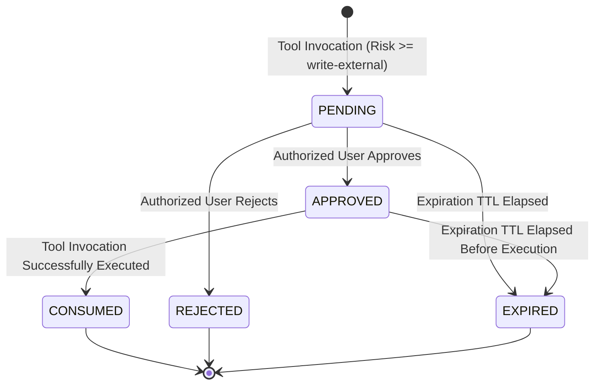
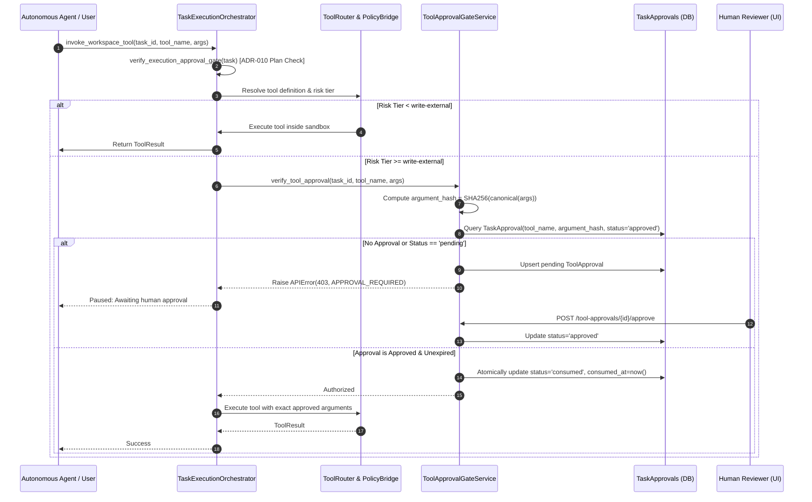

# Tool Permission Approval Gate and MCP Elicitation Architecture (Issue #199)

## 1. Executive Summary

This document specifies the technical architecture for extending the platform's human approval gate to **tool permission escalations** and **Model Context Protocol (MCP) elicitation requests**, fulfilling **Issue #199 (F19)**.

The system builds directly upon the existing, cryptographically verified execution approval gate (`ADR-010`), reusing its immutable audit lifecycle, persistence schemas, ownership authorization checks, and frontend panel architecture.

The core requirement is: **Every tool invocation with risk level $\ge \text{write-external}$ requires explicit human approval bound cryptographically to the exact tool name and canonical argument hash.** An approval granted for one tool or argument payload never authorizes any other invocation.

Furthermore, this architecture implements **MCP Elicitation** (Specification version 2025-11-25) supporting both **Form Elicitation** and **URL Elicitation**, strictly maintaining the boundary that user elicitation is an interactive input mechanism and never a substitute or bypass for tool execution authorization.

---

## 2. Existing Execution Approval Architecture Audit

### 2.1 The ADR-010 Execution Gate
Under `ADR-010` and `backend/app/repositories/task_repository.py:verify_execution_approval_gate`, autonomous execution is strictly gated:
1. **Status Preconditions:** The task must be in `APPROVED` (or active execution `WORKSPACE_SETUP` / `EXECUTING`) status. Tasks in `CREATED`, `PLANNING`, `PENDING_APPROVAL`, `REJECTED`, or terminal states cannot execute.
2. **Version Matching:** `task.approved_plan_version` must match the current `task.plan_version` and the latest `TaskPlan.plan_version`.
3. **Base Revision Invariant:** The task's `base_revision` must match the plan's `base_revision`. Any upstream Git divergence invalidates prior approvals.
4. **Cryptographic Integrity:** The gate recomputes a structural SHA-256 hash across the persisted plan fields (`base_revision`, `summary`, `expected_files`, `steps`, `dependencies`, `verification`) and compares it against the stored `plan_hash` and `TaskApproval.plan_hash` to detect post-approval tampering.
5. **Immutable Record:** A verified `TaskApproval` entity with `decision == 'APPROVED'` must exist in the `task_approvals` table.

### 2.2 Preservation Invariant (Phase 1)
This plan approval gate remains completely intact. Tool approval does not replace or weaken plan approval; it provides a second, defense-in-depth authorization checkpoint when an executing task attempts an external or high-risk side effect.

---

## 3. Tool Risk Classification Policy (Phase 2)

### 3.1 Risk Tiers and Hierarchy
Tool permissions are evaluated server-side using trusted metadata registered in the `UnifiedToolRegistry` (`backend/agent/tools/registry.py`). Risk levels are represented with an explicit hierarchy:

| Risk Tier | Numeric Weight | Description | Examples | Approval Required? |
| :--- | :---: | :--- | :--- | :---: |
| **`read-only`** / `low` | 10 | Inspects repository or workspace without mutating state. Idempotent. | `read_file`, `list_files`, `inspect_git_diff`, `check_stale_revision`, `verify_diff_immutability` | **No** |
| **`local-write`** / `medium` | 20 | Modifies files or state strictly within the task's isolated sandbox directory. | `write_file`, `patch_file`, `commit_task_changes`, `run_tests`, `record_repair_attempt` | **No** (covered by plan approval) |
| **`write-external`** / `high` | 30 | Executes operations with external side effects outside sandbox boundaries (e.g. remote Git push, PR creation, network calls). | `push_task_branch`, `create_draft_pr`, external network requests | **YES (Mandatory)** |
| **`critical`** | 40 | Administrative, irreversible, or high-blast-radius external mutations. | Remote branch deletion, production deployments, credential operations | **YES (Mandatory)** |

### 3.2 Server-Side Trust & Safe-Deny
1. **Frontend Disregard:** Risk classification is never accepted from frontend or agent request payloads. It is resolved exclusively from the server's registered `ToolDefinition`.
2. **Safe-Deny for Unknown Tools:** Any unregistered, external, or unclassifiable tool invocation defaults to weight 30 (`write-external`), triggering mandatory approval or failing closed if unapproved.
3. **Immutability of Builtin Tools:** Canonical workspace tool names cannot be registered or overridden by external MCP servers or plugins (`PROTECTED_BUILTIN_TOOL_NAMES`).

---

## 4. Tool Approval Binding & Canonical Hashing (Phase 3)

### 4.1 Binding Attributes
Every tool approval request cryptographically binds:
- `task_id`: UUID of the active task context.
- `tool_name`: Exact string identifier of the tool.
- `argument_hash`: SHA-256 digest of the canonicalized validated arguments.
- `sanitized_arguments`: Redacted argument payload for safe display in UI and audit logs.
- `risk_level`: Evaluated server-side risk tier.
- `status`: Lifecycle state (`pending`, `approved`, `rejected`, `expired`, `consumed`).
- `user_id`: Authorized user / reviewer.
- `expires_at`: Timestamp after which approval is void (default: 1 hour / 3600 seconds).

### 4.2 Deterministic Canonical Argument Hashing
Tool arguments are canonicalized and hashed server-side:
```python
def canonicalize_tool_arguments(arguments: dict[str, Any] | None) -> str:
    """Deterministically canonicalize tool arguments into a sorted JSON string."""
    if arguments is None:
        arguments = {}
    return json.dumps(arguments, sort_keys=True, separators=(",", ":"), ensure_ascii=True)

def compute_argument_hash(arguments: dict[str, Any] | None) -> str:
    """Compute deterministic SHA-256 hash of canonicalized tool arguments."""
    canonical = canonicalize_tool_arguments(arguments)
    return hashlib.sha256(canonical.encode("utf-8")).hexdigest()
```
- **Key-Order Invariance:** `{ "branch": "feat", "remote": "origin" }` and `{ "remote": "origin", "branch": "feat" }` generate the exact same hash.
- **Mutation Invalidation:** If an agent alters a single parameter (e.g., target branch or commit SHA), `compute_argument_hash` produces a completely different digest, immediately invalidating any prior approval.

---

## 5. Approval Lifecycle & Replay Protection (Phase 4 & 5)

### 5.1 State Transitions


### 5.2 Atomic Consumption (Single-Use Guarantee)
To prevent replay attacks:
1. When execution begins, the system queries for a record with `status == 'approved'`.
2. An atomic database update transitions `status` from `'approved'` to `'consumed'`, setting `consumed_at = now()`.
3. If two concurrent execution requests attempt to use the same approval, only one succeeds; the second receives an atomic rejection (`403 APPROVAL_REQUIRED: Tool approval has already been consumed`).
4. Re-running a tool requires a fresh approval request.

### 5.3 Secret Redaction Invariant
In accordance with platform security standards:
- The `argument_hash` is computed from the **original validated arguments** (guaranteeing exact cryptographic integrity).
- Persisted `sanitized_arguments` and event payloads have secrets and tokens masked via `redact_obj` (`ghp_***REDACTED***`).
- Raw secrets are never exposed in UI responses, database audit tables, or logs.

---

## 6. Execution Flow & Architecture Diagram



---

## 7. Model Context Protocol (MCP) Elicitation (Phase 7)

Per MCP Specification version 2025-11-25, elicitation allows external MCP servers to request human interaction in two standardized modes.

### 7.1 Form Elicitation
Used when an MCP server requests structured user input.
- **Request Structure:**
  - `prompt`: Human-readable prompt describing what input is required.
  - `schema`: JSON Schema specifying allowed fields (types: `string`, `number`, `integer`, `boolean`, `enum`, `array`).
  - `task_id` & `session_id`: Cryptographically bound execution context.
- **Validation & Rendering:**
  - The backend validates the schema against supported input types. Arbitrary frontend code or script execution is strictly forbidden.
  - Rendered in UI as dynamic form fields with clear validation feedback.
- **Response Handling:**
  - User response is validated against the requested schema via `SchemaValidator`.
  - User can submit (`action="submit"`) or cancel (`action="cancel"`).
  - Delivered only to the matching pending elicitation request; duplicate or cross-session responses are rejected.

### 7.2 URL Elicitation
Used when an MCP server requests user interaction with an external URL (e.g. OAuth authorization flow, external documentation).
- **Request Structure:**
  - `url`: Destination URL.
  - `purpose`: Justification displayed to the user.
- **Safety Policy:**
  - **Scheme Enforcement:** Only `https:` is permitted (`http:` allowed only on `localhost` in local development). Dangerous schemes (`javascript:`, `data:`, `file:`, `ftp:`) are strictly rejected.
  - **SSRF Prevention:** Cloud metadata addresses (`169.254.169.254`, `metadata.google.internal`) and restricted internal subnets are blocked.
  - **No Automated Navigation:** The system **never** automatically visits or submits a URL on behalf of the user. Explicit user interaction is required.

### 7.3 Non-Equivalence Guarantee
Elicitation is solely an input collection mechanism. **An approved or completed elicitation does NOT authorize tool execution.** If an MCP tool attempts side effects following elicitation, it must independently pass the Tool Approval Gate.

---

## 8. Database Persistence & Migrations (Phase 8)

To avoid duplicate tables and reuse existing task authorization architecture, `task_approvals` is extended:

### New Columns on `task_approvals`
- `approval_type`: String(32), default `"plan"` (`plan`, `tool`, `mcp_elicitation`).
- `tool_name`: String(128), nullable=True, indexed.
- `argument_hash`: String(128), nullable=True, indexed.
- `sanitized_arguments`: JSONB, nullable=True.
- `risk_level`: String(32), nullable=True.
- `status`: String(32), default `"approved"` (for plan records; tool records use `pending`, `approved`, `rejected`, `expired`, `consumed`).
- `expires_at`: DateTime(timezone=True), nullable=True.
- `consumed_at`: DateTime(timezone=True), nullable=True.
- `session_id`: String(128), nullable=True, indexed.
- `elicitation_type`: String(32), nullable=True (`form`, `url`).
- `elicitation_payload`: JSONB, nullable=True.
- `elicitation_response`: JSONB, nullable=True.

---

## 9. Frontend Experience & `ApprovalHistoryPanel` (Phase 6)

The frontend approval interface (`frontend/src/components/tasks/ApprovalHistoryPanel.tsx`) is extended to:
1. Clearly differentiate **Plan Approvals**, **Tool Permission Requests**, and **MCP Elicitations** using distinct visual badges and icons.
2. Display sanitized, syntax-highlighted argument payloads with sensitive credentials masked.
3. Provide single-click **Approve** and **Reject** actions for pending tool invocations.
4. Render interactive form elicitation fields and URL confirmation buttons.
5. Reflect atomic consumption and expiration status with live visual indicators.

---

## 10. Failure Handling & Security Summary

| Failure Scenario | Behavior | Guarantee |
| :--- | :--- | :--- |
| **Tool arguments modified after approval** | `argument_hash` recomputed at execution mismatches stored hash. | Execution immediately halted (`409 CONFLICT`). Prior approval cannot be re-used. |
| **Concurrent tool execution attempts** | Database row update uses atomic conditional status update. | Exactly one attempt consumes approval; duplicate attempt receives `403`. |
| **Expired approval** | Expiration timestamp checked before execution. | Transitions to `expired`; execution blocked. |
| **Unauthorized user attempts approval** | Ownership and tenant boundary check applied. | Returns `403 FORBIDDEN`. |
| **MCP server sends malformed form schema** | Validated against supported Draft 2020-12 schema types. | Rejected with `422 UNPROCESSABLE_ENTITY`; arbitrary HTML/JS injection blocked. |
| **Malicious URL in MCP elicitation** | Scheme checked for `https:`; SSRF IP destinations blocked. | Unsafe URLs rejected; zero automated visits. |
| **Elicitation confused for tool authorization** | Elicitation response stored separately from tool approval records. | Tool execution still strictly checked against Tool Approval Gate. |

