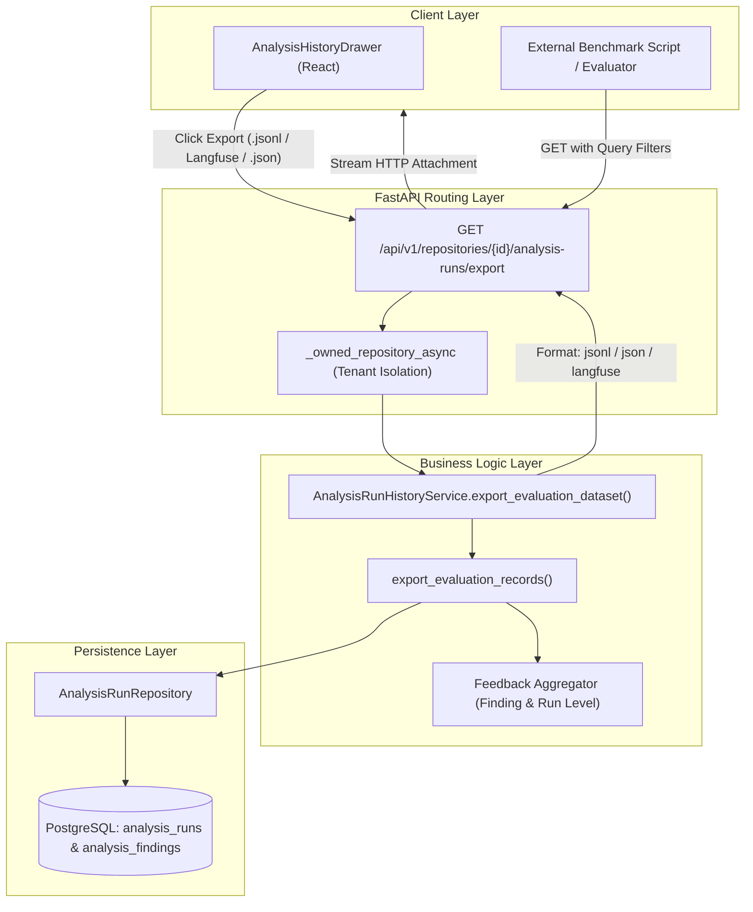

# Analysis History Evaluation Dataset Export Architecture (Issue #195)

## 1. Executive Summary

This document specifies the technical architecture for **Evaluation Dataset Export from Developer Intelligence Analysis History**, fulfilling **Issue #195 (F15 — Analysis History)**.

The platform's Developer Intelligence features (Code Explanation, Bug Detection, Test Generation, and Automated Code Review) store execution records and developer feedback in PostgreSQL (`analysis_runs` and `analysis_findings`). Previously, there was no structured pipeline to export these real-world interactions into benchmark datasets for:
1. **Model Calibration & LLM Regression Testing**: Evaluating new models (e.g. Gemini 1.5/2.0, DeepSeek, Claude 3.5, GPT-4o) on grounded developer code intelligence tasks.
2. **Evaluation Framework Integration**: Native ingestion into evaluation and observability platforms like **Langfuse**, **LangSmith**, and custom benchmark harnesses.
3. **Continuous Reinforcement from Developer Feedback**: Filtering historical runs where developers submitted `useful`, `not_useful`, or `false_positive` feedback to construct gold-standard regression suites.

---

## 2. System Architecture



---

## 3. Data Schema Specifications

### 3.1 Standard Evaluation Sample Schema (`jsonl` and `json`)

Each sample exported via `format=jsonl` or `format=json` follows a standardized evaluation record structure:

```json
{
  "id": "e6a0d240-b6cb-4ee4-90a8-b6485c2c7760",
  "repository_id": "8fa8d350-9fbb-49e3-82a1-fa081923e200",
  "feature_type": "detect_bugs",
  "status": "COMPLETED",
  "input": {
    "target_path": "src/auth/jwt_validator.py",
    "target_symbol": "verify_token",
    "start_line": 24,
    "end_line": 86,
    "source_revision": "9a3f2b1c"
  },
  "output": {
    "findings_count": 2,
    "result_payload": { ... },
    "test_output": null
  },
  "findings": [
    {
      "id": "f-101",
      "category": "security",
      "severity": "HIGH",
      "title": "Hardcoded secret fallback",
      "description": "Default secret key is used when environment variable is unset.",
      "file_path": "src/auth/jwt_validator.py",
      "start_line": 32,
      "end_line": 35,
      "source_revision": "9a3f2b1c",
      "symbol_name": "verify_token",
      "evidence": "key = os.getenv('SECRET', 'default-key')",
      "suggested_fix": "key = os.environ['SECRET']",
      "confidence": "high",
      "is_uncertain": false,
      "is_new_in_change": true,
      "source_type": "AI",
      "rule_id": "SEC-004",
      "feedback": {
        "feedback_type": "useful",
        "comment": "Accurate finding, fixed immediately.",
        "user_id": "u-202",
        "updated_at": "2026-11-09T18:30:00Z"
      }
    }
  ],
  "feedback_summary": {
    "has_feedback": true,
    "total_feedback": 1,
    "by_type": {
      "useful": 1
    },
    "entries": [ ... ]
  },
  "metadata": {
    "created_at": "2026-11-09T18:25:00Z",
    "completed_at": "2026-11-09T18:25:04Z",
    "duration_seconds": 4.12,
    "error_message": null
  }
}
```

### 3.2 Langfuse Dataset Item Schema (`format=langfuse`)

Langfuse datasets organize items into `input`, `expected_output`, and `metadata` triples:

```json
{
  "id": "e6a0d240-b6cb-4ee4-90a8-b6485c2c7760",
  "input": {
    "feature_type": "detect_bugs",
    "target_path": "src/auth/jwt_validator.py",
    "target_symbol": "verify_token",
    "start_line": 24,
    "end_line": 86,
    "source_revision": "9a3f2b1c"
  },
  "expected_output": {
    "findings_count": 2,
    "findings": [ ... ],
    "result_payload": { ... },
    "test_output": null
  },
  "metadata": {
    "repository_id": "8fa8d350-9fbb-49e3-82a1-fa081923e200",
    "status": "COMPLETED",
    "feedback_summary": {
      "has_feedback": true,
      "total_feedback": 1,
      "by_type": { "useful": 1 }
    },
    "created_at": "2026-11-09T18:25:00Z",
    "completed_at": "2026-11-09T18:25:04Z",
    "duration_seconds": 4.12,
    "error_message": null
  }
}
```

---

## 4. API Specification

### Endpoint: `GET /api/v1/repositories/{repository_id}/analysis-runs/export`

#### Query Parameters:

| Parameter | Type | Default | Description |
| :--- | :---: | :---: | :--- |
| `format` | `string` | `"jsonl"` | Export format: `jsonl` (plain JSONL), `langfuse` (Langfuse dataset JSONL), or `json` (pretty JSON array). |
| `feature_type` | `string` | `null` | Filter by feature: `explain`, `detect_bugs` (or alias `bugs`), `generate_tests` (or alias `tests`), or `review` (or alias `code_review`). |
| `status` | `string` | `null` | Filter by execution status (`COMPLETED`, `FAILED`, `PENDING`). |
| `include_feedback_only` | `boolean` | `false` | When `true`, only outputs runs that contain attached human feedback. |
| `limit` | `integer` | `1000` | Maximum number of records to export (min: 1, max: 5000). |

#### Responses:
- **`200 OK`**:
  - `Content-Type`: `application/x-ndjson` (for `jsonl` / `langfuse`) or `application/json` (for `json`).
  - `Content-Disposition`: `attachment; filename="analysis-eval-{repository_id}[-langfuse].jsonl"`.
- **`401 Unauthorized`**: Authentication missing or expired.
- **`403 Forbidden`**: User does not own the repository (strict multi-tenant isolation).
- **`404 Not Found`**: Repository does not exist.

---

## 5. Frontend Integration (`AnalysisHistoryDrawer.tsx`)

The UI drawer provides direct dataset export without leaving the workspace:
1. **Header Action**: An **Export** dropdown button next to the close button in the drawer header.
2. **Options Available**:
   - `JSONL (Plain)`: Downloads `.jsonl` evaluation dataset.
   - `Langfuse Dataset`: Downloads `-langfuse.jsonl` pre-structured for Langfuse dataset ingestion.
   - `JSON Array`: Downloads formatted `.json`.
   - `Feedback only` checkbox: Restricts export to samples with developer feedback.
3. **Non-blocking Download**: Generates an in-memory `Blob` and triggers a browser download without page reloads.

---

## 6. Verification and Test Matrix

| Test Case | Module | Description | Result |
| :--- | :--- | :--- | :---: |
| `test_export_evaluation_dataset_jsonl_structure` | `backend/tests/test_analysis_run_export.py` | Validates standard JSONL schema and sample coordinates. | **PASS** |
| `test_export_evaluation_dataset_json_format` | `backend/tests/test_analysis_run_export.py` | Validates JSON array format and record contents. | **PASS** |
| `test_export_evaluation_records_filtering` | `backend/tests/test_analysis_run_export.py` | Tests filtering by status, feature_type, and feedback presence. | **PASS** |
| `test_export_evaluation_dataset_langfuse_format` | `backend/tests/test_analysis_run_export.py` | Validates Langfuse `input`/`expected_output`/`metadata` schema. | **PASS** |
| `test_export_evaluation_records_with_code_review_alias` | `backend/tests/test_analysis_run_export.py` | Tests `code_review` alias normalization. | **PASS** |
| `test_export_multi_tenant_isolation` | `backend/tests/test_analysis_run_export.py` | Verifies zero cross-tenant leakage between repositories. | **PASS** |
| `test_export_invalid_format_raises_error` | `backend/tests/test_analysis_run_export.py` | Verifies graceful error on unsupported format. | **PASS** |
| `test_export_empty_repository` | `backend/tests/test_analysis_run_export.py` | Tests empty export behavior on clean repositories. | **PASS** |
| `test_export_endpoint_via_client` | `backend/tests/test_analysis_run_export.py` | HTTP integration test with auth headers and content disposition. | **PASS** |
| `AnalysisHistoryDrawer - Dataset Export` | `frontend/src/test/analysisHistoryExport.test.tsx` | UI test for drawer export button, dropdown, and download trigger. | **PASS** |
