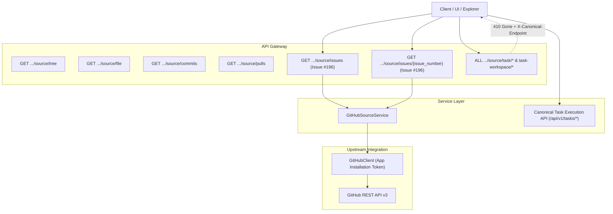

# GitHub Source Browsing and Execution Surface Consolidation Architecture (Issue #196)

## 1. Executive Summary

This document specifies the architecture and technical implementation for **F16 — GitHub Source Browsing & Consolidation**, resolving **Issue #196**.

The primary objectives achieved:
1. **Remote Issue Browsing:** Extended `GitHubSourceService` to browse live remote GitHub issues and retrieve individual issue details, complementing existing tree, file, commit, and pull request browsing.
2. **Pull Request Demuxing:** The GitHub REST API exposes both standard issues and pull requests under `/repos/{owner}/{repo}/issues`. The service demuxes this stream, strictly filtering pull requests out of issue listings and flagging individual items with `is_pull_request: bool`.
3. **Execution Surface Consolidation:** Deprecated the legacy duplicate execution endpoints under `/repositories/{repository_id}/source/task/*` and `/repositories/{repository_id}/source/task-workspace/*` in favor of the canonical `/api/v1/tasks/{id}/*` routes, returning `410 Gone` with `X-Canonical-Endpoint: /api/v1/tasks`.
4. **Dead Route Alias Pruning:** Removed redundant, unreachable path aliases (`/{repo_id}/tasks`) from `tasks.py`.
5. **Frontend Client Integration:** Provided strongly typed client methods in `repositories.ts` backed by MSW test doubles.

---

## 2. Architecture & Service Boundaries



### 2.1 Multi-Tenant Repository Ownership Boundary
Every request passing through `GitHubSourceService` invokes `_get_authorized_repository(repository_id, user_id)`. If the authenticated user does not own the target repository or the repository does not exist, an `APIError(404)` is thrown immediately before constructing upstream GitHub clients or making network calls.

### 2.2 Remote Issue Ingestion & Demuxing
In the GitHub REST API:
- `GET /repos/{owner}/{repo}/issues` returns issues and pull requests mixed together.
- A pull request is indicated by the presence of a `"pull_request"` dictionary inside the issue object.

`GitHubSourceService.list_issues` processes the raw response:
- Pull requests are filtered out: `if isinstance(item, dict) and not item.get("pull_request")`.
- Text fields are scrubbed with `app.core.secret_redaction.redact`.
- Labels are normalized from either objects (`{"name": "..."}`) or strings into `list[str]`.
- Standard GitHub metadata (`number`, `title`, `state`, `body`, `author`, `labels`, `html_url`, `created_at`, `updated_at`, `closed_at`, `comments_count`) is serialized into `RemoteIssueInfo`.

---

## 3. Schemas & Contracts

### 3.1 Backend Schema (`backend/app/integrations/github/schemas.py`)

```python
class RemoteIssueInfo(BaseModel):
    """Metadata about a remote GitHub issue for source browsing."""
    number: int
    title: str
    state: str = "open"
    body: Optional[str] = None
    author: Optional[str] = None
    labels: list[str] = Field(default_factory=list)
    html_url: Optional[str] = None
    created_at: Optional[datetime] = None
    updated_at: Optional[datetime] = None
    closed_at: Optional[datetime] = None
    comments_count: int = 0
    is_pull_request: bool = False
```

### 3.2 Frontend Type Contract (`frontend/src/types/api.ts`)

```typescript
export interface RemoteIssueInfo {
  number: number;
  title: string;
  state: string;
  body?: string | null;
  author?: string | null;
  labels: string[];
  html_url?: string | null;
  created_at?: string | null;
  updated_at?: string | null;
  closed_at?: string | null;
  comments_count: number;
  is_pull_request: boolean;
}
```

---

## 4. REST Endpoints Specification

### 4.1 Remote Issue Browsing

| Method | Path | Status | Response | Description |
| :--- | :--- | :---: | :--- | :--- |
| `GET` | `/api/v1/repositories/{id}/source/issues` | `200 OK` | `list[RemoteIssueInfo]` | Lists live remote issues for authorized repo (filtered of PRs). |
| `GET` | `/api/v1/repositories/{id}/source/issues/{number}` | `200 OK` | `RemoteIssueInfo` | Fetches single remote issue metadata and body. |

#### Error Responses:
- `400 Bad Request`: `issue_number < 1` (`INVALID_REQUEST`).
- `401 Unauthorized`: Missing or invalid session JWT.
- `404 Not Found`: Repository not owned by user, or issue number not found on GitHub.
- `502 Bad Gateway`: GitHub API upstream error (`SERVICE_UNAVAILABLE`).

### 4.2 Deprecated Task Execution Surfaces

All requests to legacy duplicate paths:
- `/{repository_id}/source/task/{action:path}`
- `/{repository_id}/source/task-workspace/{action:path}`

return:
- **Status:** `410 Gone`
- **Headers:**
  - `X-Canonical-Endpoint: /api/v1/tasks`
  - `Deprecation: true`
- **Payload:**
```json
{
  "error": "DEPRECATED_ENDPOINT",
  "message": "The endpoint /api/v1/repositories/{id}/source/task/... has been deprecated and consolidated. Please use the canonical /api/v1/tasks execution API.",
  "canonical_endpoint": "/api/v1/tasks"
}
```

---

## 5. Verification & Test Matrix

| Test Suite | File | Description | Status |
| :--- | :--- | :--- | :---: |
| `test_source_service_list_issues_filters_prs` | `backend/tests/test_github_source_browsing_consolidation.py` | Validates filtering of pull requests in issue stream. | **PASS** |
| `test_source_service_get_issue_detail_and_compat` | `backend/tests/test_github_source_browsing_consolidation.py` | Tests retrieval and adapter translation to `GitHubIssueData`. | **PASS** |
| `test_api_remote_issues_endpoints` | `backend/tests/test_github_source_browsing_consolidation.py` | Full HTTP roundtrip for listing, getting issue, and bounds checking. | **PASS** |
| `test_api_issue_not_found_handling` | `backend/tests/test_github_source_browsing_consolidation.py` | Tests 404 response on missing issue. | **PASS** |
| `test_api_multi_tenant_repository_isolation` | `backend/tests/test_github_source_browsing_consolidation.py` | Validates rejection of cross-tenant repository requests. | **PASS** |
| `test_api_deprecated_duplicate_task_execution_surfaces` | `backend/tests/test_github_source_browsing_consolidation.py` | Validates 410 Gone on `/source/task/*` and `/source/task-workspace/*`. | **PASS** |
| `test_source_service_list_issues_repo_not_found_404` | `backend/tests/test_github_source_browsing_consolidation.py` | Validates 404 when upstream repo is not found. | **PASS** |
| `test_week3_day3_task_branch_isolation.py` | `backend/tests/test_week3_day3_task_branch_isolation.py` | Regression suite for branch isolation (16/16 passed). | **PASS** |
| `sourceIssuesBrowsing.test.ts` | `frontend/src/test/sourceIssuesBrowsing.test.ts` | Frontend unit tests for service methods and MSW doubles. | **PASS** |
