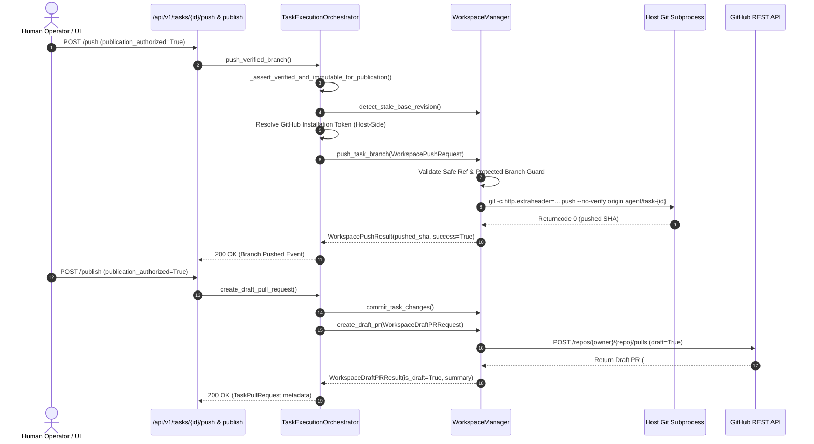

# Branch, Commit, Push, and Draft PR Publication Architecture (Issue #207 / F26)

## 1. Executive Summary

This document specifies the technical architecture, security guarantees, and credential isolation boundaries for **F26 — Branch, commit, push, draft PR publication**, resolving **Issue #207**.

### Core Objectives & Deliverables
1. **Host-Side Git Operations & Credential Isolation:**
   - Under the container sandbox architecture (F20), git network operations (`git push`, `git fetch`, `git pull`, `git remote`, `git clone`) run **exclusively host-side** on the API server.
   - Credentials (GitHub App installation tokens, personal access tokens, SSH private keys) **never enter the sandbox container** under any circumstances.
2. **Sandbox Defense-in-Depth:**
   - `WorkspaceCommandRunner` enforces an explicit rejection rule: any attempt by an untrusted task or script in the sandbox to invoke `git` with network subcommands (`push`, `pull`, `fetch`, `remote`, `clone`) fails closed immediately with `WorkspacePolicyViolationError`.
   - Sandbox environments (`ContainerBackend`, `LocalSubprocessBackend`, `RunnerClient`) strictly scrub sensitive credentials (`GITHUB_TOKEN`, `RUNNER_AUTH_SECRET`, `OPENAI_API_KEY`, etc.) from environment blocks.
3. **Protected Branch Guards (Rule 563 & ADR-010):**
   - Direct pushes or Draft PR creations targeting protected branches (`main`, `master`, `develop`, `release`, `production`, `prod`, `staging`) are forbidden across all layers: `GitBranchService`, `WorkspaceManager`, and `TaskExecutionOrchestrator`.
4. **Mandatory Human Publication Authorization Gate:**
   - Explicit human authorization (`publication_authorized=True`) is mandatory before executing `git push` or opening a Draft PR.
   - Pushes or PR creations without explicit human sign-off fail closed with `WorkspacePublicationUnauthorizedError` (`403 PUBLICATION_AUTHORIZATION_REQUIRED`).
5. **Zero Auto-Merge Draft PR Guarantee:**
   - All automated pull requests are synthesized strictly with `is_draft=True`.
   - Generated Markdown summaries provide full provenance: objective, changed files, diff statistics, test execution logs, and independent verification badges.

---

## 2. Architectural Security Boundaries

```mermaid
flowchart TD
    subgraph Host API Server (Privileged Zone)
        Orchestrator["TaskExecutionOrchestrator"]
        TokenResolver["GitHub App Token Resolver"]
        WS_Manager["WorkspaceManager"]
        HostGit["Host Git CLI Process (subprocess.run)"]
        AuditLog["Timeline Events & Secret Redaction"]
    end

    subgraph Sandbox Container / Runner (Untrusted Execution Zone)
        Runner["WorkspaceCommandRunner"]
        Container["ContainerBackend (Docker / gVisor)"]
        TestCmd["pytest / npm test (Offline Mode)"]
    end

    subgraph Upstream Version Control
        GitHubAPI["GitHub REST API v3 (Draft PRs)"]
        GitHubGit["GitHub Remote Repository (refs/heads/agent/task-*)"]
    end

    Orchestrator -->|"1. Verify passed & immutable"| WS_Manager
    Orchestrator -->|"2. Resolve installation token"| TokenResolver
    TokenResolver -->|"Token passed host-side only"| WS_Manager

    WS_Manager -->|"3. Ephemeral auth header (-c http.extraheader)"| HostGit
    HostGit -->|"4. git push (No credentials on disk)"| GitHubGit
    WS_Manager -->|"5. Synthesize Draft PR (is_draft=True)"| GitHubAPI

    Container -.->|"BLOCKED: WorkspacePolicyViolationError"| Runner
    Runner -.->|"Network disabled: --network=none"| Container

    AuditLog -.->|"Scrub tokens & keys via redact()"| Orchestrator
```

### 2.1 Credential Isolation Invariants
- **Zero Disk Persistence:** GitHub App installation tokens are passed dynamically as command-line arguments to host git using `-c http.extraheader=AUTHORIZATION: basic <base64>`, ensuring `.git/config` on disk never contains plaintext or stored credentials.
- **Zero Sandbox Entry:** Sandbox containers receive an immutable root filesystem, `--network=none` during test phases, and an environment whitelist that blocks `GITHUB_TOKEN`, `SSH_AUTH_SOCK`, and platform API keys.
- **Fail-Closed Sandbox Gate:** If an untrusted process inside the sandbox attempts to run `git push origin branch`, `WorkspaceCommandRunner.validate_command` raises `WorkspacePolicyViolationError` before process invocation.

---

## 3. Sequence of Publication Operations



---

## 4. Key Security & Verification Matrix

| Check / Requirement | Enforcement Mechanism | Failure Response |
| :--- | :--- | :--- |
| **Host-Side Execution** | Executed strictly via host `subprocess.run` inside `WorkspaceManager` | Never dispatched to `ContainerBackend` |
| **Sandbox Network Prohibition** | `FORBIDDEN_SANDBOX_GIT_SUBCOMMANDS` (`push`, `pull`, `fetch`, `remote`, `clone`) | `WorkspacePolicyViolationError` |
| **Credential Stripping** | `sanitize_environment()` and container environment filter | Sensitive tokens removed from container env |
| **Protected Branch Defense** | `PROTECTED_BRANCHES` check in `GitBranchService`, `WorkspaceManager`, `TaskExecutionOrchestrator` | `WorkspaceProtectedBranchError` (`403 POLICY_VIOLATION`) |
| **Human Authorization Gate** | `publication_authorized` bool check | `WorkspacePublicationUnauthorizedError` (`403 PUBLICATION_AUTHORIZATION_REQUIRED`) |
| **Draft PR Publication** | Hardcoded `is_draft=True`, zero auto-merge | PR is draft-only, human review mandatory |
| **Error Secret Redaction** | `redact()` wrapper on all stderr/stdout captures | Credentials replaced with `[REDACTED]` |

---

## 5. Verification Evidence

The test suite in `backend/tests/test_host_git_push_credential_isolation.py` (16 test cases) and the full Git branch integration test matrix (82 test cases) verify this implementation:
- `TestSandboxGitNetworkCommandRejection` (7 tests): All git network operations (`push`, `pull`, `fetch`, `remote`, `clone`) blocked with leading flags; safe read-only commands allowed.
- `TestHostSideGitPushExecution` (2 tests): Host-side push with ephemeral installation tokens verified; zero credentials written to `.git/config`; error output redaction confirmed.
- `TestPublicationGovernanceGates` (7 tests): Unauthorized pushes rejected; protected branch pushes rejected; draft PR creation verified with `draft=True`.
- **Full Test Matrix**:
  - `backend/tests/test_host_git_push_credential_isolation.py` (16/16 passed)
  - `backend/tests/test_agent_branch_creation.py` (6/6 passed)
  - `backend/tests/test_git_branch_service.py` (14/14 passed)
  - `backend/tests/test_prit_w3_d5_verification_and_draft_pr.py` (30/30 passed)
  - `backend/tests/test_week3_day3_task_branch_isolation.py` (16/16 passed)
  - **Total:** 82 passed, 0 failed.
