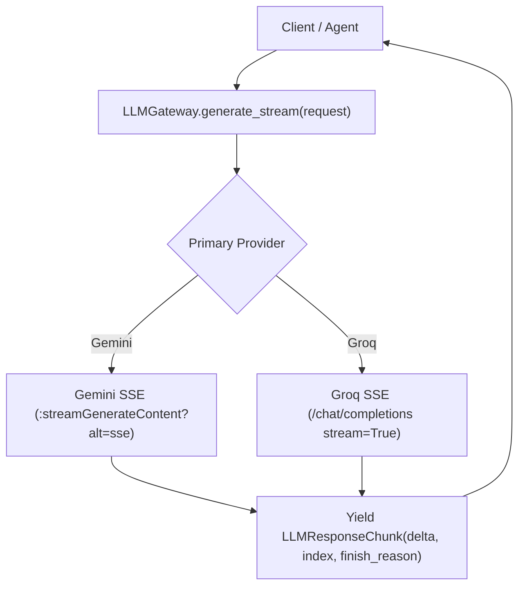

# LLM Gateway, Providers, Tool Calling, and Telemetry (F28)

> **Document:** 29_llm_gateway_providers_tool_calling_and_telemetry.md  
> **Status:** Completed  
> **Date:** 2026-11-13  
> **Related Issues:** [#209](https://github.com/Meetvirugama/AI-Powered-Software-Development-Platform/issues/209) (F28), [#202](https://github.com/Meetvirugama/AI-Powered-Software-Development-Platform/issues/202)  

---

## 1. Overview & Architectural Principles

In accordance with **ADR-001**, all LLM interactions in the platform route strictly through `LLMGateway`. Direct provider calls from business services are prohibited.

Feature **F28** upgrades the LLM infrastructure to establish:
1. **Unified Request/Response Primitives:** Standardized schema supporting tool calling (`tools`, `tool_choice`), streaming (`stream`, `LLMResponseChunk`), and schema validation modes (`response_schema_mode`).
2. **Provider Consistency:** Gemini and Groq providers implement identical unified interfaces (`generate`, `generate_stream`, and `generate_with_tools`).
3. **Strict Schema Converters:** Robust schema generation ensuring wire-level compatibility with Gemini (`responseSchema`) and Groq (`type: "json_schema"`, `strict: True`).
4. **Explicit Model Aliasing:** No silent model remaps. Gemini defaults to `gemini-flash-lite-latest`, matching production configuration, and maps predictably across providers on fallback.
5. **Model-Aware Telemetry Cost Calibration:** Token pricing calibrated at the specific model level rather than crude provider averages.

---

## 2. Unified Primitives (`backend/ai/llm/schemas.py`)

### 2.1 `LLMRequest`

The standardized inference request encapsulates prompts, configuration, and function definitions:

```python
class LLMRequest(BaseModel):
    model: str
    messages: list[Message]
    temperature: float = 0.0
    max_tokens: int = 2048
    response_schema: type[BaseModel] | None = None
    response_format: dict[str, Any] | None = None
    tools: list[LLMToolDefinition] | None = None
    tool_choice: str | dict[str, Any] | None = None
    stream: bool = False
    response_schema_mode: Literal["strict", "json", "none"] = "json"
    allow_fallback: bool = True
    request_id: str | None = None
    estimated_tokens: int | None = None
    feature: str | None = None
```

- `response_schema_mode`:
  - `"strict"`: Generates provider-enforced AST (Gemini `responseSchema`, Groq `strict: True` JSON schema).
  - `"json"`: Prompts for JSON and sets generic `json_object` response format.
  - `"none"`: Plain natural language completion.
- `allow_fallback`: Controls whether `LLMGateway` may attempt secondary provider execution during transient outages.

### 2.2 `LLMResponse` and `LLMResponseChunk`

```python
class LLMResponse(BaseModel):
    content: str = ""
    model: str
    input_tokens: int = 0
    output_tokens: int = 0
    latency_ms: float = 0.0
    tool_calls: list[LLMToolCall] | None = None
    finish_reason: str | None = None
    provider: str | None = None

    @property
    def is_final(self) -> bool:
        """True if model completed text generation without requesting tool calls."""
        return not bool(self.tool_calls)

    @property
    def total_tokens(self) -> int:
        return self.input_tokens + self.output_tokens
```

- When tool calls are generated, `content` gracefully defaults to `""` (coalescing JSON nulls).
- `LLMResponseChunk` models SSE streaming events:
  - `delta: str`: Incremental text slice.
  - `index: int`: Sequence number.
  - `finish_reason: str | None`: Terminal status indicator.
  - `tool_calls: list[LLMToolCall] | None`: Structured tool call invocations.

---

## 3. Strict Schema Converters

### 3.1 Gemini Schema Converter (`build_strict_gemini_response_schema`)
Gemini's REST API requires a strict OpenAPI 3.0 schema subset. Disallowed keywords (e.g., `$defs`, `title`, `additionalProperties`) are recursively flattened or stripped. Enums, nested objects, and arrays are converted to uppercase types (`STRING`, `INTEGER`, `OBJECT`, `ARRAY`).

### 3.2 Groq Strict JSON Schema Converter (`build_strict_groq_json_schema`)
Groq's OpenAI-compatible schema validation requires:
- `additionalProperties: False` recursively on all object nodes and nested `$defs`.
- Explicit listing of every property in `required`.
- Wrapping in `{"type": "json_schema", "json_schema": {"name": ..., "strict": True, "schema": ...}}`.

### 3.3 Provider Constraints & Mutual Exclusion
- **Gemini**: Does not support combining `responseSchema` or `responseMimeType: application/json` with `tools` (`functionDeclarations`).
- **Groq**: Does not support combining `response_format: {"type": "json_schema"}` with `tools` or `stream`.
- Both providers automatically omit conflicting structured output constraints when tool calls are requested.

---

## 4. Model Resolution & Gateway Fallback

### 4.1 Explicit Model Aliasing
- **Gemini Provider**: Default model is `gemini-flash-lite-latest`.
- Requests specifying `gemini-flash-lite-latest` are passed directly without silent promotion to `gemini-flash-latest`.
- Requests specifying OpenAI/OSS models (`gpt-*`, `openai/*`) cleanly resolve to `gemini-flash-lite-latest`.

### 4.2 Cross-Provider Fallback Translation
When a transient error occurs (e.g., HTTP 503, rate limiting, connection timeout) and `allow_fallback=True`, `LLMGateway` dynamically translates model identifiers:
- `gemini-flash-lite-latest` $\rightarrow$ `openai/gpt-oss-120b` (on Groq)
- `openai/gpt-oss-120b` $\rightarrow$ `gemini-flash-lite-latest` (on Gemini)

All request parameters (`tools`, `tool_choice`, `stream`, `response_schema_mode`, `temperature`, `max_tokens`) are preserved during fallback translation.

---

## 5. Streaming Token Pipeline

`LLMGateway.generate_stream(request: LLMRequest)` yields an `AsyncIterator[LLMResponseChunk]`:



---

## 6. Model-Aware Telemetry Cost Calibration

In `backend/app/core/telemetry.py`, hardcoded provider estimates are replaced with model-specific rates per 1,000,000 tokens:

| Model | Input Price / 1M | Output Price / 1M |
|---|---|---|
| `gemini-flash-lite-latest` | \$0.075 | \$0.30 |
| `gemini-flash-latest` | \$0.075 | \$0.30 |
| `gemini-1.5-pro` | \$1.250 | \$5.00 |
| `openai/gpt-oss-120b` | \$0.150 | \$0.60 |
| `openai/gpt-oss-20b` | \$0.050 | \$0.20 |
| `llama-3.3-70b-versatile` | \$0.590 | \$0.79 |

The `get_token_pricing(provider, model)` helper resolves the exact rate with fallback to provider defaults, ensuring accurate cost tracking in `StageExecutionTimer`.

---

## 7. Verification

All tests are verified and passing:
- `backend/tests/test_llm_gateway_f28.py` (13 tests)
- `backend/tests/test_llm_tool_calling.py` (10 tests)
- `backend/tests/test_llm_gateway.py` (21 tests)
- `backend/tests/test_gemini_provider.py` (8 tests)
- `backend/tests/test_stage_telemetry.py` (4 tests)
- Review & Benchmark test suites (46 tests)
Total: **102 tests passing** with zero regressions.
