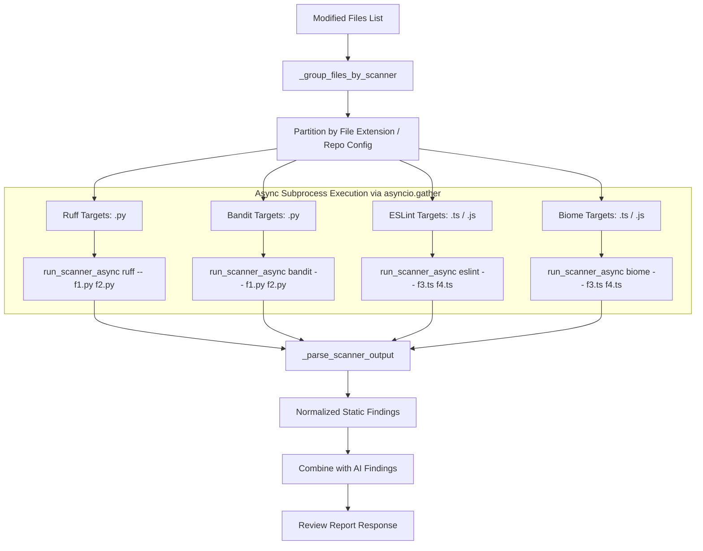

# Engineering Specification: Amortized Static Scanner Subprocess Execution & Parallel Analysis

| Metadata | Details |
|---|---|
| **Feature ID** | F39 |
| **Component** | Code Review Engine & Static Scanners |
| **Primary Files** | `backend/review/static_reviewer.py`, `backend/scanner/static_bug_scanner.py`, `backend/app/api/v1/analysis/review.py` |
| **Status** | Implemented & Verified |
| **Architecture Decision** | [ADR-019](file:///Users/meetvirugama/Desktop/AI-Powered-Software-Development-Platform/Docs/engineering/13_architecture_decisions.md#adr-019-amortized-batch-target-invocations--concurrent-static-scanner-execution) |

---

## 1. Motivation & Context

In code review workflows, static analysis tools provide early deterministic feedback before or alongside LLM-guided evaluation. Prior implementations invoked `run_scanner` in a sequential loop per file and per scanner ($O(M \times S)$ process launches). This created severe review latency (20–50 seconds for pull requests modifying 10–25 files) and caused worker thread starvation.

F39 addresses this performance limitation by:
1. Grouping file targets by scanner and invoking each scanner once with all applicable file paths separated by `--` (Batch Target Amortization).
2. Leveraging `asyncio.create_subprocess_exec` and `asyncio.gather` to execute independent scanners in parallel without blocking the asyncio event loop.
3. Adding multi-file AST scanning capabilities in `StaticBugScanner.scan_files` and `StaticBugScanner.scan_files_async`.

---

## 2. Technical Design



### 2.1 File Target Partitioning

`StaticReviewer._group_files_by_scanner(modified_files, scanners=None, repo_root=None)` inspects each modified file:
- Returns a dictionary mapping each active scanner name to its deduplicated list of target files.
- Honors explicit scanner overrides (`scanners=("ruff",)`).
- Automatically filters out non-code assets (e.g., stylesheets, documentation, images) that are irrelevant to AST and linter tools.

### 2.2 Hardened Subprocess Command Invocations

All commands separate arguments with `--`:
```python
commands = {
    "ruff": [sys.executable, "-m", "ruff", "check", "--output-format", "json", "--", *cleaned_targets],
    "bandit": [sys.executable, "-m", "bandit", "-f", "json", "-r", "--", *cleaned_targets],
    "eslint": ["npx", "--no-install", "eslint", "--format", "json", "--no-color", "--", *cleaned_targets],
    "biome": ["npx", "--no-install", "@biomejs/biome", "lint", "--reporter=json", "--", *cleaned_targets],
}
```

### 2.3 Subprocess Lifecycle & Process Reaping

`run_scanner_async` wraps process communication with an enforced timeout:
```python
try:
    proc = await asyncio.create_subprocess_exec(...)
    stdout_bytes, stderr_bytes = await asyncio.wait_for(proc.communicate(), timeout=timeout)
except (TimeoutError, OSError) as exc:
    if proc is not None and proc.returncode is None:
        try:
            proc_kill = getattr(proc, "kill", None)
            if callable(proc_kill):
                kill_res = proc_kill()
                if inspect.isawaitable(kill_res):
                    await kill_res
            await proc.wait()
        except (OSError, RuntimeError) as kill_exc:
            logger.debug("Failed to terminate scanner process: %s", kill_exc)
    raise RuntimeError(f"{scanner} could not complete: {redact(str(exc))}") from exc
```

### 2.4 Multi-File AST Scanning (`StaticBugScanner`)

`StaticBugScanner.scan_files` evaluates AST rules across files concurrently using `concurrent.futures.ThreadPoolExecutor(max_workers=min(len(file_paths), 8))`. It returns:
- `success`: Boolean indicating overall parsing success.
- `findings`: Combined list of static findings.
- `file_results`: Detailed per-file parse and rule evaluation status.
- `files_scanned`: Total file count.
- `rules_evaluated`: Aggregate count of evaluated AST rules.

---

## 3. Verification & Quality Assurance

The implementation is verified via a 41-test suite encompassing:
1. `backend/tests/test_amortized_static_reviewer_f39.py`:
   - Single target backward compatibility.
   - Batch target invocation and JSON parsing for `ruff`, `bandit`, `eslint`, and `biome`.
   - Option-injection rejection (`--flag`, `-s`, null bytes).
   - `_group_files_by_scanner` file type partitioning.
   - Subprocess launch amortization ($O(M \times S) \rightarrow O(S)$).
   - Async execution and timeout kill semantics.
   - Fault tolerance (resilience when an individual scanner crashes).
   - Multi-file AST analysis via `scan_files` and `scan_files_async`.
   - API review endpoint preference for `review_modified_files_async`.
2. Existing regression suites:
   - `backend/tests/test_static_reviewer.py` (legacy unbatched and batch verification).
   - `backend/tests/test_static_reviewer_expansion.py` (ESLint and Biome configurations).
   - `backend/tests/test_review_api_endpoints.py`, `backend/tests/test_security_review.py`.
