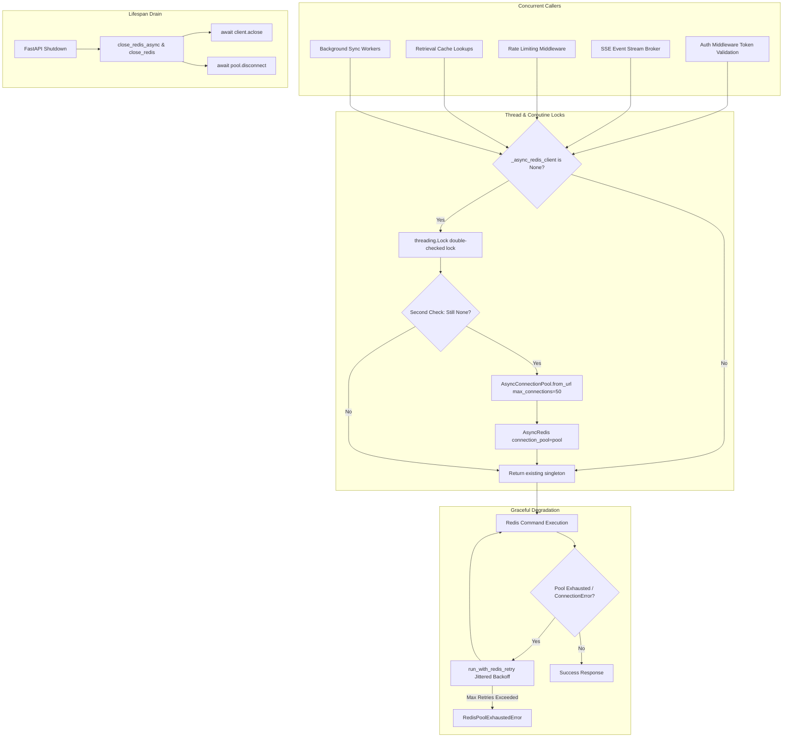

# Engineering Specification: Thread/Coroutine-Safe Redis Singleton Initialization & Bounded Connection Pooling

| Metadata | Details |
|---|---|
| **Feature ID** | F40 |
| **Component** | Core Infrastructure / Redis Service Layer |
| **Primary Files** | `backend/app/core/redis.py`, `backend/app/core/config.py`, `backend/app/core/lifespan.py` |
| **Status** | Implemented & Verified |
| **Architecture Decision** | [ADR-020](file:///Users/meetvirugama/Desktop/AI-Powered-Software-Development-Platform/Docs/engineering/13_architecture_decisions.md#adr-020-threadcoroutine-safe-redis-singleton-initialization-and-bounded-connection-pooling) |

---

## 1. Executive Summary & Problem Context

In `backend/app/core/redis.py`, `get_async_redis_client()` previously initialized the shared asynchronous Redis instance using an unguarded global check:

```python
# Legacy unguarded initialization
def get_async_redis_client() -> AsyncRedis:
    global _async_redis_client
    if _async_redis_client is None:
        _async_redis_client = AsyncRedis.from_url(settings.redis_url, **_get_redis_options())
    return _async_redis_client
```

During startup bursts or under high concurrency (concurrent Server-Sent Events subscriptions, authentication token blocklist verification, embedding cache queries, and background sync worker operations), multiple coroutines raced on `if _async_redis_client is None`. This caused:
1. **Redundant Client & Pool Instantiation:** Multiple uncoordinated connection pools were spawned, leaking socket descriptors.
2. **Connection Starvation on Hosted Redis:** Neither sync nor async connection pools imposed an explicit `max_connections` ceiling. Bursts of parallel operations exhausted connection limits on hosted Redis services (e.g., Upstash or Azure Managed Redis), producing `ConnectionError: Too many connections`.
3. **Unhandled 500 Crashes:** Momentary connection saturation triggered unhandled exceptions rather than controlled backoff.

**F40** addresses these issues with:
- Thread-safe double-checked locking (`threading.Lock`) and coroutine-safe locking (`asyncio.Lock`).
- Explicitly bounded connection pools (`max_connections=settings.redis_max_connections`, default: 50).
- Controlled exponential backoff via `run_with_redis_retry` on pool exhaustion.
- Clean draining and resource cleanup on application shutdown in `lifespan.py`.
- 100% zero-breaking-change backward compatibility across all existing calling patterns.

---

## 2. Technical Architecture



### 2.1 Thread/Coroutine-Safe Singleton Guard

1. **`get_async_redis_client()`:**
   Synchronous callers access the singleton with double-checked locking using a process-wide `threading.Lock`:
   ```python
   def get_async_redis_client() -> AsyncRedis:
       global _async_redis_client, _async_connection_pool
       if _async_redis_client is None:
           with _thread_lock:
               if _async_redis_client is None:
                   settings = get_settings()
                   opts = _get_redis_options()
                   max_conn = getattr(settings, "redis_max_connections", 50)
                   pool = AsyncConnectionPool.from_url(
                       settings.redis_url,
                       max_connections=max_conn,
                       **opts,
                   )
                   _async_connection_pool = pool
                   _async_redis_client = AsyncRedis(connection_pool=pool)
       return _async_redis_client
   ```

2. **`get_redis_async()`:**
   Async callers use an event loop-aware `asyncio.Lock` before delegating to `get_async_redis_client()`:
   ```python
   async def get_redis_async() -> AsyncRedis:
       if _async_redis_client is None:
           async with _get_async_lock():
               return get_async_redis_client()
       return _async_redis_client
   ```

3. **`get_redis()`:**
   Synchronous callers access `Redis` backed by a dedicated `ConnectionPool` with identical bounded limits and thread-safety.

### 2.2 Bounded Connection Pool Configuration

In `backend/app/core/config.py`:
```python
redis_max_connections: int = 50
redis_connection_timeout: float = 5.0
redis_socket_timeout: float = 10.0
redis_health_check_interval: int = 30
redis_retry_on_timeout: bool = True
```

- When connecting to remote services (such as Upstash or Azure Managed Redis), health-check intervals are set to 30 seconds to maintain alive TCP sockets across NAT gateways.
- Socket connect timeout (5.0s) and socket read timeout (10.0s) prevent indefinite connection hangs.

### 2.3 Graceful Degradation & Backoff

Under momentary traffic spikes where active connections reach `max_connections`, `run_with_redis_retry` catches `RedisConnectionError("Too many connections")` and applies exponential backoff with random jitter:

```python
delay = min(base_delay * (2 ** attempt) + random.uniform(0, 0.05), max_delay)
await asyncio.sleep(delay)
```

If the saturation persists through all retry attempts, it raises `RedisPoolExhaustedError`, allowing upstream handlers to emit controlled 503 Service Unavailable responses rather than crashing.

### 2.4 Clean Lifecycle Shutdown

`close_redis_async()` and `close_redis()` close both client handles and drain their connection pools:
```python
async def close_redis_async() -> None:
    global _async_redis_client, _async_connection_pool
    client, pool = _async_redis_client, _async_connection_pool
    _async_redis_client = None
    _async_connection_pool = None
    if client is not None:
        await client.aclose()
    if pool is not None:
        await pool.disconnect()
```

Integrated directly into `backend/app/core/lifespan.py`, ensuring all resources and socket handles are cleanly reclaimed.

---

## 3. Verification & Acceptance Results

The implementation is verified across 69 tests covering:
1. **Concurrency Safety:** 50 concurrent `asyncio.gather` coroutines and 32 parallel worker threads instantiate exactly 1 connection pool and 1 client instance.
2. **Pool Bounding:** Verification of `max_connections=50` (and custom override to `25`).
3. **Shutdown Draining:** Clean `aclose()` and `pool.disconnect()` calls on shutdown.
4. **Pool Exhaustion:** Successful recovery on transient exhaustion, descriptive `RedisPoolExhaustedError` on persistent failure.
5. **Zero Breaking Changes:** Transparent support for `get_redis()`, `get_async_redis_client()`, `get_redis_async()`, and `get_redis.cache_clear()`.
