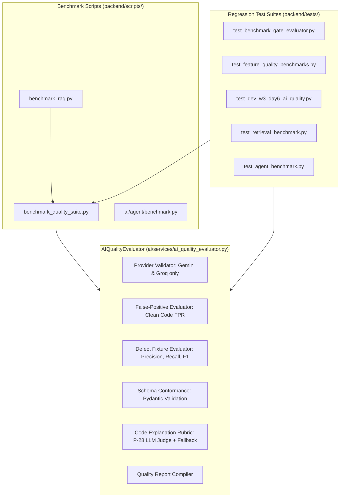

# AI Quality Evaluation & Benchmark Architecture (Phase 0 Audit)

## 1. Executive Summary

This document presents the Phase 0 audit of the AI quality evaluation and benchmarking infrastructure in the **AI-Powered Software Development Platform**, covering `AIQualityEvaluator`, `benchmark_quality_suite.py`, `benchmark_rag.py`, and related test suites.

The evaluation infrastructure measures LLM response quality, provider compliance, false-positive rates on clean code, precision/recall on known defect fixtures, schema conformance, explanation rubrics, and retrieval accuracy. However, several critical vulnerabilities and architectural gaps exist—most notably a **P0 Benchmark Gating Bug** where below-threshold or missing metrics can pass, and empty sample evaluations erroneously return `passed_quality_thresholds = True`.

---

## 2. Inventory of Existing Evaluation Components



### 2.1 `AIQualityEvaluator` (`backend/ai/services/ai_quality_evaluator.py`, 630 LOC)
1. **Provider Allowlist Validation**: Restricts permitted LLM providers to Google Gemini and Groq per ADR-008. Rejects unpermitted providers with `APIError(400)` and unconfigured providers with `APIError(503)`.
2. **Clean-Code False-Positive Evaluation**: Computes false positive rate:
   $$\text{FPR} = \frac{\text{False Positives}}{\text{Total Clean Samples}}$$
3. **Defect Fixture Evaluation**: Computes Precision, Recall, and F1 score:
   $$\text{Precision} = \frac{\text{TP}}{\text{TP} + \text{FP}}, \quad \text{Recall} = \frac{\text{TP}}{\text{TP} + \text{FN}}, \quad F_1 = \frac{2 \cdot \text{Precision} \cdot \text{Recall}}{\text{Precision} + \text{Recall}}$$
4. **Schema Conformance**: Validates raw JSON strings against Pydantic models with markdown code fence stripping (`OutputValidator.clean_json_text`).
5. **Code Explanation Quality Rubric**: 5-dimension rubric (factual accuracy, completeness, call-graph clarity, citation grounding, redaction transparency) with deterministic rubric and LLM-as-judge (`P-28`).

### 2.2 Benchmark Scripts (`backend/scripts/`)
1. **`benchmark_quality_suite.py` (1,281 LOC)**: Evaluates RAG retrieval (hit rate@5, MRR, precision@1, latency), bug detection (precision, recall, FPR across CWEs and languages), code review grounding (line boundedness, 0% hallucinations), and test generation safety/syntax.
2. **`benchmark_rag.py` (86 LOC)**: Standalone command-line runner evaluating the 150-query retrieval dataset.
3. **`backend/ai/agent/benchmark.py` (148 LOC)**: Evaluates normal vs agentic repository chat across 35 multi-turn questions.

---

## 3. Critical Problems and Technical Gaps Identified

### Gap 1: Critical Benchmark Gating Bug (P0)
1. **Empty Sample False Pass**: In `AIQualityEvaluator.generate_quality_report()` (lines 247–254 and 599–605):
   ```python
   denom_precision = true_positives + false_positives
   precision = (true_positives / denom_precision) if denom_precision > 0 else 1.0

   denom_recall = true_positives + false_negatives
   recall = (true_positives / denom_recall) if denom_recall > 0 else 1.0
   ```
   When `clean_samples = []` and `defect_fixtures = []`:
   - `total_samples = 0`
   - `precision` defaults to `1.0 >= 0.80` (PASS)
   - `recall` defaults to `1.0 >= 0.80` (PASS)
   - `fp_rate` defaults to `0.0 <= 0.05` (PASS)
   - `passed_quality_thresholds` returns `True`!
   *An evaluation where zero tests ran incorrectly passes the quality gate.*
2. **Informational Hardcoded Pass**: In `benchmark_quality_suite.py` line 1222:
   ```markdown
   | **Precision@5** | **{rag['precision_at_5']*100:.1f}%** | Informational | ✅ PASS |
   ```
   `Precision@5` is rendered with `✅ PASS` unconditionally, regardless of measured accuracy.
3. **Incomplete Metric Gating in Overall Status**: In `benchmark_quality_suite.py` lines 1176–1187 (`all_passed`):
   - `rag['precision_at_1']` (target $\ge 70\%$) is **omitted** from `all_passed`.
   - `rag['recall_at_5']` (target $\ge 80\%$) is **omitted** from `all_passed`.
   - `rag['latency_p50_ms']` (target $< 100$ms) and `latency_p95_ms` (target $< 250$ms) are **omitted**.
   - `bug['f1_score']` (target $\ge 0.850$) is **omitted**.
   - In `benchmark_rag.py` lines 68–73, only `target_hit_rate_met` and `target_mrr_met` are checked; latency and precision@1 failures still exit with code 0 (`PASS`).
4. **Lack of Value Sanitization**: `evaluate_metric` does not validate against `NaN`, $+\infty$, or $-\infty$.

### Gap 2: Small and Ad-Hoc Fixture Suite (P1)
- Bug detection currently uses only 8 hardcoded defect cases and 4 clean cases in `benchmark_quality_suite.py`.
- Lacks isolated external fixtures for security vulnerabilities, concurrency defects, performance issues, and resource leaks.
- Fixtures lack structured metadata (CWE IDs, difficulty, reproduction commands).

### Gap 3: Absence of Automated CI Quality Workflow (P1)
- No scheduled nightly workflow runs the quality suite against recorded fixtures.
- PR workflows do not run lightweight offline fixture evaluations, allowing silent quality regressions to reach `main`.

### Gap 4: Absence of End-to-End Agent Benchmark (P3)
- Benchmarks measure static finding accuracy and retrieval similarity, but do not evaluate the autonomous agent's ability to ingest an issue, edit files, run tests, and fix real bugs (SWE-bench style).

---

## 4. Phase 1 Implementation Plan

1. **Create Generic `QualityGate` Engine** in `backend/ai/evaluation/quality_gate.py`:
   - Centralized configuration schema (`QualityGateConfig`, `MetricThreshold`).
   - Operators: `gte`, `gt`, `lte`, `lt`, `eq`.
   - Mathematical safety: reject `NaN`, $\pm\infty$, validate finite numbers.
   - Enforce minimum sample counts: zero samples fail closed.
   - Strict aggregate gating: every mandatory metric must pass for `all_passed = True`.
2. **Update `AIQualityEvaluator` and `benchmark_quality_suite.py`**:
   - Refactor `generate_quality_report` to utilize `QualityGate`.
   - Eliminate zero-denominator `1.0` defaults when total samples are zero.
   - Include all mandatory metrics (`precision_at_1`, `recall_at_5`, `latency_p50`, `latency_p95`, `f1_score`) in overall gate status.
3. **Add Comprehensive Unit Tests** in `backend/tests/test_benchmark_gate_evaluator.py`.
