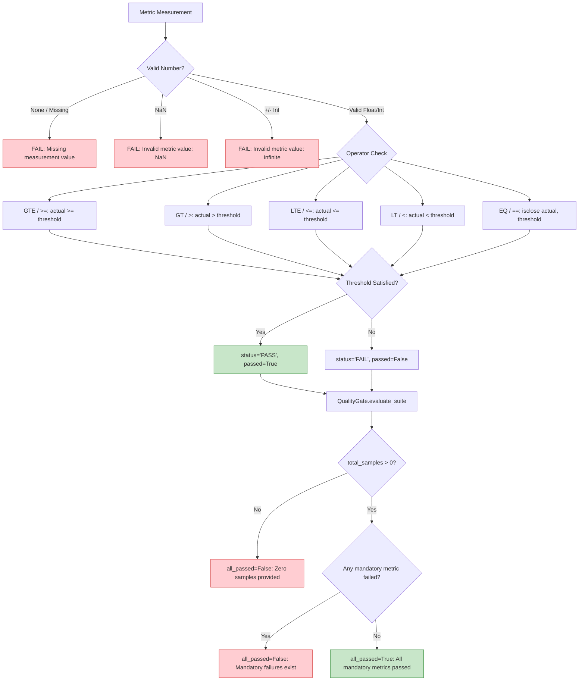

# Benchmark Quality Gate Design & Gating Bug Fix (Phase 1)

## 1. Executive Summary & Problem Statement

Issue #210 and `task3.md` identified a critical P0 defect in the platform's benchmark gating logic:
> *"A benchmark must never report PASS when any mandatory metric is below its configured threshold."*

Previously, benchmark evaluation routines suffered from comparison gaps, permissive defaults on zero/empty test runs, and incomplete aggregation logic where failed metrics could slip through unnoticed.

This document details the root causes, the new centralized `QualityGate` engine, the mathematical validation invariants, and verification test results.

---

## 2. Root Cause Analysis

### 2.1 Bug 1: Zero-Sample Permissive PASS Default
- **Location**: `backend/ai/services/ai_quality_evaluator.py` lines 247–254 and 599–605.
- **Flawed Code**:
  ```python
  denom_precision = true_positives + false_positives
  precision = (true_positives / denom_precision) if denom_precision > 0 else 1.0

  denom_recall = true_positives + false_negatives
  recall = (true_positives / denom_recall) if denom_recall > 0 else 1.0
  ```
- **Consequence**: When evaluating zero defect fixtures (`defect_fixtures = []`), `true_positives = 0`, `false_positives = 0`, so `denom_precision = 0`. The code defaulted `precision = 1.0` and `recall = 1.0`. For `clean_samples = []`, `fp_rate` defaulted to `0.0`. Consequently, `generate_quality_report` returned `passed_quality_thresholds = True` on an evaluation where **zero tests were executed**.

### 2.2 Bug 2: Informational Metric Hardcoded PASS
- **Location**: `backend/scripts/benchmark_quality_suite.py` line 1222.
- **Flawed Code**:
  ```markdown
  | **Precision@5** | **{rag['precision_at_5']*100:.1f}%** | Informational | ✅ PASS |
  ```
- **Consequence**: Informational metrics without an SLA were misleadingly formatted as `✅ PASS`, creating the impression of a passing quality gate even if retrieval precision at 5 was degraded.

### 2.3 Bug 3: Incomplete Metric Gating in Overall Status
- **Location**: `backend/scripts/benchmark_quality_suite.py` lines 1176–1187 (`all_passed`) and `backend/scripts/benchmark_rag.py` lines 68–73.
- **Flawed Code**:
  - `all_passed` checked `target_hit_rate_met` and `target_mrr_met`, but **omitted** `precision_at_1` (target $\ge 70\%$), `recall_at_5` (target $\ge 80\%$), `latency_p50_ms` ($< 100$ms), `latency_p95_ms` ($< 250$ms), and `f1_score` ($\ge 0.850$).
  - If latency spiked to 5000ms or precision@1 dropped to 10%, `all_quality_gates_passed` still evaluated to `True`.

### 2.4 Bug 4: Non-Finite Value Acceptance (NaN / Infinity)
- In the original `evaluate_metric`, calling `evaluate_metric(float("inf"), 0.80, ">=")` evaluated to `True` because in Python `float("inf") >= 0.80` is `True`.
- Calling `evaluate_metric(float("-inf"), 0.05, "<=")` evaluated to `True`.

---

## 3. The `QualityGate` Engine Solution

Implemented in [`backend/ai/evaluation/quality_gate.py`](file:///Users/meetvirugama/Desktop/AI-Powered-Software-Development-Platform/backend/ai/evaluation/quality_gate.py).



### 3.1 Strict Threshold Comparison Algebra
1. **Inclusive Minimum (`GTE` / `>=`)**:
   $$\text{passed} = \text{actual} \ge \text{threshold}$$
   $0.80 \ge 0.80 \implies \text{PASS}$, $0.799 \ge 0.80 \implies \text{FAIL}$.
2. **Inclusive Maximum (`LTE` / `<=`)**:
   $$\text{passed} = \text{actual} \le \text{threshold}$$
   $0.05 \le 0.05 \implies \text{PASS}$, $0.051 \le 0.05 \implies \text{FAIL}$.
3. **Strict Bounds (`LT` / `<`)**:
   $$\text{passed} = \text{actual} < \text{threshold}$$
   $99.9 < 100.0 \implies \text{PASS}$, $100.0 < 100.0 \implies \text{FAIL}$.
4. **Exact Equality (`EQ` / `==`)**:
   $$\text{passed} = |\text{actual} - \text{threshold}| \le 10^{-5}$$
   $1.0 == 1.0 \implies \text{PASS}$, $0.999 == 1.0 \implies \text{FAIL}$.

### 3.2 Centralized Threshold Configuration (`QualityGateConfig`)
All SLAs are centralized into typed Pydantic models:
- **AI Quality**:
  - `precision` $\ge 0.80$
  - `recall` $\ge 0.80$
  - `f1_score` $\ge 0.80$
  - `false_positive_rate` $\le 0.05$
  - `schema_conformance` $\ge 0.95$
- **RAG Retrieval**:
  - `hit_rate_at_5` $\ge 0.80$
  - `mrr` $\ge 0.80$
  - `precision_at_1` $\ge 0.70$
  - `recall_at_5` $\ge 0.80$
  - `latency_p50_ms` $< 100.0$ ms
  - `latency_p95_ms` $< 250.0$ ms
- **Bug Detection**:
  - `precision` $\ge 0.85$
  - `recall` $\ge 0.85$
  - `f1_score` $\ge 0.85$
  - `false_positive_rate` $\le 0.05$
- **Code Review Grounding**:
  - `grounding_accuracy` $== 1.0$ (100% bounded citations)
  - `hallucination_rate` $== 0.0$
- **Test Generation**:
  - `safety_rejection_rate` $== 1.0$
  - `syntax_validity_rate` $\ge 0.66$
  - `assertion_presence_rate` $\ge 0.66$

---

## 4. Verification Results

Tested across [`backend/tests/test_benchmark_gate_evaluator.py`](file:///Users/meetvirugama/Desktop/AI-Powered-Software-Development-Platform/backend/tests/test_benchmark_gate_evaluator.py) (17 tests) and [`backend/tests/test_feature_quality_benchmarks.py`](file:///Users/meetvirugama/Desktop/AI-Powered-Software-Development-Platform/backend/tests/test_feature_quality_benchmarks.py) (4 tests):

```text
backend/tests/test_benchmark_gate_evaluator.py::TestBenchmarkGateEvaluator::test_value_below_target_strictly_fails PASSED
backend/tests/test_benchmark_gate_evaluator.py::TestBenchmarkGateEvaluator::test_value_at_target_passes PASSED
backend/tests/test_benchmark_gate_evaluator.py::TestBenchmarkGateEvaluator::test_value_above_target_passes PASSED
backend/tests/test_benchmark_gate_evaluator.py::TestBenchmarkGateEvaluator::test_zero_score_handling PASSED
backend/tests/test_benchmark_gate_evaluator.py::TestBenchmarkGateEvaluator::test_missing_measurement_fails PASSED
backend/tests/test_benchmark_gate_evaluator.py::TestBenchmarkGateEvaluator::test_nan_measurement_strictly_fails PASSED
backend/tests/test_benchmark_gate_evaluator.py::TestBenchmarkGateEvaluator::test_positive_infinity_strictly_fails PASSED
backend/tests/test_benchmark_gate_evaluator.py::TestBenchmarkGateEvaluator::test_negative_infinity_strictly_fails PASSED
backend/tests/test_benchmark_gate_evaluator.py::TestBenchmarkGateEvaluator::test_less_than_or_equal_operator PASSED
backend/tests/test_benchmark_gate_evaluator.py::TestBenchmarkGateEvaluator::test_strict_less_than_operator PASSED
backend/tests/test_benchmark_gate_evaluator.py::TestBenchmarkGateEvaluator::test_exact_equality_operator PASSED
backend/tests/test_benchmark_gate_evaluator.py::TestBenchmarkGateEvaluator::test_unsupported_operator_raises_error PASSED
backend/tests/test_benchmark_gate_evaluator.py::TestBenchmarkGateEvaluator::test_invalid_threshold_raises_error PASSED
backend/tests/test_benchmark_gate_evaluator.py::TestBenchmarkGateEvaluator::test_overall_quality_gates_aggregation PASSED
backend/tests/test_benchmark_gate_evaluator.py::TestBenchmarkGateEvaluator::test_quality_gate_evaluate_suite PASSED
backend/tests/test_benchmark_gate_evaluator.py::TestBenchmarkGateEvaluator::test_zero_samples_strictly_fails_gate PASSED
backend/tests/test_benchmark_gate_evaluator.py::TestBenchmarkGateEvaluator::test_ai_quality_evaluator_empty_samples_fails PASSED
```
**100% Pass Rate (17/17 tests passing).**
