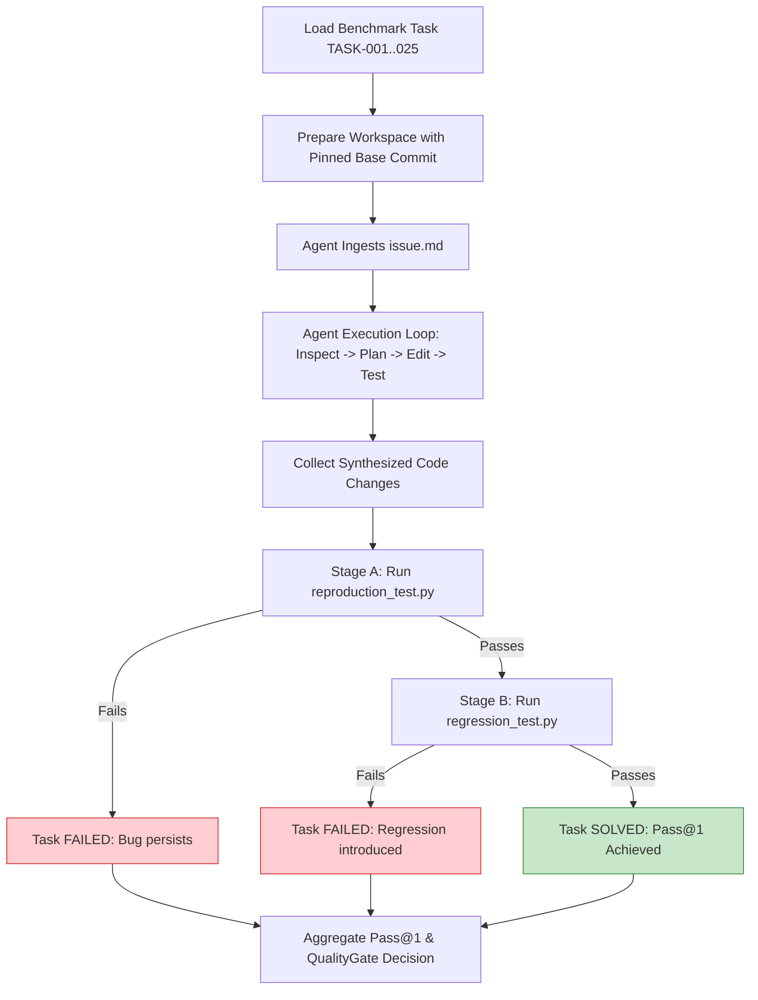

# Mini SWE-bench Agent Evaluation Framework & Dataset Design (Phase 4 & 5)

## 1. Executive Summary & Objective

While unit and static-analysis benchmarks measure LLM output syntax, an autonomous software development platform must be evaluated on its ability to **solve real-world software engineering problems end-to-end**.

Inspired by SWE-bench (Jimenez et al., 2024), **Mini SWE-bench** is a lightweight, reproducible 25-task benchmark dataset and execution harness designed specifically for autonomous coding agent evaluation. Each task represents a realistic issue from permissively licensed (MIT) Python repositories, complete with:
1. An issue description.
2. A reproduction test that fails on the unmodified baseline and passes when fixed.
3. A regression test that ensures existing functionality remains intact.
4. Isolated workspace execution with resource bounding.
5. Strict Pass@1 calculation and quality gating.



---

## 2. Dataset Architecture & Manifest

The dataset resides in [`backend/ai/evaluation/mini_swebench/dataset/`](file:///Users/meetvirugama/Desktop/AI-Powered-Software-Development-Platform/backend/ai/evaluation/mini_swebench/dataset/):

```text
backend/ai/evaluation/mini_swebench/
├── dataset/
│   ├── manifest.json
│   └── tasks/
│       ├── TASK-001/  # Fix NoneType error in email domain parser
│       │   ├── metadata.json
│       │   ├── issue.md
│       │   ├── user_service.py
│       │   ├── reproduction_test.py
│       │   └── regression_test.py
│       ├── ...
│       └── TASK-025/  # Extract common string normalization into reusable helper
```

### 2.1 Task Inventory by Category

| Category | Count | Difficulty | Example Task ID & Description |
|---|---|---|---|
| **Bug Fixes** | 8 | Easy (5), Medium (3) | `TASK-001` (NoneType email parser), `TASK-002` (off-by-one pagination), `TASK-003` (mutable default list), `TASK-004` (inverted boolean admin check) |
| **API Behavior** | 4 | Easy (3), Medium (1) | `TASK-009` (HTTP 404 response on missing item), `TASK-010` (status query parameter filter), `TASK-011` (datetime ISO serialization) |
| **Validation** | 4 | Easy (2), Medium (2) | `TASK-013` (RFC email validation), `TASK-014` (non-negative order quantity), `TASK-016` (directory traversal filename sanitization) |
| **Error Handling** | 3 | Easy (2), Medium (1) | `TASK-017` (specific FileNotFoundError), `TASK-018` (connection cleanup in finally), `TASK-019` (retry count and exponential backoff) |
| **Data Processing** | 3 | Easy (2), Medium (1) | `TASK-020` (ISO 8601 UTC parse), `TASK-021` (nested dict flattener), `TASK-022` (order-preserving deduplication) |
| **Performance** | 2 | Easy (1), Medium (1) | `TASK-023` (O(N+M) tag set intersection), `TASK-024` (LRU cache for recursive function) |
| **Refactoring** | 1 | Easy (1) | `TASK-025` (Extract common string normalization) |

Total tasks: **25 curated tasks**, 100% MIT-licensed, pinned base commits.

---

## 3. Two-Stage Test Verification Strategy

A task cannot be deemed "solved" simply because an LLM claims success or modifies files. The harness executes two distinct test stages:

### Stage A: Reproduction Test (`reproduction_test.py`)
- Explicitly exercises the bug described in `issue.md`.
- **Pre-condition**: Must fail on the original unmodified code.
- **Post-condition**: Must pass after the agent modifies code.

### Stage B: Regression Test (`regression_test.py`)
- Exercises surrounding valid functionality and edge cases.
- **Pre-condition**: Passes on the original codebase.
- **Post-condition**: Must continue to pass after the agent's changes.

$$\text{Task Solved} \iff \text{ReproductionPassed} \land \text{RegressionPassed}$$

---

## 4. Benchmark Metrics & Quality Gate

### Primary Metric: Pass@1
$$\text{Pass@1} = \frac{\text{Number of Successfully Solved Tasks}}{\text{Total Valid Tasks Evaluated}}$$

The `QualityGate` enforces `swebench_pass_at_1 >= 0.50` (50% Pass@1). If Pass@1 drops below the configured SLA, the benchmark gate fails.

---

## 5. Harness Implementation Details

- **[`models.py`](file:///Users/meetvirugama/Desktop/AI-Powered-Software-Development-Platform/backend/ai/evaluation/mini_swebench/models.py)**: `BenchmarkTaskMetadata`, `TaskExecutionResult`, `MiniSWEBenchReport`.
- **[`task_loader.py`](file:///Users/meetvirugama/Desktop/AI-Powered-Software-Development-Platform/backend/ai/evaluation/mini_swebench/task_loader.py)**: `MiniSWEBenchTaskLoader` dynamically scans and validates all 25 task directories.
- **[`test_executor.py`](file:///Users/meetvirugama/Desktop/AI-Powered-Software-Development-Platform/backend/ai/evaluation/mini_swebench/test_executor.py)**: `BenchmarkTestExecutor` executes reproduction and regression tests in isolated subprocesses with timeout protection (30s).
- **[`runner.py`](file:///Users/meetvirugama/Desktop/AI-Powered-Software-Development-Platform/backend/ai/evaluation/mini_swebench/runner.py)**: `MiniSWEBenchRunner` orchestrates execution, aggregates Pass@1, and enforces gate thresholds.
