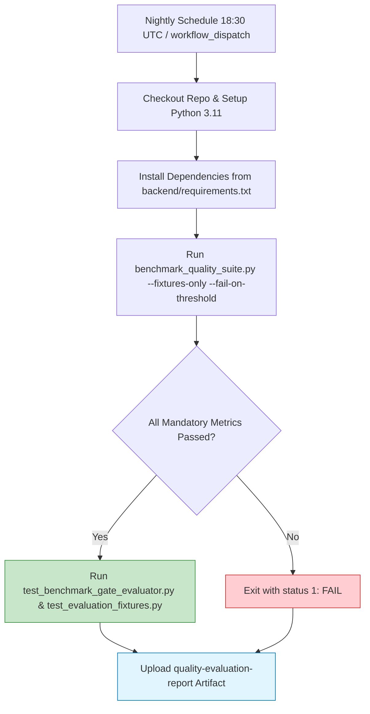

# Nightly AI Quality CI Workflow & Execution Guide (Phase 3)

## 1. Objective & Architecture

To prevent silent quality degradation across AI prompt revisions, model migrations, or retrieval logic updates, the platform implements an automated nightly CI workflow in `.github/workflows/nightly-quality-evaluation.yml`.



---

## 2. CI Execution Separation: PR vs Nightly

| Characteristic | Pull Request Workflow (`main_ai-powered-dev-platform-api.yml`) | Nightly Quality Workflow (`nightly-quality-evaluation.yml`) |
|---|---|---|
| **Trigger** | Every PR and push to `main` | Nightly cron (`30 18 * * *`) + manual `workflow_dispatch` |
| **Duration Target** | $< 3$ minutes | $3 - 5$ minutes |
| **LLM Network Calls** | **Strictly ZERO** (Mocked unit & integration tests) | **Strictly ZERO** (Offline recorded fixture evaluation) |
| **Scope** | Unit tests, static analysis, syntax verification, security lint | RAG retrieval hit rate/MRR, bug precision/recall, code review line grounding, test generation syntax/safety |
| **Gating Enforcement** | Pytest failure aborts merge | Mandatory metric failure (`--fail-on-threshold`) exits with non-zero code |
| **Artifact Output** | Test coverage reports | `Docs/quality_benchmark_report.md` & `reports/quality-metrics.json` |

---

## 3. Strict Failure Behaviour

1. **Deterministic Exit Codes**:
   - When `--fail-on-threshold` is supplied, `benchmark_quality_suite.py` checks `res["all_quality_gates_passed"]`.
   - If any mandatory metric is below SLA (e.g., hit rate $< 80\%$, bug precision $< 85\%$, hallucination rate $> 0\%$, or sample count $= 0$), the runner prints:
     ```text
     ❌ CI Gate Failure: One or more mandatory quality metrics did not achieve threshold.
     ```
     and terminates with `sys.exit(1)`.
2. **Guaranteed Report Generation**:
   - `if: always()` in GitHub Actions ensures that `quality-metrics.json` and `quality_benchmark_report.md` are uploaded as CI artifacts even when a threshold failure causes the job to fail.
   - Engineers can inspect the uploaded JSON artifact to pinpoint exactly which metric regressed.

---

## 4. Local Execution & Manual Verification

Developers can run the exact nightly quality suite locally:

```bash
# Activate environment
source .venv/bin/activate

# Execute fixture-only benchmark suite with strict gating
python backend/scripts/benchmark_quality_suite.py \
  --fixtures-only \
  --fail-on-threshold \
  --output-json reports/quality-metrics.json \
  --output-md Docs/quality_benchmark_report.md
```
