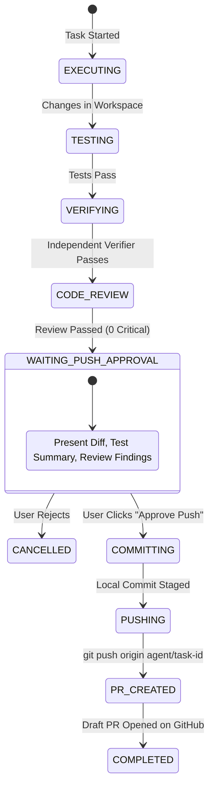
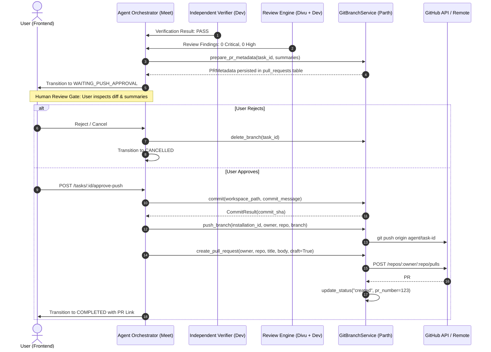

# GitHub Integration Architecture & Audit Report
**Author:** Parth — GitHub Integration Lead  
**Scope:** GitHub Authentication, Issue APIs, Branch Handling, PR Integration, Rate Limiting, Repository Permissions, and Publication Authorization Flow.

---

## 1. Audit of Current GitHub Subsystems

### 1.1 GitHub Authentication
* **Current State:**
  * **App Installation Tokens:** Implemented in `GitHubClient.get_installation_token()` using RS256 JWT exchange against GitHub API (`/app/installations/{installation_id}/access_tokens`).
  * **Database Model:** `GitHubInstallation` stores `installation_id`, `account_login`, `account_id`, and cached access tokens.
  * **User Session Authentication:** Handled via Bearer JWT (`Authorization: Bearer <token>`) containing the authenticated user ID (`sub`), decoded by `app/core/auth.py`.
  * **Repository Ownership Scoping:** `GitBranchService._get_repository()` and `GitHubSourceService` verify that `Repository.user_id == authenticated_user_id` before performing any operations.
* **Findings & Recommendations:**
  * Installation tokens expire after **60 minutes**. Token caching must use Redis with a **55-minute TTL** (`W1-06b`) with auto-eviction on 401 Unauthorized.

---

### 1.2 Issue APIs
* **Current State:**
  * Currently, `GitHubClient` only exposes repository contents, trees, commits, branches, and read-only PR endpoints.
  * No GitHub Issue APIs are exposed in `GitHubClient` or `GitHubSourceService`.
* **Identified Requirement (Feature F-23):**
  * **Issue Creation from AI Findings:** Code Review findings (Dev LLM + Divu Static) need to be exportable as GitHub Issues.
* **Architecture Specification for Issue APIs:**
  * `POST /repos/{owner}/{repo}/issues`: Create issue with title, Markdown body, labels (e.g., `ai-review`, `security`, `bug`), and assignees.
  * `GET /repos/{owner}/{repo}/issues/{issue_number}`: Fetch issue status and comments.
  * `PATCH /repos/{owner}/{repo}/issues/{issue_number}`: Close or update issue when an agent auto-fix PR is merged.

---

### 1.3 Branch Handling
* **Current State:** Fully implemented across Week 2 Days 1–4.
  * **Naming Convention:** Strict canonical format `agent/task-{short_id}` (e.g., `agent/task-f47ac10b`).
  * **Execution Isolation:** `GitBranchService.on_task_executing()` creates the isolated branch from the default branch (`main`) pointing to the base commit SHA.
  * **Idempotency:** When tasks are paused and resumed, existing branches are detected via `branch_exists()` and marked `ready` without duplicate ref creation.
  * **Default Branch Protection:** `delete_branch()` explicitly blocks deleting the repository's default branch.
  * **Commit Staging (Week 2 Day 4):** `GitBranchService.commit()` stages workspace changes into local git commits on the agent branch without pushing to remote.

---

### 1.4 Pull Request Integration
* **Current State:**
  * **Read Operations:** `GitHubClient` provides `list_pull_requests()`, `get_pull_request()`, `get_pull_request_files()`, and `GitHubSourceService.get_pull_request_diff()`.
  * **Metadata Storage (Week 2 Day 5):** `PullRequest` database model and `PullRequestRepository` persist task PR metadata (`task_id`, `branch`, `base_branch`, `changed_files`, `commit_message`, `test_summary`, `verification_summary`).
* **Week 3 Deliverables Needed:**
  * `GitHubService.push_branch()`: Authenticated push from workspace to GitHub.
  * `GitHubService.create_pull_request()`: Opens a **Draft Pull Request** on GitHub with structured metadata body.

---

## 2. Repository Permission & Rate-Limit Behavior

### 2.1 GitHub App Permission Scopes
The platform requires specific GitHub App permission matrices. Any missing permission causes GitHub to return `403 Resource not accessible by integration`.

| Category | Permission Level | Rationale & Operations |
| :--- | :--- | :--- |
| **Repository Contents** | `Read & Write` | • Clone repository into workspace • Create agent branches (`POST /git/refs`) • Push commits and delete branches on task cancellation |
| **Pull Requests** | `Read & Write` | • Create draft pull requests (`POST /repos/.../pulls`) • Attach review findings & verification summaries to PR body • Fetch PR diffs and changed files |
| **Issues** | `Read & Write` | • Create issues from unaddressed review findings (`POST /issues`) • Link PRs to existing issue numbers |
| **Repository Metadata** | `Read-only` | • Resolve repository default branch and basic details |
| **Webhooks** | Subscribed | • `push`, `pull_request`, `pull_request_review`, `installation` |

### 2.2 Rate-Limit Behavior & Resilience Policies
* **GitHub Limits:**
  * **Installation Tokens:** 5,000 requests per hour per installation.
  * **Search API:** 30 requests per minute.
  * **Secondary Rate Limits:** Triggered if more than 100 concurrent requests or rapid burst writes occur.
* **Rate-Limit Response Headers:**
  * `X-RateLimit-Limit`: Maximum requests per hour.
  * `X-RateLimit-Remaining`: Requests remaining in the current window.
  * `X-RateLimit-Reset`: Unix epoch timestamp when quota resets.
  * `Retry-After`: Delay in seconds (present during secondary rate limiting or HTTP 429).
* **Platform Resilience Strategy:**
  1. **HTTP 401 Unauthorized:** Invalidate cached Redis token, re-mint token via JWT, and retry once.
  2. **HTTP 403 Forbidden with `x-ratelimit-remaining == 0` or HTTP 429:**
     * Read `X-RateLimit-Reset` or `Retry-After`.
     * Sleep asynchronously until reset (or fail fast with `retryable=True` if reset > 60s).
  3. **HTTP 403 Permission Denied:** Do NOT retry; raise structured `APIError(403, GITHUB_PERMISSION_DENIED)`.
  4. **HTTP 5xx Server Errors:** Bounded exponential backoff with jitter (`attempt < 3`).

---

## 3. Publication Authorization Flow

The **Publication Authorization Flow** is the mandatory security gate that guarantees **no code is ever pushed to GitHub or merged without explicit human sign-off**.

### 3.1 Architecture State Machine

### 3.2 Step-by-Step Authorization Sequence

### 3.3 Hard Enforcement Rules
1. **Rule 553:** Only Parth's service creates commits and pushes branches. No other module invokes `git` or GitHub push APIs directly.
2. **Rule 554:** The PR is created **after** human approval. The orchestrator must enter `WAITING_PUSH_APPROVAL` and receive explicit confirmation before `push_branch` is called.
3. **Rule 563:** Direct push to `main` is strictly prohibited. Pushes must target isolated `agent/task-{id}` branches only.
4. **Draft PR by Default:** All agent PRs are created with `draft: True` so CI and team maintainers can review without accidental merges.
