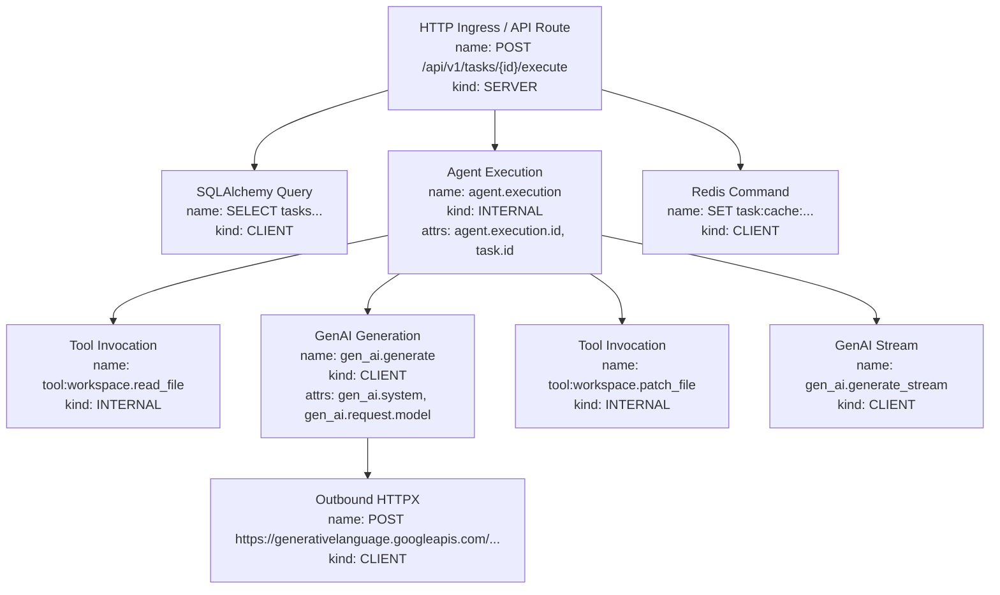

# Distributed Tracing Design

> **Project:** AI-Powered Software Development Platform  
> **Feature:** F31 — Logging, telemetry, health: Distributed Tracing, LLM Observability & Agent Execution Monitoring  
> **Status:** Active / Production-Ready  
> **Related Issue:** [#212](https://github.com/Meetvirugama/AI-Powered-Software-Development-Platform/issues/212)

---

## 1. Trace Context Propagation

Distributed tracing across platform services adheres to the **W3C TraceContext** standard (`traceparent` and `tracestate` headers). Inbound HTTP requests received by FastAPI automatically extract any upstream trace context, establishing a child span within an ongoing distributed trace. If no upstream context is present, FastAPI generates a fresh root trace.

For asynchronous background jobs and message queues, the W3C TraceContext is serialized and propagated via message headers, allowing Celery, Redis, or background tasks to maintain parent-child relationships across asynchronous boundaries.

```
Format: traceparent: {version}-{trace_id}-{parent_id}-{trace_flags}
Example: traceparent: 00-4bf92f3577b34da6a3ce929d0e0e4736-00f067aa0ba902b7-01
```

---

## 2. Span Hierarchy and Tree Topology

Every distributed operation executed within the platform forms an explicit hierarchical directed acyclic graph (DAG):



### Contextual Identifiers Enriched on Spans

Spans capture key domain identifiers allowing instant correlation across queries:
- `request_id`: Extracted from HTTP header `X-Request-ID` or generated by middleware.
- `analysis_run_id`: The primary key of the `AnalysisRun` record being processed.
- `agent_execution_id`: The unique execution instance of an autonomous agent run.
- `task_id`: The ID of the parent task being resolved.
- `repository_id`: The repository subject to analysis or modification.

---

## 3. Auto-Instrumentation Architecture

OpenTelemetry framework auto-instrumentations are configured during application startup in `app.core.lifespan.lifespan()` via `app.observability.instrumentation`.

### 3.1 FastAPI Ingress (`instrument_fastapi`)

- Uses `opentelemetry.instrumentation.fastapi.FastAPIInstrumentor`.
- Injects `X-Trace-ID` and `X-Span-ID` into response headers for client diagnostics.
- Excluded URLs: Health and documentation routes are explicitly omitted to prevent exporter clutter and metric skew:
  ```python
  _EXCLUDED_URLS = "health,health/live,health/ready,docs,redoc,openapi.json"
  ```
- Redacts authorization headers from span attributes: `authorization`, `cookie`, `proxy-authorization`.

### 3.2 HTTPX Outbound Client (`instrument_httpx`)

- Uses `opentelemetry.instrumentation.httpx.HTTPXClientInstrumentor`.
- Injects standard W3C `traceparent` headers into outbound HTTP calls.
- Applied automatically to all `httpx.AsyncClient` instances used by the GitHub integration, Gemini provider, and Groq provider.
- Sanitizes query parameters and authorization headers in URL strings before tagging span attributes.

### 3.3 SQLAlchemy Database Engine (`instrument_sqlalchemy`)

- Uses `opentelemetry.instrumentation.sqlalchemy.SQLAlchemyInstrumentor`.
- Binds to the application `AsyncEngine` (`app.core.database.engine`).
- Parameter Masking: Configured with `enable_commenter=False` and parameter values omitted to prevent PII or database credential leakage into trace spans.
- Captures SQL statement names (`SELECT`, `INSERT`, `UPDATE`), execution duration, and connection checkout latency.

### 3.4 Redis Cache Client (`instrument_redis`)

- Uses `opentelemetry.instrumentation.redis.RedisInstrumentor`.
- Captures cache hits, misses, command names (`GET`, `SET`, `HGETALL`), and duration.
- Redacts argument values for security-sensitive keys (e.g. session tokens, webhook secrets).

---

## 4. Sampling Strategy

Tracing high-throughput operations requires robust sampling to balance operational visibility against exporter network overhead and storage costs.

The platform implements a **Parent-Based Ratio Sampler**:

```python
from opentelemetry.sdk.trace.sampling import ParentBased, TraceIdRatioBased

sampler = ParentBased(root=TraceIdRatioBased(sample_rate))
```

### Sampling Rules:
1. **Parent-Based Respect:** If an upstream client or service has already made a sampling decision (recorded in `traceparent` flags), the backend respects that decision to maintain unbroken end-to-end traces.
2. **Deterministic Ratio Sampling:** For root requests originating at the API boundary, the sampler applies a ratio defined by `OTEL_TRACE_SAMPLE_RATE` (default: `1.0` in development/staging, configurable to `0.1`–`0.25` in high-throughput production).
3. **Always-Sample on Errors:** If an unhandled exception or HTTP 5xx error occurs within a span, the span processor ensures the trace is recorded regardless of sampling ratio.

---

## 5. Exporter Pipeline and Resiliency

The OpenTelemetry tracer provider is wired to a `BatchSpanProcessor` with bounded memory queues:

```python
exporter = OTLPSpanExporter(
    endpoint=settings.otel_exporter_otlp_endpoint,
    headers=parsed_headers,
    timeout=5,
)
tracer_provider.add_span_processor(
    BatchSpanProcessor(
        exporter,
        max_queue_size=2048,
        schedule_delay_millis=5000,
        max_export_batch_size=512,
        export_timeout_millis=30000,
    )
)
```

### Resiliency Guarantees:
- **Non-blocking Dispatch:** Spans are queued in memory and dispatched in background worker threads.
- **Circuit Breaking / Drop on Overflow:** If the remote collector is down or network latency causes queue saturation (> 2048 spans), new spans are dropped gracefully without slowing down API requests.
- **Graceful Shutdown:** During FastAPI application termination, `shutdown_telemetry()` flushes remaining spans with a 5-second deadline.
