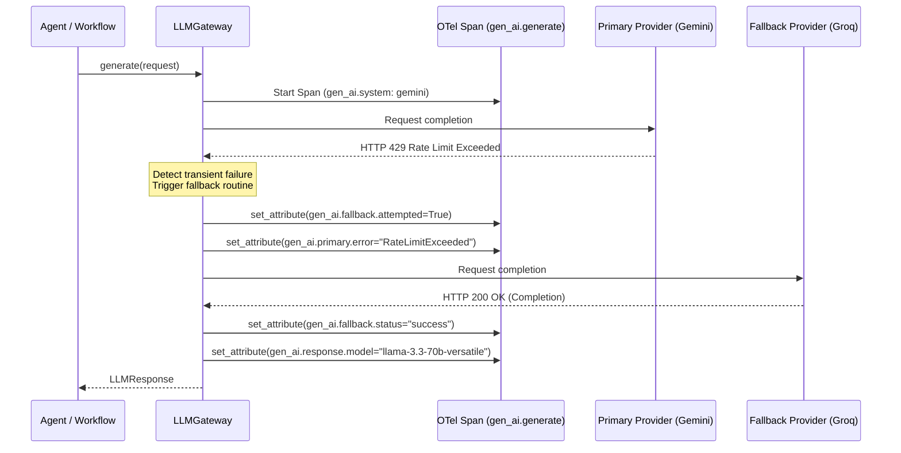

# GenAI Observability & Semantic Tracing

> **Project:** AI-Powered Software Development Platform  
> **Feature:** F31 — Logging, telemetry, health: Distributed Tracing, LLM Observability & Agent Execution Monitoring  
> **Status:** Active / Production-Ready  
> **Related Issue:** [#212](https://github.com/Meetvirugama/AI-Powered-Software-Development-Platform/issues/212)

---

## 1. Overview

GenAI Observability instruments all large language model (LLM) calls, multi-turn reasoning loops, and autonomous tool interactions across the platform. Built directly into the unified `LLMGateway` (Feature F28) and `ToolRouter`, this system adheres strictly to the **OpenTelemetry GenAI Semantic Conventions**, providing standardized telemetry across Gemini and Groq providers.

---

## 2. OpenTelemetry GenAI Semantic Conventions

Spans created for LLM requests are tagged with standard attributes as defined in the OpenTelemetry specification:

| Semantic Attribute Key | Type | Description | Example |
|---|---|---|---|
| `gen_ai.operation.name` | `string` | The GenAI operation performed | `generate`, `generate_stream` |
| `gen_ai.system` | `string` | The underlying AI provider system | `gemini`, `groq` |
| `gen_ai.request.model` | `string` | Target model requested | `gemini-2.5-pro`, `llama-3.3-70b-versatile` |
| `gen_ai.response.model` | `string` | Actual model that fulfilled the request | `gemini-2.5-pro` |
| `gen_ai.request.temperature` | `double` | Sampling temperature requested | `0.2` |
| `gen_ai.request.max_tokens` | `int` | Maximum output tokens configured | `4096` |
| `gen_ai.usage.input_tokens` | `int` | Count of prompt tokens consumed | `1250` |
| `gen_ai.usage.output_tokens` | `int` | Count of completion tokens generated | `340` |
| `gen_ai.usage.total_tokens` | `int` | Total tokens consumed (`input + output`) | `1590` |
| `gen_ai.response.finish_reasons` | `string` | Termination reason reported by provider | `stop`, `max_tokens` |

### Attribute Builder Implementation (`build_llm_span_attributes`)

Located in `app.observability.genai`, `build_llm_span_attributes()` safely compiles request parameters and response usage data into normalized span attributes, redacting any unexpected sensitive fields.

---

## 3. Provider Fallback Tracing

A core capability of the `LLMGateway` is transparent failover from the primary provider (e.g. Gemini) to the fallback provider (e.g. Groq) upon encountering transient errors (HTTP 429 rate limits, HTTP 503 service outages, or connection timeouts).

To enable detailed failure analysis and post-mortem review, when a fallback occurs, the active span records dedicated fallback attributes:

| Fallback Attribute Key | Type | Description |
|---|---|---|
| `gen_ai.fallback.attempted` | `bool` | Set to `True` when primary provider failed and secondary was engaged. |
| `gen_ai.fallback.provider` | `string` | The name of the fallback provider (`groq`, `gemini`). |
| `gen_ai.fallback.status` | `string` | Outcome of the fallback attempt (`success`, `failed`). |
| `gen_ai.primary.error` | `string` | Redacted error message from the failed primary attempt. |



---

## 4. Streaming Observability

Streaming calls invoked via `LLMGateway.generate_stream()` are monitored for time-to-first-token (TTFT), inter-token latency, and total completion time:

1. **Span Span-Time:** The span begins when the stream request is dispatched.
2. **First Chunk Timing:** The gateway records the latency in milliseconds between request dispatch and arrival of chunk 1 (`ttft_ms`).
3. **Usage Accumulation:** As chunks arrive, token estimates or final chunk usage blocks are coalesced.
4. **Span Completion:** When the generator finishes yielding chunks or raises an error, the span records cumulative usage, sets status to `OK` or `ERROR`, and emits metrics.

---

## 5. Token Usage, Latency & Cost Calculation

To support financial governance and budget limits, LLM telemetry calculates real-time USD costs using provider-specific pricing tables calibrated in `app.core.telemetry.get_token_pricing()`:

$$\text{Estimated Cost} = \left(\frac{\text{Input Tokens}}{1,000,000} \times \text{Price}_{\text{in}}\right) + \left(\frac{\text{Output Tokens}}{1,000,000} \times \text{Price}_{\text{out}}\right)$$

Cost estimates are:
1. Recorded on the OpenTelemetry span as `gen_ai.usage.cost_usd`.
2. Passed to `LangfuseAdapter.record_generation()` for aggregate financial reporting in Langfuse.
3. Accumulated within `StageExecutionTimer` and persisted to `AnalysisRun.result_payload["stage_metrics"]`.

---

## 6. Autonomous Agent Tool Invocation Tracing

When autonomous agents make decisions using tools (e.g. `workspace.read_file`, `workspace.write_file`, `command.run`), the execution is mediated through `ToolRouter.route()`.

Each tool execution produces an OpenTelemetry child span under the active `agent.execution` parent span via `app.observability.agent.trace_tool_invocation`:

```python
with trace_tool_invocation(
    tool_name=tool_name,
    execution_id=execution_id,
    task_id=task_id,
    metadata={"path": file_path},
) as tool_span:
    result = await tool.execute(arguments)
```

### Tool Span Attributes:
- `tool.name`: Name of the tool invoked (`workspace.read_file`, `git.commit`).
- `tool.execution_id`: Agent execution ID.
- `tool.status`: `success` or `error`.
- `tool.duration_s`: Execution time in seconds.
- `tool.metadata.*`: Redacted parameters (e.g., target file path, exit code).
