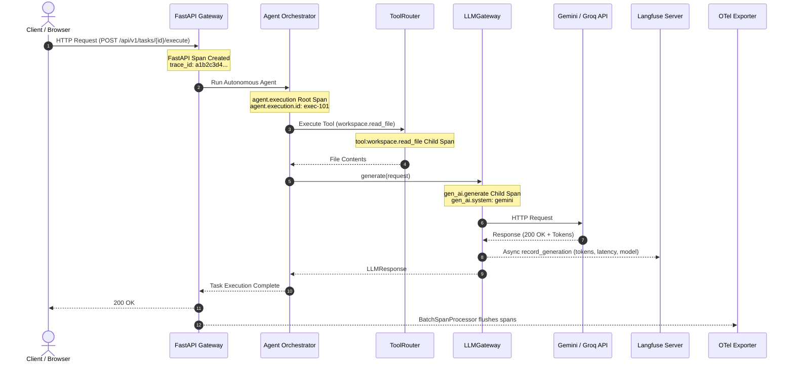

# Observability Architecture

> **Project:** AI-Powered Software Development Platform  
> **Feature:** F31 — Logging, telemetry, health: Distributed Tracing, LLM Observability & Agent Execution Monitoring  
> **Status:** Active / Production-Ready  
> **Related Issue:** [#212](https://github.com/Meetvirugama/AI-Powered-Software-Development-Platform/issues/212)

---

## 1. Executive Summary

The observability architecture provides end-to-end distributed tracing, LLM-specific telemetry, autonomous agent execution monitoring, and structured log correlation across the platform. Built on the **OpenTelemetry (OTel)** open standard and complemented by **Langfuse** for specialized GenAI observability, this architecture delivers deep visibility without introducing single points of failure, exposing credentials, or degrading system latency.

```mermaid
flowchart TD
    Client["Client / IDE / Frontend"] -->|HTTP / TraceParent| FastAPILayer["FastAPI API Gateway"]
    
    subgraph Core Observability Foundation
        FastAPILayer -->|Extract / Inject Context| OTelManager["TelemetryManager (OpenTelemetry SDK)"]
        ContextVars["Context Variables (trace_id, request_id, run_id, agent_id)"] <--> FastAPILayer
        ContextVars --> JSONLogger["JsonFormatter (Structured Logging)"]
    end

    subgraph Instrumentation Layer
        FastAPILayer --> HTTPXInst["HTTPX Instrumentor"]
        FastAPILayer --> SQLAInst["SQLAlchemy Instrumentor"]
        FastAPILayer --> RedisInst["Redis Instrumentor"]
    end

    subgraph Autonomous Agent & Workflow Engine
        FastAPILayer --> AgentExec["Agent Execution Loop (trace_agent_execution)"]
        AgentExec --> ToolRouter["ToolRouter.route() (trace_tool_invocation)"]
        ToolRouter --> Tools["Workspace / Shell / Retrieval Tools"]
    end

    subgraph Unified LLM Gateway (F28)
        AgentExec --> LLMGateway["LLMGateway.generate / generate_stream"]
        LLMGateway --> PrimaryProvider["Primary Provider (Gemini / Groq)"]
        LLMGateway -.->|Fallback on Transient Failure| FallbackProvider["Fallback Provider"]
    end

    subgraph Observability Dispatch
        LLMGateway --> GenAISpan["GenAI Semantic Span (OTel)"]
        LLMGateway --> OTelMetrics["ObservabilityMetrics (Counters & Histograms)"]
        LLMGateway --> LangfuseAdapter["LangfuseAdapter (Fail-Safe LLM Traces)"]
    end

    subgraph Telemetry Sinks
        OTelManager -->|OTLP / HTTP| OTelCollector["OpenTelemetry Collector / Jaeger / Datadog"]
        LangfuseAdapter -->|HTTPS / Batched| LangfuseServer["Langfuse Cloud or Self-Hosted Server"]
        JSONLogger -->|Stdout / JSON Lines| LogAggregator["Loki / CloudWatch / ELK"]
    end
```

---

## 2. Core Architectural Principles

1. **OpenTelemetry as the Unified Open Standard:**  
   All tracing across HTTP ingress, database interactions, cache calls, internal agents, and LLMs adheres strictly to OpenTelemetry specification and GenAI Semantic Conventions.
2. **Langfuse as Dedicated LLM Interface:**  
   While OTel provides uniform latency and graph propagation, Langfuse captures model prompts, completions (subject to privacy toggles), cost calculations, and token usage analytics in a rich web dashboard.
3. **Preservation of In-App Telemetry:**  
   Existing application-level progress tracking—specifically `stage_metrics` stored inside `AnalysisRun.result_payload["stage_metrics"]`—remains untouched. OTel and Langfuse run alongside without modifying frontend-facing schema contracts.
4. **Fail-Closed Privacy & Fail-Safe Telemetry:**  
   Observability failures must never crash business transactions. All Langfuse API calls, exporter failures, and metric emissions are wrapped in defensive isolation. Sensitive credentials, bearer tokens, and secrets are strictly redacted before span creation. Prompt and response recording is disabled by default and requires explicit opt-in.
5. **Decoupled Health & Readiness:**  
   `/health`, `/health/live`, and `/health/ready` check only essential services (PostgreSQL and Redis). The health of external tracing sinks (OTLP endpoints, Langfuse server) never alters the readiness state of the platform.

---

## 3. Component Responsibilities

| Component | Module | Responsibilities |
|---|---|---|
| **TelemetryManager** | `app.observability.telemetry` | Process-wide singleton managing `TracerProvider`, `MeterProvider`, resource attributes (`service.name`, `service.version`), sampling policies, and OTLP / In-Memory span exporters. |
| **JsonFormatter** | `app.core.logging` | Structured JSON log formatter enriched with dynamic OpenTelemetry `trace_id` and `span_id`, plus contextual `request_id`, `analysis_run_id`, and `agent_execution_id`. |
| **GenAI Conventions** | `app.observability.genai` | Defines standardized GenAI semantic attribute keys (`gen_ai.system`, `gen_ai.request.model`, `gen_ai.usage.input_tokens`, etc.) and span attribute builders. |
| **LLMGateway Integration** | `ai.llm.client` | Instruments `generate()` and `generate_stream()` with active GenAI OTel spans, fallback attempt tracking, token latency timing, and Langfuse generation dispatch. |
| **Agent Tracing** | `app.observability.agent` | Provides `trace_agent_execution` and `trace_tool_invocation` context managers with execution ID propagation and exception capture. |
| **LangfuseAdapter** | `app.observability.langfuse_adapter` | Asynchronous, fail-safe client wrapper for Langfuse tracing, handling prompt redaction, generation tracking, and tool execution logging. |
| **ObservabilityMetrics** | `app.observability.metrics` | Bounded-cardinality OTel instruments: `llm_requests_total`, `llm_request_duration_seconds`, `agent_executions_total`, and `tool_invocations_total`. |
| **Instrumentation** | `app.observability.instrumentation` | Auto-instrumentation hooks for FastAPI, HTTPX, SQLAlchemy, and Redis with health check filtering and parameter sanitation. |

---

## 4. End-to-End Trace Lifecycle



---

## 5. Configuration & Environment Variables

All observability behavior is configurable through environment variables defined in `app.core.config.Settings`:

```bash
# OpenTelemetry Configuration
OTEL_ENABLED=true
OTEL_SERVICE_NAME=ai-dev-platform-backend
OTEL_SERVICE_VERSION=1.0.0
OTEL_ENVIRONMENT=production
OTEL_EXPORTER_OTLP_ENDPOINT=http://otel-collector:4318/v1/traces
OTEL_EXPORTER_OTLP_HEADERS=Authorization=Bearer secret_token
OTEL_TRACE_SAMPLE_RATE=1.0
OTEL_METRICS_ENABLED=true

# Langfuse LLM Observability Configuration
LANGFUSE_ENABLED=true
LANGFUSE_PUBLIC_KEY=pk-lf-1234567890
LANGFUSE_SECRET_KEY=sk-lf-0987654321
LANGFUSE_HOST=https://cloud.langfuse.com
LANGFUSE_SAMPLE_RATE=1.0

# Privacy & Security Guardrails
OBSERVABILITY_CAPTURE_PROMPTS=false
OBSERVABILITY_CAPTURE_RESPONSES=false
OBSERVABILITY_MASK_SENSITIVE_DATA=true
```
