# Reliability, Security, and Failure Recovery Audit Report

> **Author**: Prit Zania — Repository Engine & Workspace Lead  
> **Date**: 2026-10-30  
> **Milestone**: Week 3 Day 6 — Reliability, Security, and Failure Recovery  
> **Reference Specs**: [week3.md](file:///d:/AI-Powered-Software-Development-Platform/Docs/week3.md) (§6 F33, F34, F37, F39, §8 Day 6, §11 Scenarios H & J), [daily_tasks.md](file:///d:/AI-Powered-Software-Development-Platform/Docs/daily_tasks.md), [ADR-007](file:///d:/AI-Powered-Software-Development-Platform/Docs/architecture/03_decisions/ADR-007-multi-tenant-isolation.md), [ADR-010](file:///d:/AI-Powered-Software-Development-Platform/Docs/architecture/03_decisions/ADR-010-human-review-checkpoint.md)  
> **Test Suite**: [test_prit_w3_d6_reliability_and_recovery.py](file:///d:/AI-Powered-Software-Development-Platform/backend/tests/test_prit_w3_d6_reliability_and_recovery.py) (**32/32 passed, 100% pass rate**; **169/169 passed across Week 3**)

---

## 1. Executive Summary

As autonomous agents carry out multi-step coding, repair, and verification tasks, real-world execution environments introduce unpredictable edge cases:
- Worker pods or host machines may crash or restart mid-execution.
- Remote repository tracking branches may drift or advance ahead while an agent is modifying local files, causing silent regressions or push rejections.
- Workspace files could inadvertently mutate after independent verification has passed, resulting in unverified code reaching draft pull requests.
- Abandoned temporary directories and crashed workers leave disk clutter and consume limited storage quotas.
- Concurrent requests could cause race conditions across tasks modifying the same workspace.
- Diagnostic logs could leak access tokens or API keys.

During **Week 3 Day 6**, Prit Zania designed, implemented, and verified the complete **Reliability, Security, and Failure Recovery** framework within `backend/sandbox` and `backend/app/schemas/workspace.py`.

### Core Capabilities Delivered:
1. **Worker Crash and Restart Recovery (`recover_workspaces`, `reconcile_workspace`)**:
   - Reconstructs in-flight and orphaned workspace state from persisted `metadata.json` disk snapshots upon worker initialization.
   - Transitions interrupted workspace creation (`CREATING`) safely to `FAILED`.
   - Transitions stale, interrupted active tasks (`IN_USE`) exceeding the inactivity threshold (`RECOVERY_STALE_TIMEOUT_SECONDS = 3600`) to `STOPPED`.
   - Safely reloads cached workspace metadata into in-memory manager caches.
2. **Stale Base-Revision Drift Detection (`detect_stale_base_revision`, `assert_not_stale`)**:
   - Compares the task's isolated base revision against the latest remote tracking branch (`origin/main`).
   - Counts commits behind via `git rev-list --count {base_rev}..{remote_sha}`.
   - Raises `WorkspaceStaleRevisionError` and halts publication if upstream branch has advanced, providing clear remediation rebase instructions.
3. **Verification-to-Publication Diff Immutability (`compute_verification_diff_hash`, `verify_diff_immutability`)**:
   - Computes SHA-256 fingerprints of verified unified diffs after independent test verification passes.
   - Asserts diff fingerprint equality immediately prior to `git push` and draft PR creation.
   - Raises `WorkspacePostVerificationMutationError` if files or hunk lines were modified post-verification.
4. **Hardened Sandbox Cleanup & Orphan Collection (`cleanup_orphaned_workspaces`)**:
   - Safely sweeps abandoned or untracked directories older than `DEFAULT_MAX_ORPHAN_AGE_SECONDS` (86,400s / 24h).
   - Supports non-destructive dry-run mode (`dry_run=True`) for operator previews.
   - Guaranteed containment: strictly guards active workspaces (`IN_USE`, `READY`, `CREATING`) from accidental deletion.
5. **Sandbox Invariant Auditor (`validate_workspace_invariants`)**:
   - Performs automated end-to-end invariant validation checking lifecycle states, physical filesystem directory existence, human approval consistency (ADR-010), and additions for plaintext secret leaks.
6. **Task Concurrency Mutex Locking (`get_task_lock`)**:
   - Provides per-task thread-safe mutex locks preventing concurrent mutations on the same workspace.
7. **Secret Scrubbing & Redaction (`sanitize_log`)**:
   - Scrubs API keys, private keys, AWS access IDs, and GitHub tokens (`ghp_...`) from output logs and execution timeline event payloads.
8. **ToolRouter Policy Bridge Integration**:
   - Registered 6 canonical Day 6 tools into Devu's `ToolRouter`: `recover_workspace`, `check_stale_revision`, `verify_diff_immutability`, `cleanup_orphaned_workspaces`, `validate_workspace_invariants`, and `check_disk_budget`.

---

## 2. Architecture & Design

```mermaid
flowchart TD
    subgraph Storage [Sandbox Storage Layer .workspaces/]
        D1[task-abc123-f7a8b9/] --> M1[metadata.json]
        D1 --> G1[.git / Working Tree]
        D2[task-orphan-old/] --> J1[Abandoned Files]
    end

    subgraph Manager [WorkspaceManager Reliability Engine]
        R1[recover_workspaces] -->|Scan base dir| M1
        R1 -->|CREATING| S_FAIL[Set status=FAILED]
        R1 -->|IN_USE & Stale > 1h| S_STOP[Set status=STOPPED]
        
        SR[detect_stale_base_revision] -->|git fetch & rev-list| REM[Check Remote HEAD]
        SR -->|commits_behind > 0| ERR_STALE[WorkspaceStaleRevisionError]
        
        IM[verify_diff_immutability] -->|SHA-256 Hash| DH1[Verification Diff Hash]
        IM -->|Diff mutated| ERR_MUT[WorkspacePostVerificationMutationError]
        
        OC[cleanup_orphaned_workspaces] -->|Dry run / Safe delete| D2
        INV[validate_workspace_invariants] -->|Audit lifecycle & containment| AUD[Invariant Status]
        LCK[get_task_lock] -->|Task Mutex| MUTEX[Serialized Task Execution]
    end

    subgraph Bridge [ToolRouter Policy Bridge]
        TR[Devu ToolRouter] --> BR[WorkspaceToolPolicyBridge]
        BR -->|TOOL_RECOVER_WORKSPACE| R1
        BR -->|TOOL_CHECK_STALE_REVISION| SR
        BR -->|TOOL_VERIFY_DIFF_IMMUTABILITY| IM
        BR -->|TOOL_CLEANUP_ORPHANED| OC
        BR -->|TOOL_VALIDATE_INVARIANTS| INV
        BR -->|TOOL_CHECK_DISK_BUDGET| DSK[check_disk_budget]
    end
```



---

## 3. Detailed Component Implementations

### 3.1 Worker Crash & Restart Recovery
- **File**: [workspace_manager.py](file:///d:/AI-Powered-Software-Development-Platform/backend/sandbox/workspace_manager.py#L1858-L1975)
- **Persisted Metadata Snapshots**: Every workspace state transition (`transition_state`, `create_workspace`, `stop_execution`) invokes `_save_metadata_file(metadata)`, writing atomic `metadata.json` snapshots to disk.
- **Bulk Scan & Reconstruct**: When workers boot up, `recover_workspaces()` inspects each directory matching `task-*`:
  - `CREATING`: Interrupted mid-provisioning -> marked `FAILED`.
  - `IN_USE`: Checks `last_active_at` or `updated_at`. If inactive for $> 3600$s, halts execution safely at `STOPPED` and emits `WORKER_CRASH_RECOVERED` timeline event. If recent, preserves active state.
- **Single Task Reconcile**: `reconcile_workspace(task_id)` dynamically locates the workspace on disk even if evicted from in-memory cache, restoring `_workspaces[task_id]` and returning a `WorkspaceRecoveryRecord`.

### 3.2 Stale Base-Revision Drift Detection
- **File**: [workspace_manager.py](file:///d:/AI-Powered-Software-Development-Platform/backend/sandbox/workspace_manager.py#L2029-L2128)
- **Git Divergence Analysis**:
  ```python
  # Query remote tracking branch and compute commits behind
  res_count = self.command_runner.execute_raw_command(
      ["git", "rev-list", "--count", f"{base_rev}..{remote_sha}"],
      cwd=Path(meta.workspace_path),
  )
  commits_behind = int(res_count.stdout.strip()) if res_count.exit_code == 0 else 0
  is_stale = (commits_behind > 0)
  ```
- **Safety Enforcement**: `assert_not_stale(task_id)` raises `WorkspaceStaleRevisionError` blocking publication and PR creation until rebased onto latest remote HEAD.

### 3.3 Post-Verification Diff Immutability
- **File**: [workspace_manager.py](file:///d:/AI-Powered-Software-Development-Platform/backend/sandbox/workspace_manager.py#L2130-L2180)
- **Diff Fingerprinting**:
  ```python
  diff_hash = hashlib.sha256(raw_diff.encode("utf-8")).hexdigest()
  ```
- **Tamper Detection**: If any file in the workspace is touched or edited after test verification completes, `verify_diff_immutability(task_id, expected_hash)` detects the fingerprint mismatch, records `POST_VERIFICATION_MUTATION_DETECTED` on the task timeline, and blocks branch publication.

### 3.4 Hardened Cleanup & Orphan Collection
- **File**: [workspace_manager.py](file:///d:/AI-Powered-Software-Development-Platform/backend/sandbox/workspace_manager.py#L2182-L2260)
- **Containment Rules**:
  - Compares directory paths against `_workspaces.values()`. If active (`CREATING`, `IN_USE`, `READY`, `INITIALIZING`), the workspace is strictly protected and never touched.
  - Directories without metadata or in terminal status (`CLEANED`, `FAILED`, `STOPPED`) whose age exceeds `max_age_seconds` are flagged as candidate orphans.
  - In `dry_run=True`, candidate directories are enumerated in `candidate_paths` with `cleaned_count = 0` and zero filesystem writes.
  - In `dry_run=False`, safe deletion is performed using `_safe_remove_dir`.

### 3.5 Sandbox Invariant Auditor
- **File**: [workspace_manager.py](file:///d:/AI-Powered-Software-Development-Platform/backend/sandbox/workspace_manager.py#L2262-L2330)
- **Audited Invariants**:
  1. `containment`: Path resides strictly within `.workspaces/`.
  2. `directory_exists`: Verified directory physically exists on disk.
  3. `git_initialized`: `.git` repository and task branch are valid.
  4. `approval_status`: If `IN_USE`, task must satisfy ADR-010 human approval gate.
  5. `secret_hygiene`: Workspace diff contains zero plaintext credentials or tokens.

### 3.6 ToolRouter Policy Bridge Dispatch
- **File**: [tool_policy_bridge.py](file:///d:/AI-Powered-Software-Development-Platform/backend/sandbox/tool_policy_bridge.py#L521-L600)
- **Exposed Tools**:
  - `TOOL_RECOVER_WORKSPACE`: Reconciles crashed/stale workspaces.
  - `TOOL_CHECK_STALE_REVISION`: Asserts base revision is fresh.
  - `TOOL_VERIFY_DIFF_IMMUTABILITY`: Validates post-verification diff integrity.
  - `TOOL_CLEANUP_ORPHANED`: Sweeps orphaned directories (supports dry-run).
  - `TOOL_VALIDATE_INVARIANTS`: Runs complete health and security invariant check.
  - `TOOL_CHECK_DISK_BUDGET`: Validates byte and file quotas.

---

## 4. Verification Evidence & Test Results

### 4.1 Week 3 Day 6 Test Suite Results
```
pytest backend/tests/test_prit_w3_d6_reliability_and_recovery.py --no-cov -v

======================= test session starts =======================
collected 32 items

TestWorkerCrashAndRestartRecovery::test_recover_workspaces_empty_dir PASSED
TestWorkerCrashAndRestartRecovery::test_recover_workspaces_marks_stuck_creating_as_failed PASSED
TestWorkerCrashAndRestartRecovery::test_recover_workspaces_marks_stale_in_use_as_stopped PASSED
TestWorkerCrashAndRestartRecovery::test_recover_workspaces_preserves_active_workspace PASSED
TestWorkerCrashAndRestartRecovery::test_reconcile_workspace_reloads_cached_metadata PASSED
TestStaleBaseRevisionDetection::test_detect_stale_base_revision_up_to_date PASSED
TestStaleBaseRevisionDetection::test_detect_stale_base_revision_diverged PASSED
TestStaleBaseRevisionDetection::test_assert_not_stale_raises_exception_when_diverged PASSED
TestStaleBaseRevisionDetection::test_assert_not_stale_passes_when_up_to_date PASSED
TestDiffImmutabilityAndPostVerification::test_compute_verification_diff_hash PASSED
TestDiffImmutabilityAndPostVerification::test_verify_diff_immutability_matching_hash PASSED
TestDiffImmutabilityAndPostVerification::test_verify_diff_immutability_detects_mutation PASSED
TestHardenedCleanupAndOrphanCollection::test_cleanup_orphaned_workspaces_dry_run PASSED
TestHardenedCleanupAndOrphanCollection::test_cleanup_orphaned_workspaces_real_run PASSED
TestHardenedCleanupAndOrphanCollection::test_cleanup_orphaned_workspaces_preserves_active PASSED
TestSandboxInvariantValidation::test_validate_workspace_invariants_healthy PASSED
TestSandboxInvariantValidation::test_validate_workspace_invariants_missing_dir PASSED
TestSandboxInvariantValidation::test_validate_workspace_invariants_forbidden_secrets PASSED
TestDiskQuotaAndBudgetEnforcement::test_check_disk_budget_normal PASSED
TestDiskQuotaAndBudgetEnforcement::test_check_disk_budget_exceeds_bytes PASSED
TestDiskQuotaAndBudgetEnforcement::test_check_disk_budget_exceeds_files PASSED
TestTaskConcurrencyAndLocking::test_get_task_lock_acquired_and_released PASSED
TestTaskConcurrencyAndLocking::test_get_task_lock_different_tasks_independent PASSED
TestSecretSanitization::test_sanitize_log_redacts_tokens PASSED
TestSecretSanitization::test_sanitize_log_preserves_safe_text PASSED
TestToolPolicyBridgeDay6Integration::test_tool_router_day6_tools_registered PASSED
TestToolPolicyBridgeDay6Integration::test_tool_router_recover_workspace_dispatch PASSED
TestToolPolicyBridgeDay6Integration::test_tool_router_check_stale_revision_dispatch PASSED
TestToolPolicyBridgeDay6Integration::test_tool_router_verify_diff_immutability_dispatch PASSED
TestToolPolicyBridgeDay6Integration::test_tool_router_cleanup_orphaned_dispatch PASSED
TestToolPolicyBridgeDay6Integration::test_tool_router_validate_invariants_dispatch PASSED
TestToolPolicyBridgeDay6Integration::test_tool_router_check_disk_budget_dispatch PASSED

======================= 32 passed in 13.65s =======================
```

### 4.2 Comprehensive Week 3 Regression Test Results (Days 1–6)
```
pytest backend/tests/test_prit_w3_d1_workspace.py \
       backend/tests/test_prit_w3_d2_blast_radius_and_test_planner.py \
       backend/tests/test_prit_w3_d3_workspace_execution.py \
       backend/tests/test_prit_w3_d4_restricted_test_runner.py \
       backend/tests/test_prit_w3_d5_verification_and_draft_pr.py \
       backend/tests/test_prit_w3_d6_reliability_and_recovery.py --no-cov -q

169 passed, 1 warning in 37.88s (100% pass rate)
```

---

## 5. Security & ADR Compliance Matrix

| Rule / Requirement | Description | Status | Evidence |
|---|---|:---:|---|
| **ADR-007 Multi-Tenant Isolation** | Workspace operations contained strictly within designated `.workspaces/` sandbox directories | ✅ PASSED | `WorkspacePathGuard.validate_workspace_root`, path boundary assertion |
| **ADR-010 Human Review Gate** | Zero automated merge; publication requires explicit human authorization; unapproved tasks blocked | ✅ PASSED | `WorkspacePublicationUnauthorizedError` on unauthorized push/PR |
| **Week 3 Scenario H (Worker Restart)** | Reconcile state across worker restart without resetting repair budget or repeating external calls | ✅ PASSED | `recover_workspaces()`, `reconcile_workspace()`, persistent `metadata.json` |
| **Week 3 Scenario J (Revision Drift)** | Detect upstream branch divergence and reject publication when base revision drifted | ✅ PASSED | `detect_stale_base_revision()`, `assert_not_stale()`, `WorkspaceStaleRevisionError` |
| **Diff Immutability** | Diff validated by test suite cannot be modified before PR creation | ✅ PASSED | `verify_diff_immutability()`, `WorkspacePostVerificationMutationError` |
| **Secret Sanitization** | Plaintext tokens (`ghp_...`, OpenAI, AWS, Google) scrubbed from logs and event payloads | ✅ PASSED | `sanitize_log()`, `SECRET_SCAN_PATTERNS`, `TestSecretSanitization` |
| **Concurrency Mutex** | Serialized per-task execution to prevent race conditions during file mutation | ✅ PASSED | `get_task_lock()`, `TestTaskConcurrencyAndLocking` |

---

## 6. Conclusion

With Week 3 Day 6 complete, the repository engine and sandbox subsystem provide enterprise-grade reliability, failure recovery, security sanitization, and tamper-proof verification integrity. All components are fully integrated with Devu's `ToolRouter` and validated by 32 dedicated unit/integration tests and 169 cumulative Week 3 regression tests.
