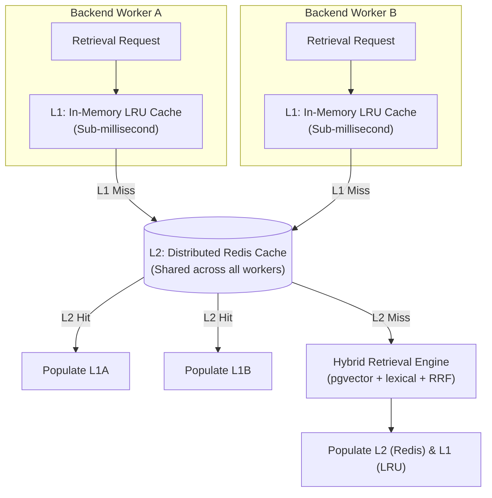
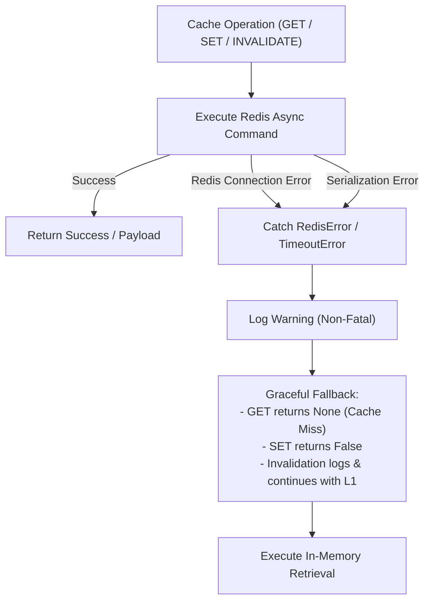

# Distributed Retrieval Cache Design & Architecture

> **Component:** Multi-Stage Hybrid Retrieval & Distributed Query Caching  
> **Status:** Production Implementation  
> **Related Issue:** [#218](https://github.com/Meetvirugama/AI-Powered-Software-Development-Platform/issues/218)  
> **Applicable Modules:** `backend/ai/retrieval/cache.py`, `backend/ai/retrieval/cache_keys.py`, `backend/ai/retrieval/cache_serialization.py`, `backend/ai/services/retrieval_optimizer.py`

---

## 1. Overview & Motivation

The AI-Powered Software Development Platform relies on multi-stage hybrid code retrieval combining dense semantic embeddings (pgvector / HNSW), lexical code search (PostgreSQL `tsvector`), and reciprocal rank fusion (RRF). While highly accurate, full multi-stage retrieval across large codebase indexes involves substantial embedding computation and database IO.

Prior to this implementation, caching was divided into:
- An isolated, in-process LRU cache (`LRUQueryCache`) within each worker process.
- An optional, independent Redis result cache (`RetrievalResultCache`) in the hybrid retrieval pipeline.

When multiple FastAPI or background worker processes handle concurrent user requests, the independent LRU caches lead to duplicate retrieval operations across workers. 

The **Distributed Retrieval Cache** bridges this gap by unifying local memory and distributed Redis caching into a resilient **Two-Level (L1/L2) Hierarchical Cache**.



---

## 2. Architecture & Components

### 2.1 The Two-Level Hierarchy (`TwoLevelRetrievalCache`)

The cache architecture implements an L1-first, L2-distributed hierarchy managed by `TwoLevelRetrievalCache`:

| Layer | Implementation Class | Storage Medium | Typical Latency | Invalidation Scope |
|---|---|---|---|---|
| **L1 (Local)** | `InMemoryRetrievalCache` (wrapping `LRUQueryCache`) | Python Process Memory (`OrderedDict`) | `< 0.2 ms` | Process-local LRU eviction, repository invalidation |
| **L2 (Distributed)** | `RetrievalResultCache` (wrapping `redis.asyncio.Redis`) | Redis Key-Value Store | `1.5 - 5.0 ms` | Cluster-wide via versioned keys & cursor scan |

### 2.2 Cache Abstraction (`RetrievalCache`)

Both cache layers conform to the abstract base class `RetrievalCache` defined in `backend/ai/retrieval/cache.py`:

```python
class RetrievalCache(ABC):
    @abstractmethod
    async def get(self, key: str) -> Optional[Any]:
        """Retrieve an entry by key. Returns None on cache miss or error."""

    @abstractmethod
    async def set(self, key: str, value: Any, ttl: Optional[int] = None) -> bool:
        """Store an entry by key with a TTL in seconds."""

    @abstractmethod
    async def delete(self, key: str) -> bool:
        """Explicitly evict an entry by key."""

    @abstractmethod
    async def invalidate_repository(
        self,
        repo_id: Union[uuid.UUID, str],
        new_index_version: Optional[str] = None
    ) -> int:
        """Invalidate all cached queries for a given repository."""
```

### 2.3 Component Coordination Sequence

```mermaid
sequenceDiagram
    autonumber
    actor Client as Retrieval Caller
    participant Opt as RetrievalLatencyOptimizer
    participant L1 as L1 InMemoryCache
    participant L2 as L2 RedisCache
    participant Engine as Retrieval Engine

    Client->>Opt: execute_optimized_retrieval_async(query, repo_id)
    Opt->>L1: get(cache_key)
    alt L1 Cache Hit (< 0.5ms)
        L1-->>Opt: cached_payload
        Opt-->>Client: Results (Record L1 Hit)
    else L1 Cache Miss
        Opt->>L2: get(cache_key)
        alt L2 Cache Hit (2-5ms)
            L2-->>Opt: cached_payload
            Opt->>L1: set(cache_key, cached_payload, ttl=300)
            Opt-->>Client: Results (Record L2 Hit)
        else L2 Cache Miss
            Opt->>L2: acquire_stampede_lock(lock_key, ttl=5)
            Opt->>Engine: execute_retrieval(query)
            Engine-->>Opt: computed_results
            Opt->>L2: set(cache_key, computed_results, ttl=600)
            Opt->>L1: set(cache_key, computed_results, ttl=300)
            Opt->>L2: release_stampede_lock(lock_key, token)
            Opt-->>Client: Results (Record Cache Miss)
        end
    end
```

---

## 3. Cache Key Formulation & Deterministic Query Hashing

### 3.1 Logical Key Structure

All retrieval cache keys follow the canonical Redis key schema:

```text
retrieval:v2:{scope}:{repo_id}:{index_version}:{query_hash}
```

Where:
- `v2`: Cache schema and protocol version.
- `{scope}`: Access or visibility boundary (`repo` by default, or tenant/user identifier).
- `{repo_id}`: Canonical UUID string of the repository.
- `{index_version}`: Dynamic generation token or commit SHA corresponding to the current indexed state of the codebase.
- `{query_hash}`: 64-character SHA-256 hexadecimal digest derived from canonical query normalization.

### 3.2 Canonical Query Normalization

To maximize cache hit rates while preventing collision across differing retrieval parameters, queries are normalized deterministically before hashing:

1. **Whitespace & Case Stripping:** Surrounding whitespace is stripped, internal whitespace runs collapsed, and query text normalized.
2. **Deterministic Configuration Ordering:** Retrieval parameters (`top_k`, `retrieval_mode`, `filters`, `weights`, `alpha`, `rerank_strategy`) are serialized using standard JSON with sorted keys.
3. **Canonical Digest Generation (`generate_query_hash`):**

```python
def generate_query_hash(
    query: str,
    retrieval_config: Optional[Dict[str, Any]] = None,
) -> str:
    normalized_query = normalize_retrieval_query(query)
    canonical_dict = {
        "q": normalized_query,
        "cfg": retrieval_config or {},
    }
    canonical_bytes = json.dumps(
        canonical_dict,
        sort_keys=True,
        separators=(",", ":"),
        ensure_ascii=True,
    ).encode("utf-8")
    return hashlib.sha256(canonical_bytes).hexdigest()
```

### 3.3 Dynamic Index Versioning

The cache key incorporates `{index_version}`. The active version is tracked in Redis under:

```text
retrieval:repo_index_version:{repo_id}
```

If Redis is unconfigured, empty, or unreachable, the system defaults to:
- The target commit SHA passed during synchronization, or
- `"v1"` (or `"active"`) for stable backward compatibility.

Whenever a repository index updates, advancing the index version instantly changes the key prefix, rendering all pre-sync results unreachable across all workers without synchronous key-by-key deletions.

---

## 4. Safe Payload Serialization

### 4.1 Schema Versioning & Structure

Cache values are serialized into UTF-8 JSON payloads conforming to schema version `"2.0"`:

```json
{
  "schema_version": "2.0",
  "created_at": 1794576000.123,
  "payload_type": "code_chunks",
  "data": [
    {
      "id": "c1f7a0b2-3c4d-5e6f-7a8b-9c0d1e2f3a4b",
      "file_path": "backend/app/main.py",
      "content": "from fastapi import FastAPI...",
      "start_line": 1,
      "end_line": 45,
      "language": "python",
      "similarity_score": 0.892,
      "metadata": {
        "symbol_type": "function",
        "symbol_name": "create_app"
      }
    }
  ]
}
```

### 4.2 Security & Integrity Guarantees

- **No Arbitrary Code Execution:** Python `pickle` is strictly forbidden. Payloads use standard `json.loads` / `json.dumps`.
- **Payload Size Ceiling:** Payloads exceeding `RETRIEVAL_CACHE_MAX_PAYLOAD_BYTES` (default: 500 KB) are rejected on `set()` to prevent Redis memory fragmentation and latency degradation.
- **Defensive Deserialization:**
  - If `schema_version` does not match `"2.0"`, deserialization returns `None`.
  - Malformed or corrupt JSON strings are caught, logged as warnings, and treated as cache misses.
  - Automatically reconstructs typed `CodeChunk` domain models when `payload_type == "code_chunks"`, and returns native lists/dictionaries for generic results.

---

## 5. TTL Management & Eviction Policies

| Cache Tier | Default TTL | Eviction Policy | Storage Bounds |
|---|---|---|---|
| **L1 (Local LRU)** | 300 seconds (5 min) | LRU eviction via `collections.OrderedDict.popitem(last=False)` | Max 1,000 entries (`retrieval_cache_max_local_entries`) |
| **L2 (Redis)** | 600 seconds (10 min) | Redis TTL via `SETEX` + Redis `allkeys-lru` eviction | Memory capped by Redis `maxmemory` setting |

1. **Local LRU Eviction:** Checked both lazily on `get()` and eagerly on `set()` when capacity exceeds `maxsize`.
2. **Redis Server-Side Expiration:** Enforced natively by Redis via `client.setex(key, ttl_seconds, serialized)`.
3. **Asymmetric TTL:** L1 local cache has a shorter TTL (300s) than Redis (600s). This prevents prolonged divergence between local memory and Redis when updates occur.

---

## 6. Concurrency & Cache Stampede Protection

When multiple backend workers concurrently execute identical cold queries (e.g. after a deployment or index bump), they could trigger simultaneous expensive vector searches.

### 6.1 Distributed Single-Flight Lock (`acquire_stampede_lock`)

To prevent the thundering herd problem:
1. Before running a retrieval query, the worker attempts to acquire an atomic distributed lock in Redis:
   ```text
   retrieval:lock:{scope}:{repo_id}:{index_version}:{query_hash}
   ```
2. The lock is acquired using `SET key token NX EX ttl` with a default TTL of 5 seconds.
3. A unique UUID token is retained by the acquiring worker.
4. If acquired, the worker executes retrieval, populates L1 and L2, and safely releases the lock via a Lua script verifying token ownership:

```lua
if redis.call("get", KEYS[1]) == ARGV[1] then
    return redis.call("del", KEYS[1])
else
    return 0
end
```

5. If another worker holds the lock, the waiting worker yields briefly (`asyncio.sleep`) or falls back to executing retrieval if timeout expires, guaranteeing that locking issues never block retrieval execution.

---

## 7. Resilient Failure Handling & Degraded Modes

The distributed cache adheres to the **Zero-Failure Retrieval Guarantee**: *Cache failures must degrade retrieval performance, never retrieval availability.*



### Failure Modes & Responses:
1. **Redis Unavailable / Offline:**
   - `client` is `None` or raises `ConnectionError`.
   - Handled gracefully in `RedisRetrievalCache`: catches all exceptions, logs a structured warning, and returns `None` (miss).
   - `TwoLevelRetrievalCache` transparently continues using L1 local cache and normal database retrieval.
2. **Corrupted Redis Entry:**
   - `deserialize_retrieval_payload` catches `json.JSONDecodeError` or validation errors.
   - Logs an error, discards the bad entry, and treats the operation as a cache miss.
3. **Redis Write Timeout / Out of Memory:**
   - `set()` fails safely, returns `False`. The retrieval result is returned to the user and saved in L1 local memory regardless.

---

## 8. Configuration Parameters

The distributed cache is configured via environment variables and `backend/app/core/config.py`:

```env
# Master flag for retrieval caching
RETRIEVAL_CACHE_ENABLED=true

# Distributed Redis caching flag (fallback to L1 only if false)
RETRIEVAL_REDIS_CACHE_ENABLED=true

# Redis L2 cache TTL in seconds (default: 600s / 10 min)
RETRIEVAL_CACHE_TTL_SECONDS=600

# Local L1 cache capacity per worker process (default: 1000 items)
RETRIEVAL_CACHE_MAX_LOCAL_ENTRIES=1000

# Maximum serialized payload size in bytes (default: 500 KB)
RETRIEVAL_CACHE_MAX_PAYLOAD_BYTES=512000

# Redis connection URL
REDIS_URL=redis://localhost:6379/0
```
