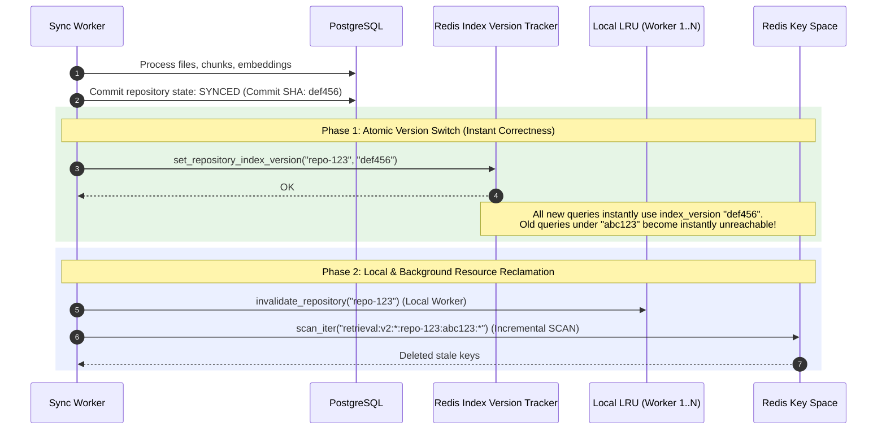
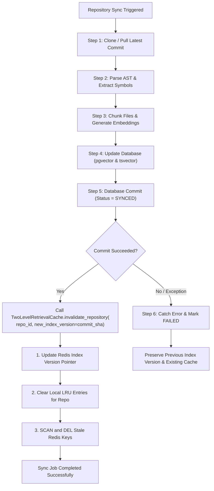

# Retrieval Cache Invalidation & Repository Lifecycle

> **Component:** Repository Synchronization Pipeline & Distributed Cache Invalidation  
> **Status:** Production Implementation  
> **Related Issue:** [#218](https://github.com/Meetvirugama/AI-Powered-Software-Development-Platform/issues/218)  
> **Applicable Modules:** `backend/app/services/sync_worker.py`, `backend/ai/retrieval/cache.py`, `backend/ai/retrieval/cache_keys.py`, `backend/ai/services/retrieval_optimizer.py`

---

## 1. Problem Statement & Consistency Challenge

When a repository is synchronized via GitHub webhook or manual sync, several critical assets are mutated:
- Repository code files are downloaded, pruned, and modified.
- Abstract Syntax Trees (AST) and symbols are extracted and updated.
- Vector embeddings (dense vectors via `pgvector`) are updated or re-indexed.
- Lexical full-text search indexes (`tsvector`) are refreshed.

If retrieval queries continue serving results cached prior to the synchronization, developers and autonomous AI agents will encounter **stale code**, hallucinated file line offsets, or missing symbols.

Because multiple backend workers run concurrently across multiple nodes or containers, invalidating an in-memory cache on one worker does not invalidate it on other workers. Relying on Redis `KEYS` or synchronous full-cluster wipes during high-traffic periods introduces severe Redis stop-the-world pauses and cache stampedes.

---

## 2. Invalidation Strategy: Version-Aware Key Partitioning

To guarantee instant correctness without synchronous cluster-wide key deletions, the platform employs **Version-Aware Key Partitioning**:

```text
retrieval:v2:{scope}:{repo_id}:{index_version}:{query_hash}
```

### 2.1 The Two-Phase Invalidation Mechanism



### Phase 1: Atomic Version Switch (Immediate Visibility Barrier)
1. Every retrieval query resolves the current `index_version` for `{repo_id}` from Redis key `retrieval:repo_index_version:{repo_id}`.
2. Upon successful synchronization, the sync worker atomically updates this version to the new target commit SHA (or increments an integer generation).
3. The moment the version changes, **100% of subsequent queries across all worker instances** hash their cache keys with the new version token.
4. Old cache entries with previous version tokens become unreachable instantly—achieving instantaneous cache invalidation with zero cluster lockup.

### Phase 2: Bounded Asynchronous Reclamation (Garbage Collection)
1. Old cache entries in Redis are bounded by their original 600s TTL and naturally expire without manual intervention.
2. In addition, an incremental cursor-based `SCAN` (`SCAN ... MATCH ... COUNT 100`) deletes old versioned keys asynchronously to immediately reclaim memory.
3. In-process LRU entries matching `{repo_id}` on the executing worker are evicted immediately.

---

## 3. Repository Synchronization Lifecycle Hook

The invalidation hook is integrated directly into the authoritative repository synchronization pipeline in `backend/app/services/sync_worker.py`:



### 3.1 Hook Placement in `sync_worker.py`

Invalidation is executed **strictly after** the database transaction committing the `SYNCED` state succeeds:

```python
# backend/app/services/sync_worker.py (Step 9)
db.commit()
logger.info(
    "repository_sync_completed",
    extra={"repository_id": str(repository_id), "commit_sha": target_commit_sha},
)

# Phase 4 Invalidation Hook
try:
    from backend.ai.retrieval.cache import get_retrieval_cache
    cache = get_retrieval_cache()
    if asyncio.iscoroutinefunction(cache.invalidate_repository):
        await cache.invalidate_repository(
            repository_id,
            new_index_version=target_commit_sha,
        )
    else:
        # Synced execution helper
        ...
except Exception as cache_err:
    logger.warning(
        "retrieval_cache_invalidation_failed",
        extra={"repository_id": str(repository_id), "error": str(cache_err)},
    )
```

---

## 4. Failure Modes & Edge Case Guarantees

### 4.1 Failed Repository Synchronization

If repository synchronization fails at any stage (e.g. network disconnect during git pull, embedding API rate limit, database constraint violation):
- **Rule:** The cache is **NEVER** invalidated prematurely.
- **Guarantee:** The existing `index_version` in Redis remains untouched.
- **Behavior:** Running workers continue serving valid cached results corresponding to the last successfully synced state. Stale or partial embeddings are never exposed.

### 4.2 Invalidation Hook / Redis Outage

If repository synchronization succeeds in the database, but Redis is unreachable during the invalidation step:
- **Rule:** Cache cleanup failure must **never fail the repository sync job**.
- **Guarantee:** The sync worker catches the Redis exception, logs a warning with structured telemetry, and allows the sync job to succeed.
- **Behavior:** The local LRU cache on the sync worker is still cleared. When Redis reconnects, subsequent syncs or periodic reconciliation jobs update the version pointer.

### 4.3 Concurrent Query During Invalidation

If queries arrive precisely while the sync worker is updating the index version:
- If a query arrives before the Redis version update: it safely accesses the old index version.
- If a query arrives after the Redis version update: it hashes with the new version token, misses both L1 and L2, executes a fresh search against the newly synced database, and populates the cache for the new version.
- **Zero Race Window:** Because database commit precedes cache version update, queries with the new version are guaranteed to see the committed data.

---

## 5. Non-Blocking Key Deletion Strategy

Production systems must avoid blocking the Redis event loop with `KEYS *`. 

### 5.1 Safe Cursor Scanning (`scan_iter`)

When explicit deletion of old keys is performed, `RedisRetrievalCache` uses batched cursor scanning:

```python
async def invalidate_repository(self, repo_id: Union[uuid.UUID, str], new_index_version: Optional[str] = None) -> int:
    # 1. Update version pointer
    if new_index_version:
        await set_repository_index_version_async(self.client, repo_id, new_index_version)

    # 2. Match pattern for old repository keys
    repo_str = str(repo_id)
    pattern = f"retrieval:v2:*:{repo_str}:*"
    deleted = 0
    batch: List[str] = []

    async for key in self.client.scan_iter(match=pattern, count=100):
        # Optional: Skip deleting keys that belong to the new index version
        if new_index_version and f":{new_index_version}:" in key:
            continue
        batch.append(key)
        if len(batch) >= 100:
            deleted += await self.client.delete(*batch)
            batch = []

    if batch:
        deleted += await self.client.delete(*batch)
    return deleted
```

- **Batch Size:** Fixed at 100 keys per iteration to bound Redis CPU consumption.
- **Safety:** Bounded execution time per slice prevents starving concurrent Redis reads and writes.
- **Passive Expiration:** Any keys missed by scan are safely removed by Redis TTL expiration within 600 seconds.

---

## 6. Consistency Guarantees Summary

| Requirement | Guarantee | Enforcement Mechanism |
|---|---|---|
| **Stale Result Prevention** | Read-your-writes after sync | Atomic version bump in Redis + Commit SHA key tokens |
| **Multi-Worker Coherence** | Immediate cross-process cutoff | All workers query central index version pointer in Redis |
| **Availability Under Failure** | Uninterrupted query serving | Graceful fallback to database retrieval if cache fails |
| **Isolation of Incomplete Sync** | No phantom or corrupted data | Sync hook called only after `db.commit()` succeeds |
| **Zero Redis Lockup** | Sub-millisecond latency impact | Cursor-based `scan_iter` with count=100; no `KEYS` |
