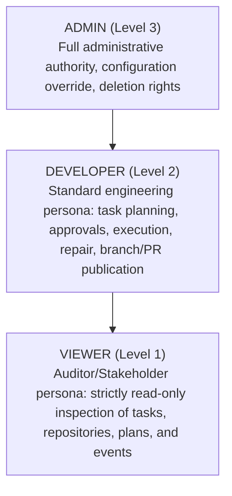

# F30 — API Security, Role-Based Access Control (RBAC), and CI Security Pipeline Report

> **Author:** Om (Persistence & Security Infrastructure) / Sukun (Security Lead)  
> **Date:** 2026-11-13  
> **Status:** Completed & Verified  
> **Reference Issue:** [#211 — F30: API Security](https://github.com/Meetvirugama/AI-Powered-Software-Development-Platform/issues/211)  
> **Pull Request:** `feature/issue-211-api-security`  

---

## 1. Executive Summary

This architecture and security report documents the end-to-end design, implementation, and verification of **Feature F30 — API Security**. It resolves the architectural recommendations outlined in Issue #211:

1. **Role-Based Access Control (RBAC):** Established a granular RBAC hierarchy (`Admin` > `Developer` > `Viewer`) embedded directly into signed JWT claims, enforced at every API route boundary, with strict adherence to multi-tenant isolation principles.
2. **CI Security Pipeline Integration:** Authored a dedicated, high-speed CI security verification pipeline (`.github/workflows/security-ci.yml`) integrating Gitleaks secret scanning, Bandit security analysis, Ruff static security audits, `pip-audit` vulnerability scanning, and `security_gate.py` compliance tests.
3. **Secret Scanning Modernization:** Integrated Gitleaks (`v8.24.0`) into the pre-commit configuration (`.pre-commit-config.yaml`) alongside existing scanners, standardized on `.gitleaks.toml`, eliminating redundant CI overhead and preventing secret exposure prior to commit creation.

---

## 2. Threat Model & RBAC Hierarchy

### 2.1 Role Hierarchy

The platform defines three canonical roles represented by `UserRole(str, Enum)` in `backend/app/models/user.py`:



| Role | Hierarchy Level | Capabilities | Restrictions |
|---|---|---|---|
| `ADMIN` | 3 | Full administrative capabilities: repo management, task governance, user role administration, bypass for custom permissions. | Must still respect multi-tenant boundary (cannot view other users' private repositories or tasks). |
| `DEVELOPER` | 2 | Primary developer persona: repository synchronization, task creation, plan generation, human approval/rejection, tool execution, tests, bounded repair, independent verification, git branch/commit/push, draft PR publication, memory creation. | Cannot perform admin-only system configurations. |
| `VIEWER` | 1 | Read-only inspection: list and view repositories, tasks, plans, execution diffs, test logs, verification results, checkpoints, memory entries. | **Strictly blocked (HTTP 403 Forbidden)** from initiating any mutating, governance, execution, or publishing actions. |

### 2.2 Tenant Isolation Priority

> [!IMPORTANT]
> **Tenant Isolation Supersedes RBAC Role:** A user with role `ADMIN` attempting to query or mutate a repository or task belonging to another user receives an immediate **`HTTP 404 Not Found`** (`RESOURCE_NOT_FOUND` / `TASK_NOT_FOUND`), never `200 OK` or `403 Forbidden`. This completely prevents cross-tenant enumeration, reconnaissance, or resource existence leakage.

---

## 3. Architecture & Implementation

### 3.1 Database Schema & Migration

Added an indexed `role` column with default value `"developer"` to the `users` table:

- **Model:** `backend/app/models/user.py`
  ```python
  role: Mapped[str] = mapped_column(
      String(32),
      default=UserRole.DEVELOPER.value,
      server_default=UserRole.DEVELOPER.value,
      index=True,
      nullable=False,
  )
  ```
- **Alembic Migration:** `backend/migrations/versions/k8b9c0d1e2f3_add_user_role_for_rbac.py`
  - Revisions: `k8b9c0d1e2f3` revises `j7a8b9c0d1e2`.
  - Idempotent `upgrade()` and `downgrade()` managing the `role` column and `ix_users_role` composite index.

### 3.2 JWT Claims & Authentication Layer

Tokens generated via `create_access_token` now embed the user's role and permission set:

- **JWT Payload Structure:**
  ```json
  {
    "sub": "<user_uuid>",
    "role": "developer",
    "permissions": ["tasks:approve", "tasks:execute"],
    "jti": "<unique_jwt_identifier>",
    "iat": 1794590000,
    "exp": 1794590900,
    "iss": "ai-dev-platform",
    "aud": "ai-dev-platform-api"
  }
  ```
- **Middleware Extraction:** `backend/app/core/auth.py`
  Decodes validated token claims into request state:
  ```python
  request.state.role = payload.get("role", UserRole.DEVELOPER.value)
  request.state.permissions = payload.get("permissions", [])
  ```

### 3.3 Dependency-Driven Access Control

Authored modular FastAPI dependencies in `backend/app/api/v1/dependencies.py`:

1. `require_role(*allowed_roles)`: Requires caller's active role to be one of the explicitly permitted roles.
2. `require_min_role(min_role)`: Compares caller's hierarchical level against required minimum level via `ROLE_HIERARCHY`.
3. `require_permission(permission)`: Checks for granular capability string, auto-bypassed for `ADMIN`.
4. `get_owned_repository(..., min_role=...)`: Enforces tenant isolation AND minimum role requirement in a single atomic database guard.
5. `get_owned_task(..., min_role=...)`: Enforces task ownership AND minimum role requirement.

### 3.4 Protected Route Inventory

The following state mutations are strictly protected by `min_role=UserRole.DEVELOPER`:

| Module | Route | Guard Enforced | Viewer Behavior |
|---|---|---|---|
| Repositories | `POST /api/v1/repositories/{id}/sync` | `min_role=DEVELOPER` | 403 Forbidden |
| Repositories | `DELETE /api/v1/repositories/{id}` | `min_role=DEVELOPER` | 403 Forbidden |
| Tasks | `POST /api/v1/tasks` | `require_min_role(DEVELOPER)` | 403 Forbidden |
| Tasks | `POST /api/v1/repositories/{id}/tasks` | `require_min_role(DEVELOPER)` | 403 Forbidden |
| Governance | `POST /api/v1/tasks/{id}/plan` | `min_role=DEVELOPER` | 403 Forbidden |
| Governance | `POST /api/v1/tasks/{id}/approve` | `min_role=DEVELOPER` | 403 Forbidden |
| Governance | `POST /api/v1/tasks/{id}/reject` | `min_role=DEVELOPER` | 403 Forbidden |
| Execution | `POST /api/v1/tasks/{id}/execute` | `min_role=DEVELOPER` | 403 Forbidden |
| Execution | `POST /api/v1/tasks/{id}/pause` & `/resume` | `min_role=DEVELOPER` | 403 Forbidden |
| Execution | `POST /api/v1/tasks/{id}/cancel` | `min_role=DEVELOPER` | 403 Forbidden |
| Workspace Tools | `POST /api/v1/tasks/{id}/tools/{name}` | `min_role=DEVELOPER` | 403 Forbidden |
| Test Runner | `POST /api/v1/tasks/{id}/tests` | `min_role=DEVELOPER` | 403 Forbidden |
| Bounded Repair | `POST /api/v1/tasks/{id}/repair` | `min_role=DEVELOPER` | 403 Forbidden |
| Verification | `POST /api/v1/tasks/{id}/verify` | `min_role=DEVELOPER` | 403 Forbidden |
| Git Publication | `POST /api/v1/tasks/{id}/branch` | `min_role=DEVELOPER` | 403 Forbidden |
| Git Publication | `POST /api/v1/tasks/{id}/commit` | `min_role=DEVELOPER` | 403 Forbidden |
| Git Publication | `POST /api/v1/tasks/{id}/push` | `min_role=DEVELOPER` | 403 Forbidden |
| Git Publication | `POST /api/v1/tasks/{id}/authorize-publication` | `min_role=DEVELOPER` | 403 Forbidden |
| Git Publication | `POST /api/v1/tasks/{id}/create-pr` & `/publish` | `min_role=DEVELOPER` | 403 Forbidden |
| Recovery | `POST /api/v1/tasks/{id}/checkpoints` & `/recover` | `min_role=DEVELOPER` | 403 Forbidden |
| Memory | `POST /api/v1/repositories/{id}/memories` | `min_role=DEVELOPER` | 403 Forbidden |
| Memory | `PATCH /api/v1/repositories/{id}/memories/{entry_id}` | `min_role=DEVELOPER` | 403 Forbidden |
| Memory | `DELETE /api/v1/repositories/{id}/memories/{entry_id}` | `min_role=DEVELOPER` | 403 Forbidden |

---

## 4. Modern Secret Scanning & CI Pipeline

### 4.1 Pre-Commit Gitleaks Hook

Added Gitleaks directly into `.pre-commit-config.yaml`:

```yaml
  - repo: https://github.com/gitleaks/gitleaks
    rev: v8.24.0
    hooks:
      - id: gitleaks
        name: gitleaks-secret-scan
        description: Detect hardcoded secrets, credentials, and API keys using Gitleaks
        entry: gitleaks protect --verbose --redact --config .gitleaks.toml
        language: golang
        stages: [pre-commit]
```

### 4.2 Dedicated Security CI Workflow

Implemented `.github/workflows/security-ci.yml` running on all PRs and pushes to `main`, `feature/**`, and `fix/**`:

- **Job 1 (Gitleaks):** Scans entire git history with `.gitleaks.toml` rules.
- **Job 2 (Linters):** Executes Bandit (`--severity-level high -q`) and Ruff syntax/security checks.
- **Job 3 (Dependencies):** Executes `pip-audit -r backend/requirements.txt --desc on`.
- **Job 4 (Security Gate & Unit Tests):**
  - Runs `backend/scripts/security_gate.py --skip-db --out security-gate-report.md`.
  - Runs `backend/tests/test_rbac_and_api_security.py` with 100% pass verification.
  - Uploads audit reports as artifacts.

---

## 5. Verification & Test Results

### 5.1 Unit & Integration Test Suite

The automated test suite in `backend/tests/test_rbac_and_api_security.py` passes completely:

```
backend/tests/test_rbac_and_api_security.py::test_user_role_enum_and_hierarchy PASSED
backend/tests/test_rbac_and_api_security.py::test_create_access_token_embeds_role_and_permissions PASSED
backend/tests/test_rbac_and_api_security.py::test_create_access_token_defaults_to_developer PASSED
backend/tests/test_rbac_and_api_security.py::test_require_role_dependency_logic PASSED
backend/tests/test_rbac_and_api_security.py::test_require_min_role_dependency_logic PASSED
backend/tests/test_rbac_and_api_security.py::test_require_permission_dependency_logic PASSED
backend/tests/test_rbac_and_api_security.py::test_viewer_is_forbidden_from_mutating_tasks PASSED
backend/tests/test_rbac_and_api_security.py::test_viewer_is_forbidden_from_repository_mutations PASSED
backend/tests/test_rbac_and_api_security.py::test_viewer_has_read_only_access PASSED
backend/tests/test_rbac_and_api_security.py::test_developer_and_admin_have_mutation_access PASSED
backend/tests/test_rbac_and_api_security.py::test_cross_tenant_isolation_supersedes_rbac_role PASSED
backend/tests/test_rbac_and_api_security.py::test_memory_api_rbac_guards PASSED

======================== 12 passed, 1 warning in 1.46s ========================
```

### 5.2 Security Gate Compliance Report

Running `backend/scripts/security_gate.py` produced a **100% clean PASS**:

| Gate item | Result | Details |
|---|---|---|
| 1. No secrets in .git history | ✅ PASS | 782 commits scanned across all branches; 0 possible real secrets. |
| 4. Repository isolation (User A cannot access User B) | ✅ PASS | 25 passed in 1.73s |
| 5. Prompt injection treated as data | ✅ PASS | 7 passed in 0.23s |
| 6. Path traversal / workspace confinement | ✅ PASS | 19 passed in 0.20s |
| 7. API security (rate limits, headers, CORS) | ✅ PASS | 24 passed in 2.35s |
| **Overall** | **✅ PASS** | **All items verified and compliant.** |
