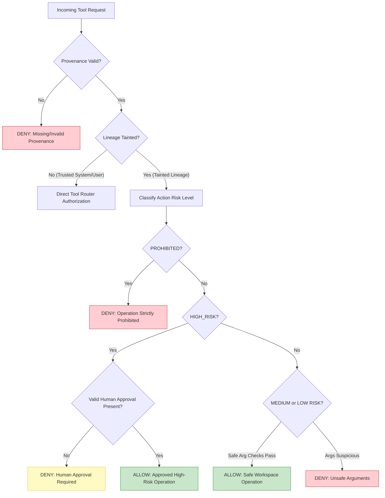

# Execution Policy & Risk Classification Specification

## 1. Policy Engine Philosophy

The `TaintPolicyEngine` implements a **Capability-Based Execution Policy** inspired by the CaMeL framework and traditional principle of least privilege. In an autonomous coding system, the model must be permitted to inspect and modify application code within an authorized workspace to resolve bugs. However, all actions initiated by tainted lineage are scrutinized against strict capability boundaries.

The core policy engine resides in [`backend/ai/security/taint_policy.py`](file:///Users/meetvirugama/Desktop/AI-Powered-Software-Development-Platform/backend/ai/security/taint_policy.py).



---

## 2. 4-Tier Risk Classification Matrix

| Risk Tier | Criteria | Examples | Default Policy Action | Override Possibility |
|---|---|---|---|---|
| **PROHIBITED** | Operations that risk host compromise, secret leakage, or lateral network movement | Accessing `.env`, `.git/config`, `~/.ssh`; running `curl`, `wget`, `nc`; shell metacharacters (`\|`, `;`, `&&`, `` ` ``, `$()`); `rm -rf /` | **DENY** | **NEVER** (hard security perimeter, even with approval) |
| **HIGH_RISK** | Destructive actions or pipeline alterations that could corrupt project integrity | Deleting project source files (`rm`, `delete_file`); modifying CI/CD workflows (`.github/workflows`); custom shell scripts | **GATE** | Allowed **ONLY** with cryptographically bound human approval |
| **MEDIUM_RISK** | Controlled execution within isolated workspace | Approved test runners (`pytest`, `npm test`, `cargo test`, `mvn test`) with argument bounds | **ALLOW** | Allowed if command passes safe argument validator |
| **LOW_RISK** | Read/write operations on workspace project code | Reading source files (`read_file`), applying diffs (`write_file`), searching codebase (`find_files`) | **ALLOW** | Allowed directly without human gate |

---

## 3. Policy Specification & Enforcement Rules

### 3.1 Protected Files & Secret Access Control
The policy engine enforces a strict blacklist of protected files and directories:
```python
PROTECTED_PATTERNS = {
    ".env", ".env.local", ".env.production",
    "id_rsa", "id_ed25519", "credentials", "secrets",
    ".git", ".git/config", ".ssh", ".aws",
    "service-account.json", "token.json", ".npmrc", ".pypirc"
}
```

#### Path Normalization & Canonicalization
To prevent path-traversal evasions (e.g. `././.env`, `src/../../.env`, `.\.env`):
1. Normalizes all path separators to forward slashes.
2. Strips redundant `./` and trailing whitespace.
3. Checks for traversal markers (`..`).
4. Compares normalized base names and paths against `PROTECTED_PATTERNS`.
5. Any tainted read/write access to a protected pattern returns `ActionRiskLevel.PROHIBITED`.

### 3.2 Shell Command Safety & Metacharacter Blocking
Arbitrary shell execution under tainted lineage is the primary vehicle for prompt injection payloads.
For any `bash_command`, `execute_command`, or `run_command`:

1. **Strict Metacharacter Rejection**:
   The command string is scanned for chaining and injection metacharacters:
   ```python
   SHELL_METACHARACTERS = {";", "&&", "||", "|", "`", "$(", "${", "\n", "\r", ">", "<"}
   ```
   If any metacharacter is detected, the command is classified as `ActionRiskLevel.PROHIBITED`.
2. **Network Tool Blocking**:
   Network commands are prohibited:
   ```python
   NETWORK_BINARIES = {"curl", "wget", "nc", "netcat", "ncat", "telnet", "ssh", "scp", "ftp", "socat"}
   ```
3. **Safe Command Allowlist**:
   Commands are split into tokens and checked against verified test runners:
   ```python
   SAFE_COMMAND_PREFIXES = {
       "pytest", "python -m pytest",
       "npm test", "npm run test", "npx vitest", "npx jest",
       "cargo test", "mvn test", "go test"
   }
   ```
   If a command matches a safe prefix and contains no blacklisted flags, it is classified as `MEDIUM_RISK` and permitted. Custom or unknown commands are escalated to `HIGH_RISK` and require human approval.

### 3.3 File Deletion & Destruction Policy
- Deleting files (`delete_file`, `rm`) under tainted lineage is classified as `HIGH_RISK`.
- It cannot be executed autonomously by the agent execution loop.
- It requires an explicit `ExecutionApproval` signed by an authenticated user.
