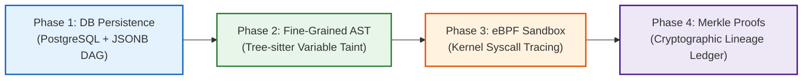

# Future Security Enhancements & Engineering Roadmap

## 1. Overview

While the initial provenance and taint-tracking architecture establishes an airtight, fail-closed security boundary across the AI software development pipeline, continuous evolution is required as agentic capabilities expand. This roadmap outlines future security improvements planned for subsequent milestones.

---

## 2. Engineering Roadmap

---

## 3. Detailed Future Capabilities

### 3.1 Persistent Database Lineage (`data_provenance_edges`)
- **Current State**: `TaintTracker` maintains an in-memory graph with JSON serialization for task checkpointing.
- **Enhancement**: Introduce an Alembic migration adding:
  - `provenance_records` table: `(provenance_id, trust_level, source_type, source_reference, content_hash, tainted, metadata, created_at)`.
  - `provenance_edges` table: `(parent_id, child_id, transformation, created_at)`.
- **Benefit**: Enables enterprise-scale queryability, cross-session forensic auditing, and recursive CTE graph traversal directly within PostgreSQL.

### 3.2 Fine-Grained AST-Level Taint Tracking
- **Current State**: Taint is tracked at the coarse-grained component level (e.g. Requirement $\rightarrow$ PlanStep $\rightarrow$ ToolRequest).
- **Enhancement**: Integrate with the platform's tree-sitter AST parser (`SymbolParser`).
  - Trace specific variables and function definitions synthesized by the LLM.
  - Distinguish between a generated test file and modified business logic.
- **Benefit**: Allows the system to permit modifications to test files with lower scrutiny while enforcing strict approval gates on core authentication or database migration scripts.

### 3.3 eBPF-Based Kernel Sandbox Enforcement
- **Current State**: Tool policy enforcement occurs at the Python application layer (`TaintPolicyEngine` and `ToolRouter`).
- **Enhancement**: Deploy eBPF probes (via Tetragon or Cilium) on sandbox worker nodes:
  - Intercept low-level syscalls: `sys_enter_connect`, `sys_enter_execve`, `sys_enter_openat`.
  - Block egress TCP SYN packets at the socket layer when running under offline test modes.
- **Benefit**: Defense-in-depth: Even if a process escapes Python interpreter controls or a subshell is spawned, kernel-level eBPF probes abort unauthorized network connections and file access.

### 3.4 Merkle Tree Provenance Cryptography
- **Current State**: `ExecutionApproval` uses SHA-256 canonical argument digests. Lineage DAG relies on UUID parent pointers.
- **Enhancement**: Convert the lineage DAG into a **Merkle DAG** (similar to Git commit trees).
  - Child hash: $H_C = \text{SHA-256}(H_{P_1} \parallel H_{P_2} \parallel \text{Transform} \parallel \text{Content})$.
  - Digital signatures from developer keys during approval.
- **Benefit**: Mathematically verifiable non-repudiation and proof that execution history has not been retroactively altered.

### 3.5 Swarm & Multi-Agent Provenance Propagation
- **Current State**: Provenance covers single-agent execution loops (`AgentExecutionLoop`).
- **Enhancement**: Extend `TaintTracker` across distributed agent swarms:
  - When subagents communicate via the message board or tool RPCs, their message envelopes will carry serialized provenance vectors.
  - Subagents operating on untrusted data automatically restrict their available tool palette.

### 3.6 Interactive Declassification & Selective Untainting
- **Current State**: Taint propagation is strictly monotonic; taint cannot be cleared once attached.
- **Enhancement**: Provide a developer UI allowing an authenticated user to perform **Selective Declassification**:
  - A developer inspects a flagged requirement (e.g. "Add logging of user headers").
  - The developer reviews the proposed patch and explicitly marks the requirement as `USER_APPROVED`.
  - The system records an explicit declassification audit record and allows execution without repeated prompts.
