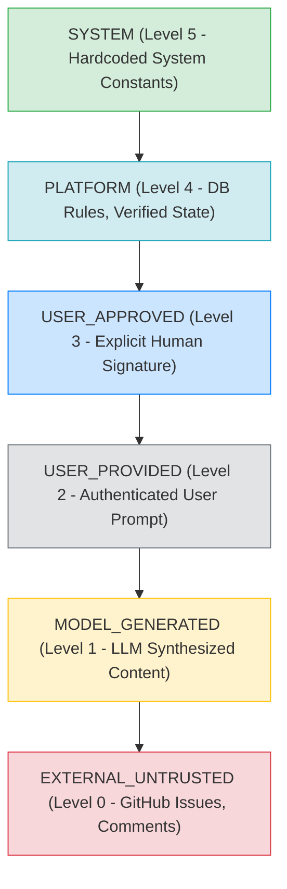
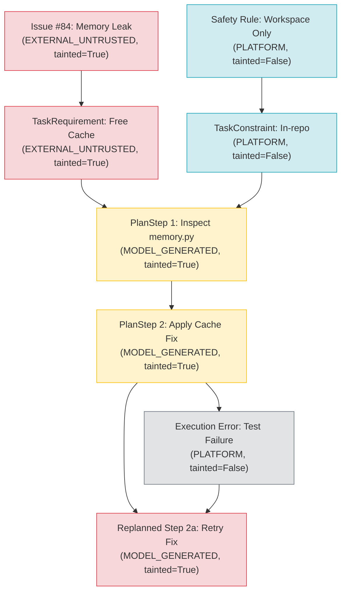

# Taint Tracking Design & Propagation Algebra

## 1. Information Flow Security Model

The taint tracking system in the platform is founded on classic **Information Flow Control (IFC)** principles (Denning & Denning, Bell-LaPadula, Biba integrity model) adapted for **Language Model Agent Architectures**.

In traditional IFC, data sensitivity or integrity levels are tracked across variables and memory registers. In our AI agent system:
- **Objects**: Requirements, prompts, plan steps, tool arguments, synthesized patches, and tool execution requests.
- **Labels**: `(TrustLevel, TaintedBool)`.
- **Flow Rules**: Information derived from any untrusted or tainted source permanently retains the tainted label. No transformation—whether prompt rewriting, LLM summarization, or agent reflection—can decontaminate or elevate the data integrity.

---

## 2. Trust Level Lattice & Mathematical Formalism

Let $\mathcal{T}$ denote the set of trust levels:
$$\mathcal{T} = \{ \text{SYSTEM}, \text{PLATFORM}, \text{USER\_APPROVED}, \text{USER\_PROVIDED}, \text{EXTERNAL\_UNTRUSTED}, \text{MODEL\_GENERATED} \}$$

We define an integrity partial order $\preceq$ over $\mathcal{T}$, where $A \preceq B$ denotes that $A$ has lower or equal integrity compared to $B$ ($A$ is less trusted than $B$):

$$\text{EXTERNAL\_UNTRUSTED} \prec \text{MODEL\_GENERATED} \prec \text{USER\_PROVIDED} \prec \text{USER\_APPROVED} \prec \text{PLATFORM} \prec \text{SYSTEM}$$



### 2.3 The Taint State Space

Every provenance record carries a tuple:
$$\mathcal{L} = (t, \tau) \in \mathcal{T} \times \{0, 1\}$$
where $t \in \mathcal{T}$ is the trust level, and $\tau \in \{0, 1\}$ is the boolean taint status ($1 = \text{tainted}, 0 = \text{untainted}$).

We establish the foundational invariant:
$$\forall x: t(x) = \text{EXTERNAL\_UNTRUSTED} \implies \tau(x) = 1$$
Any external, untrusted input is **axiomatically tainted**.

---

## 3. Propagation Algebra

When an operation produces a child node $C$ from a set of parent nodes $P = \{p_1, p_2, \dots, p_k\}$, the child's taint status $\tau(C)$ and trust level $t(C)$ are governed by strict algebraic rules:

### Rule 1: Monotonic Taint Disjunction
$$\tau(C) = \bigvee_{i=1}^{k} \tau(p_i)$$
*If any parent is tainted, the child is unconditionally tainted.*

### Rule 2: Non-Escalation of Trust Level
For any algorithmic transformation $f$:
$$t(C) \le \min_{i=1 \dots k} t(p_i)$$
*A derived output can never possess higher trust than its least trusted parent.*

### Rule 3: Model Generation Boundary
When an LLM generates a child node (e.g. `TaskPlanner`, `PlanReplanner`, `RepairService`):
$$t(C) = \text{MODEL\_GENERATED}$$
$$\tau(C) = \bigvee_{i=1}^{k} \tau(p_i)$$
Even if all parents were `USER_PROVIDED` ($\tau=0$), the generated output is classified as `MODEL_GENERATED`. If any parent was tainted ($\tau=1$), the model generation remains tainted ($\tau=1$).

### Rule 4: Fail-Closed Completeness
$$\text{If } \exists p_i \in P \text{ such that } p_i \notin \text{TaintTracker}: \quad \text{Execution Rejected (Validation Error)}$$
Unregistered provenance IDs fail closed. An attacker cannot forge or invent provenance IDs to bypass tracking.

---

## 4. Lineage DAG & Traversal Mechanics

Lineage is represented as an acyclic directed graph $G = (V, E)$ where vertices $V$ are `DataProvenance` records and edges $E = \{(u, v) \mid u \text{ was used to derive } v\}$.



### 4.1 Recursive Lineage Traversal (`get_lineage`)
```python
def get_lineage(self, provenance_id: str) -> List[DataProvenance]:
    with self._lock:
        lineage: List[DataProvenance] = []
        visited: Set[str] = set()

        def _dfs(pid: str) -> None:
            if pid in visited:
                return
            visited.add(pid)
            record = self._provenance_map.get(pid)
            if not record:
                return
            lineage.append(record)
            for parent_id in record.parent_ids:
                _dfs(parent_id)

        _dfs(provenance_id)
        return lineage
```

### 4.2 Cycle Prevention
While typical execution flows strictly forward in time, circular links could theoretically be introduced by malicious schema inputs. `_dfs` maintains a `visited` set to guarantee termination in $\mathcal{O}(|V| + |E|)$ time without stack overflow.

---

## 5. Serialization and Cross-Boundary Persistence

The taint tracking ledger must survive across asynchronous task execution steps and DBOS durable workflows.

1. **JSON Serialization**: `TaintTracker.serialize()` serializes the entire dictionary of `DataProvenance` records to a canonical JSON string.
2. **Deterministic Deserialization**: `TaintTracker.deserialize(json_str)` reconstructs the in-memory graph while verifying data integrity.
3. **Pydantic Compatibility**: All schemas (`TaskRequirement`, `PlanStep`, `ToolRequest`) store both `provenance: Optional[DataProvenance]` and `provenance_ids: List[str]`, maintaining 100% backward compatibility with legacy payloads that lack provenance fields.
