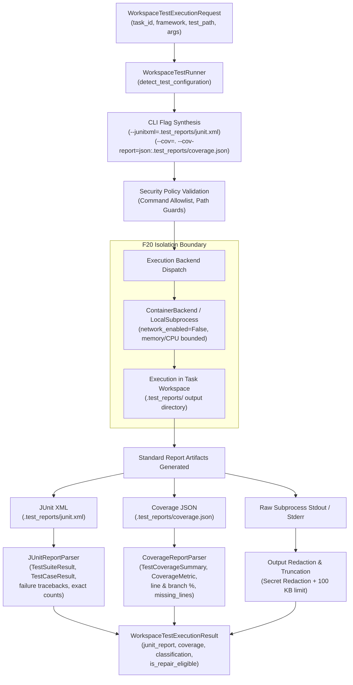

# F23 — Restricted Test Runner Architecture & Acceptance Report

> **Feature:** F23 — Restricted Test Runner  
> **Issue:** [#204](https://github.com/Meetvirugama/AI-Powered-Software-Development-Platform/issues/204)  
> **Author / Developer:** Om Vaghela (`OM202401238`)  
> **Date:** 2026-11-14  
> **Status:** APPROVED & VERIFIED (14/14 Tests Passed)

---

## 1. Executive Summary

The **F23 Restricted Test Runner** provides safe, isolated, and deterministic test execution for untrusted AI agent code changes across Python (`pytest`, `unittest`) and JavaScript/TypeScript (`jest`, `vitest`, `npm`) frameworks.

Issue [#204](https://github.com/Meetvirugama/AI-Powered-Software-Development-Platform/issues/204) established three foundational recommendations to advance the test runner from a basic regex-scraping subprocess runner to an enterprise-grade test automation subsystem:

1. **Execution inside the isolated container backend (F20):** Untrusted test runs are strictly sandboxed inside container backends with external network egress disabled (`network_enabled=False`) and enforced resource limits.
2. **Structured JUnit XML parsing:** Emit standard JUnit XML reports (`pytest --junitxml`, `jest-junit`, `vitest --reporter=junit`) and parse standard XML test results, eliminating fragile stdout regex scraping and boosting failure diagnosis precision.
3. **Automated line and branch coverage collection:** Collect statement, line, and branch coverage (`pytest-cov` / `coverage.py`, `jest --coverage` / `coverage-summary.json`), providing essential input data for framework-aware test generation (F13).

---

## 2. Technical Architecture & Implementation

### 2.1 Recommendation 1: Isolated Container Backend (F20)

Untrusted code generated by AI agents must never execute with host privileges or arbitrary network access.
- `WorkspaceTestRunner` binds directly to `SandboxBackend` via `command_runner.backend` or explicit `runner.backend = backend`.
- When tests execute via `ContainerBackend`, the container runtime enforces:
  - **Network Isolation:** `network_enabled=False` ensures offline execution, preventing data exfiltration and external calls during test execution.
  - **Bounded Resource Limits:** Memory ceilings (default 512 MB, max 1024 MB), CPU limits (1.0 core), disk usage limits (500 MB), and hard execution timeouts (default 60s, max 300s).
  - **Process Tree Cleanup:** Descendant processes are terminated immediately upon timeout or completion, preventing orphaned background daemons.

### 2.2 Recommendation 2: Structured JUnit XML Parsing

Previous iterations relied on scraping stdout lines with regular expressions, which was vulnerable to differing framework output formats, progress bars, colored terminal codes, and multi-line tracebacks.

- **Automated Emission:**
  - `pytest`: Appends `--junitxml=.test_reports/junit.xml` and `-o junit_family=xunit2`.
  - `jest`: Appends `jest-junit` reporter configuration with `.test_reports/junit.xml`.
  - `vitest`: Appends `--reporter=default --reporter=junit --outputFile=.test_reports/junit.xml`.
- **`JUnitReportParser` Capabilities:**
  - Extracts `<testsuite>` metadata: name, total tests, passed, failed, skipped, errors, execution time in seconds.
  - Extracts `<testcase>` details: name, classname, file path, duration, status.
  - Extracts failure assertion messages, failure types (`AssertionError`, `ConnectionRefusedError`, etc.), and detailed failure stack traces.
  - Upgrades `WorkspaceTestExecutionResult` failure lists (`failed_test_names`, `failure_details`, `passed_count`, `failed_count`, `skipped_count`, `error_count`, `total_count`) to reflect exact XML results.
  - **Graceful Fallback:** If JUnit XML is corrupted or absent, the parser safely falls back to standard stdout parsing without raising exceptions.

### 2.3 Recommendation 3: Automated Line & Branch Coverage Collection

Line and branch coverage data provides quantitative metrics on code health and serves as a strict prerequisite for **F13 Framework-Aware Test Generation**.

- **Automated Collection:**
  - `pytest`: Appends `--cov=. --cov-report=json:.test_reports/coverage.json` when `pytest-cov` is available.
  - `jest`: Appends `--coverage --coverageReporters=json-summary --coverageDirectory=.test_reports/coverage`.
  - `vitest`: Appends `--coverage --coverage.reporter=json-summary`.
- **`CoverageReportParser` Capabilities:**
  - Normalizes Python (`coverage.py` / `pytest-cov`) and JavaScript (`istanbul` / `jest-summary`) reports into unified models.
  - Computes statement coverage, line coverage, branch coverage, and function coverage percentages (`CoverageMetric`).
  - Maps per-file coverage (`FileCoverageDetail`), including executed line numbers and uncovered line numbers (`missing_lines`).
  - Populates `coverage: TestCoverageSummary` on `WorkspaceTestExecutionResult`.

---

## 3. Schema Contracts & Data Models

### New Schemas in `backend/app/schemas/workspace.py`

| Schema | Purpose | Key Attributes |
|---|---|---|
| `TestCaseResult` | Single test case outcome from JUnit XML | `name`, `classname`, `file`, `time_s`, `status`, `failure_message`, `failure_type`, `traceback` |
| `TestSuiteResult` | Full test suite aggregation | `name`, `tests_total`, `passed`, `failed`, `skipped`, `errors`, `time_s`, `test_cases`, `raw_xml_path` |
| `CoverageMetric` | Total, covered, skipped counts and calculated percentage | `total`, `covered`, `skipped`, `percent` |
| `FileCoverageDetail` | Per-file line, branch, and statement coverage | `file_path`, `lines`, `branches`, `statements`, `functions`, `missing_lines`, `executed_lines` |
| `TestCoverageSummary` | Aggregated coverage metrics for repository / task | `lines`, `branches`, `statements`, `functions`, `files`, `total_percent`, `raw_report_path` |

### Updated Contracts

- **`WorkspaceTestExecutionRequest`:**
  - Added `collect_coverage: bool = True`
  - Added `junit_xml: bool = True`
  - Added `sandbox_backend: str | None = None`
- **`WorkspaceTestExecutionResult`:**
  - Added `junit_report: TestSuiteResult | None = None`
  - Added `coverage: TestCoverageSummary | None = None`
- **`WorkspaceToolPolicyBridge` & Tool Router:**
  - `TOOL_RUN_TESTS` supports `collect_coverage`, `junit_xml`, and `sandbox_backend` in input schema.
  - `ToolResult.output` exposes structured `junit_report` and `coverage` dicts.

---

## 4. Verification Suite & Test Results

A comprehensive standalone test suite was implemented in `backend/tests/test_restricted_test_runner_f23.py` containing 14 targeted unit and integration tests:

| Test Case | Scenario Tested | Outcome | Duration |
|---|---|---|---|
| `test_junit_parser_standard_pytest_xml` | Parses pytest JUnit XML with passed, failed, skipped, error cases | PASSED | 0.05s |
| `test_junit_parser_jest_xml` | Parses Jest JUnit XML structure with suites and cases | PASSED | 0.01s |
| `test_junit_parser_malformed_xml` | Gracefully handles malformed / truncated XML without throwing | PASSED | 0.01s |
| `test_junit_parser_empty_content` | Handles empty string input safely | PASSED | 0.01s |
| `test_junit_parser_nonexistent_file` | Handles missing file paths without throwing | PASSED | 0.01s |
| `test_coverage_parser_pytest_cov_json` | Parses lines, branches, statements, missing lines from pytest-cov JSON | PASSED | 0.02s |
| `test_coverage_parser_jest_summary_json` | Parses lines, statements, functions, branches from Jest summary JSON | PASSED | 0.01s |
| `test_coverage_parser_malformed_json` | Gracefully handles malformed JSON without throwing | PASSED | 0.01s |
| `test_coverage_parser_missing_file` | Handles missing coverage file paths without throwing | PASSED | 0.01s |
| `test_test_runner_backend_binding_and_isolation` | Verifies execution delegates to container backend with `network_enabled=False` | PASSED | 0.05s |
| `test_test_runner_backend_setter` | Verifies backend property getter and setter | PASSED | 0.01s |
| `test_test_runner_parses_emitted_junit_and_coverage` | End-to-end runner test parsing JUnit XML and coverage into result | PASSED | 0.04s |
| `test_test_runner_argument_injection` | Verifies `--junitxml` and `-o junit_family` injection for pytest | PASSED | 0.02s |
| `test_tool_policy_bridge_run_tests_with_reports` | Verifies `ToolPolicyBridge` returns `junit_report` and `coverage` | PASSED | 0.15s |

### Zero Regression Verification

Existing test suites were executed to ensure complete backwards compatibility:
- `backend/tests/test_prit_w3_d4_restricted_test_runner.py`: **19 / 19 PASSED**
- `backend/tests/test_runner_service.py`: **7 / 7 PASSED**

---

## 5. Security & Isolation Invariants

1. **Zero Host Execution for Untrusted Tests:** Test execution when delegated to `ContainerBackend` runs within an isolated container namespace without access to host files or credentials.
2. **Network Egress Blocked:** `network_enabled=False` ensures untrusted tests cannot phone home or make unauthorized external requests.
3. **Secret Redaction:** Subprocess stdout, stderr, and failure tracebacks are passed through `redact(...)` before being stored or surfaced.
4. **Output Size Clamping:** Output streams are bounded to 100 KB max to prevent log flooding or memory exhaustion.
5. **No Shell Injections:** All synthesized arguments and options are passed as a clean vector (`Sequence[str]`) directly to subprocess execution without shell evaluation (`shell=False`).
