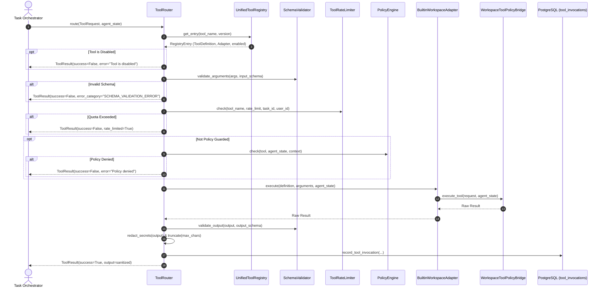

# 03 — System Architecture

## 1. High-Level Architecture Overview

The Unified Tool Registry architecture decouples tool registration, schema enforcement, rate limiting, and authorization from execution implementations.

```mermaid
flowchart TD
    Client["Task Execution Orchestrator / Agent"] -->|ToolRequest| Router["ToolRouter"]
    
    subgraph Governance & Pre-Execution
        Router -->|1. Lookup| Reg["UnifiedToolRegistry"]
        Reg -->|Metadata Contract| Router
        Router -->|2. Validate Args| SV["SchemaValidator (Draft 2020-12)"]
        Router -->|3. Check Quota| RL["ToolRateLimiter (Redis / Memory)"]
        Router -->|4. Authorize| PE["PolicyEngine & Command Allowlist"]
    end
    
    subgraph Adapters & Execution
        Router -->|5. Execute with Timeout| Adapter{"Execution Adapter"}
        Adapter -->|Builtin| BWA["BuiltinWorkspaceAdapter"]
        Adapter -->|MCP (Boundary)| MCP["MCPToolAdapter"]
        Adapter -->|Plugin (Boundary)| PLG["PluginToolAdapter"]
        BWA --> WS["WorkspaceToolPolicyBridge / Sandbox"]
    end
    
    subgraph Common Output Boundary
        WS -->|Raw Result| Post["Post-Execution Processing"]
        Post -->|Normalize| OB1["Normalize Result"]
        OB1 -->|Schema Check| OB2["Validate Output Schema"]
        OB2 -->|Sanitize| OB3["Redact Secrets & Bound Output"]
        OB3 -->|Audit Log| DB[("PostgreSQL tool_invocations")]
        DB -->|ToolResult| Client
    end
```

---

## 2. Component Structure

1. **`UnifiedToolRegistry` (`backend/agent/tools/registry.py`):**
   - Stores `RegistryEntry(definition, adapter, handler, enabled)`.
   - Organizes entries by `tool_name -> {version: entry}`.
   - Enforces name collision rules, built-in tool protection, and SemVer sorting.

2. **`SchemaValidator` (`backend/agent/tools/schema_validator.py`):**
   - Compiles schemas using `Draft202012Validator`.
   - Caches compiled validators by SHA-256 fingerprint.
   - Recursion depth and property count guardrails.
   - Blocks remote network `$ref` URIs.

3. **`ToolRateLimiter` (`backend/agent/tools/rate_limiter.py`):**
   - Sliding-window rate limiter evaluated via Redis Lua script.
   - Supports scopes: `task`, `user`, `provider`, `global`.
   - In-memory thread-safe fallback for local test execution.

4. **`ToolRouter` (`backend/agent/tools/router.py`):**
   - Unified routing gateway orchestrating the complete lifecycle.
   - Enforces timeout ceilings via thread worker isolation.
   - Sanitizes and bounds outputs, masking sensitive keys and tokens.

5. **`BuiltinWorkspaceAdapter` (`backend/agent/tools/adapters/builtin.py`):**
   - Signature inspection engine that determines caller calling convention (`(request, context)` vs `(**kwargs)`).
   - Direct dispatch without `TypeError` retry loops.

---

## 3. Tool Execution Sequence Diagram


