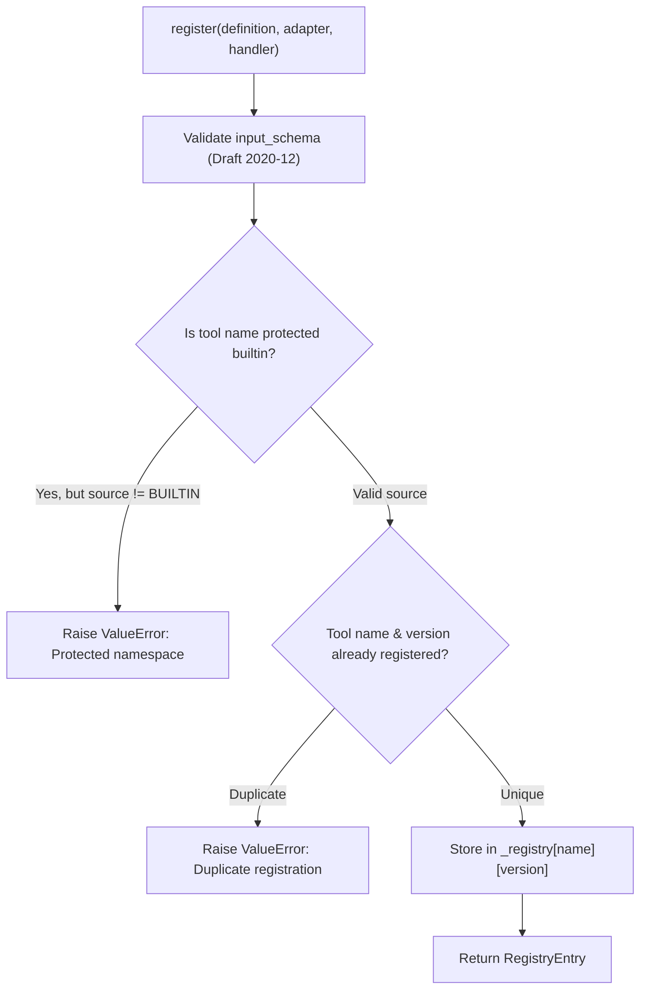

# 04 — Tool Definition & Registry Contract

## 1. Overview

The Unified Tool Registry manages the lifecycle, discovery, and governance of all tools available to agents within the platform. Every tool is registered as a first-class declarative citizen using rich metadata contracts, strict semantic versioning, and lifecycle states.

---

## 2. ToolDefinition Contract

Defined in [`backend/agent/tools/models.py`](file:///Users/meetvirugama/Desktop/AI-Powered-Software-Development-Platform/backend/agent/tools/models.py), `ToolDefinition` encapsulates all declarative properties of a tool:

```python
@dataclass
class ToolDefinition:
    name: str
    description: str
    input_schema: Dict[str, Any]
    output_schema: Optional[Dict[str, Any]] = None
    version: str = "1.0.0"
    source: ToolSource = ToolSource.BUILTIN  # BUILTIN, MCP, PLUGIN
    provider_id: Optional[str] = None
    risk_tier: ToolRiskTier = ToolRiskTier.READ_ONLY  # READ_ONLY, SAFE_WRITE, SYSTEM_WRITE, DANGEROUS
    annotations: ToolAnnotations = field(default_factory=ToolAnnotations)
    rate_limit: Optional[ToolRateLimit] = None
    timeout_s: float = 30.0
    enabled: bool = True
```

### 2.1 Tool Risk Tiers
- **`READ_ONLY`**: Non-destructive information retrieval (e.g., `view_file`, `list_dir`, `grep_search`). Minimal authorization constraints.
- **`SAFE_WRITE`**: Scoped modifications within sandbox boundaries (e.g., `create_file`, `edit_file`). Requires path authorization.
- **`SYSTEM_WRITE`**: High-impact environment changes (e.g., `run_command`, `git_checkout`). Subject to strict command allowlists, flag filtering, and policy approval.
- **`DANGEROUS`**: Sensitive or irreversible administrative operations. Policy engine enforces explicit confirmation or DENY by default.

### 2.2 Semantic Versioning
- Versions must follow SemVer syntax: `MAJOR.MINOR.PATCH` (e.g., `1.0.0`, `1.2.3`).
- SemVer sorting allows registry queries without explicit version pins to reliably resolve to the latest stable release.
- Major version increments represent breaking changes in `input_schema` or `output_schema`.

---

## 3. UnifiedToolRegistry Operations

The registry is implemented in [`backend/agent/tools/registry.py`](file:///Users/meetvirugama/Desktop/AI-Powered-Software-Development-Platform/backend/agent/tools/registry.py) as `UnifiedToolRegistry`.

### 3.1 Tool Registration & Collision Prevention



#### Collision Rules:
1. **Protected Built-in Namespaces:** External sources (`MCP`, `PLUGIN`) cannot register tools under canonical workspace names (`view_file`, `edit_file`, `run_command`, etc.).
2. **Version Uniqueness:** Attempting to register the identical tool name and version string raises a collision error. To update an existing tool, increment the SemVer version or unregister the previous entry.
3. **Provider Scoping:** When MCP or Plugin tools register, their identifiers are namespaced with their `provider_id` to prevent cross-vendor naming collisions.

### 3.2 Dynamic Lifecycle Management

Tools can be toggled without unregistering or losing their configuration:
- `disable_tool(name: str)`: Disables all versions of the tool. Subsequent routing requests return `ToolResult(success=False, error_category="NOT_FOUND")`.
- `enable_tool(name: str)`: Restores execution eligibility for the tool.
- `unregister_tool(name: str, version: Optional[str])`: Removes specific versions or the complete entry from the active catalog.

---

## 4. Querying & Filtering

The registry provides rich catalog reflection for agents and orchestrators:
- `list_tools(source, risk_tier, enabled_only)`: Returns definitions matching query criteria.
- `get_tool(name, version=None)`: Resolves either the exact version requested or automatically falls back to the highest SemVer available.
- `get_entry(name, version=None)`: Retrieves the underlying `RegistryEntry` including execution adapter and callable handler.
