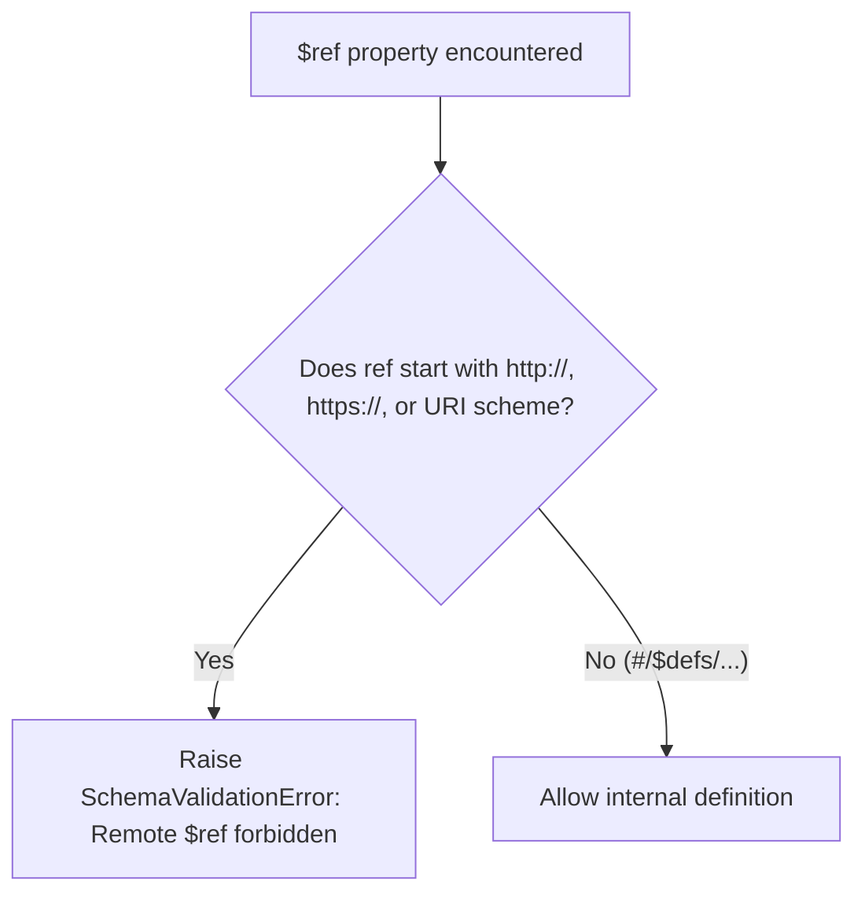

# 05 — Schema Validation & Draft 2020-12 Guardrails

## 1. Overview

Schema validation enforces strict structural integrity across tool inputs and tool outputs. Implemented in [`backend/agent/tools/schema_validator.py`](file:///Users/meetvirugama/Desktop/AI-Powered-Software-Development-Platform/backend/agent/tools/schema_validator.py), `SchemaValidator` uses JSON Schema Draft 2020-12 with compiled validator caching, DoS guardrails, and network isolation.

---

## 2. Compilation and Performance

Compiling JSON schemas at runtime per invocation introduces unacceptable latency. The `SchemaValidator` provides an internal thread-safe validator cache:

1. **Fingerprinting:** Each schema is normalized and hashed via SHA-256 (`schema_fingerprint`).
2. **Cache Keying:** Lookups check `_validator_cache` using the SHA-256 hash.
3. **Format Checking:** Schemas are compiled with standard format checkers (e.g., date-time, uri, email, uuid) enabled by default.
4. **Cache Metrics:** The `cache_size` property exposes the current footprint for operational observability.

```python
validator = SchemaValidator(max_depth=10, max_properties=200)
fingerprint = validator.compute_fingerprint(schema)
compiled_validator = validator.compile(schema)
```

---

## 3. DoS Protection Guardrails

Adversarial or deeply nested JSON schemas can cause stack overflow exceptions or excessive CPU consumption (ReDoS/DoS). `SchemaValidator` enforces two structural limits:

### 3.1 Maximum Nesting Depth ($\le 10$)
Schema structures (`properties`, `items`, `oneOf`, `anyOf`, `allOf`, `$defs`) are recursively checked for depth. Any schema exceeding 10 levels of nesting is rejected at compile time:
```python
def _check_depth(schema: Any, current_depth: int = 1) -> None:
    if current_depth > MAX_DEPTH:
        raise SchemaValidationError(f"Schema exceeds maximum allowed nesting depth of {MAX_DEPTH}")
    ...
```

### 3.2 Maximum Property Count ($\le 200$)
To prevent schema expansion attacks, the total count of declared properties across all object levels must not exceed 200.

---

## 4. Remote Reference ($ref) Rejection

Schemas referencing remote network locations can be exploited for Server-Side Request Forgery (SSRF) or unauthenticated outbound network calls.

- **Blocked URIs:** Any `$ref` beginning with `http://`, `https://`, `ftp://`, `file://`, or any remote scheme is explicitly rejected during compilation.
- **Allowed References:** Local internal definitions (`#/$defs/...` or `#/definitions/...`) are permitted.



---

## 5. Input & Output Validation

### 5.1 Input Schema Validation
Before a tool handler is invoked or policy rules are evaluated, arguments are checked against the tool's `input_schema`. If validation fails:
- Execution is aborted immediately.
- A standardized `ToolResult` is returned with `success=False` and `error_category="INVALID_ARGUMENTS"`.
- Detailed error messages indicate the specific field, expected type, or constraint violated.

### 5.2 Output Schema Validation
When a tool registers an optional `output_schema`, raw handler return values are validated prior to returning the result:
- If valid, the sanitized output is included in `ToolResult.output`.
- If invalid, the result is marked as `success=False` with `error_category="SYSTEM_ERROR"`, capturing the discrepancy in audit logs while preventing unformatted payloads from reaching downstream agents.
